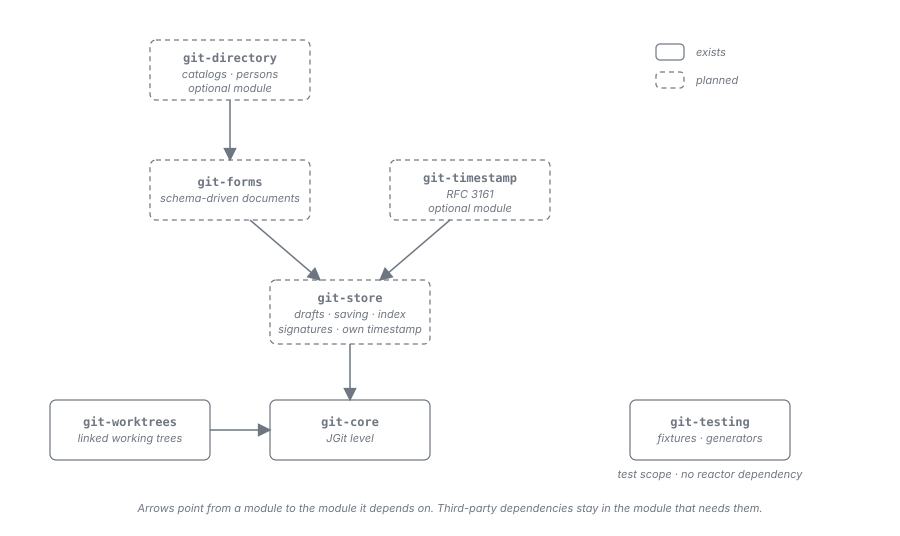

= git-document-repository Specification
:toc: left
:toclevels: 3
:toc-title: Table of Contents
:sectnums:
:source-highlighter: highlight.js

== Overview

_See Requirement link:Requirements.adoc#GDR-GEN-1[GDR-GEN-1: Module Layering and Dependency Isolation]_

This specification describes how the modules of `git-document-repository` realise the
xref:Requirements.adoc[requirements]. The rationale lives in the concepts under xref:concepts/git-as-document-persistence.adoc[`doc/concepts/`]
and the decisions under `doc/adr/`; neither is restated here.

*Status of the whole specification:* PLANNED. `git-core`, `git-worktrees` and `git-testing` are scaffolds (a
`pom.xml`, a `module-info.java` and a `@NullMarked` package each); the other modules are not created. Every section
carries its own status and moves to IN PROGRESS and IMPLEMENTED with the code.

== Document Structure

[cols="1,3"]
|===
|Document |Content

|xref:specification/git-core.adoc[git-core]
|Hardened repositories, remote policy, modes, in-core writing, compare-and-swap, in-core merge, transport, cache
repository, reading, notes, identity

|xref:specification/git-worktrees.adoc[git-worktrees]
|Linked working trees, commit from a working tree, working-tree status

|xref:specification/git-testing.adoc[git-testing]
|Repository fixtures and the credential generator

|xref:specification/git-store.adoc[git-store]
|Repository registry, drafts, saving, release, identity per save, index, outbox, codecs

|xref:specification/git-forms.adoc[git-forms]
|Kinds of documents, schema validation, data layout, generated output, workflow, deadlines, links, running numbers

|xref:specification/git-crypto.adoc[git-crypto]
|Envelope encryption, pseudonyms, erasure by key rotation, personal fields

|xref:specification/git-signing.adoc[git-signing]
|Commit signature, trailers, approvals, passkeys, verification

|xref:specification/git-timestamp.adoc[git-timestamp]
|RFC 3161 tokens as notes, verification, retry

|xref:specification/git-directory.adoc[git-directory]
|Catalogs, service catalog, persons, first login, resolution, Backstage import, confirmation

|xref:specification/error-model.adoc[Error Model]
|Results and outcomes, null safety, logging, secrets

|xref:specification/testing.adoc[Testing]
|Test approach, layering checks, non-functional measurements
|===

== Module Dependencies

[cols="1,2,2"]
|===
|Module |Depends on (reactor) |Third-party dependencies (each needs the owner's approval)

|`git-core` |– |JGit
|`git-worktrees` |`git-core` |–
|`git-testing` |– |`cui-test-generator`, JUnit 5
|`git-store` |`git-core` |–
|`git-forms` |`git-store` |a YAML library, a JSON Schema validator, a template engine
|`git-crypto` |`git-store` |an envelope-encryption library (candidate: Google Tink _(unverified)_)
|`git-signing` |`git-store` |a WebAuthn verification library (open)
|`git-timestamp` |`git-store` |an RFC 3161 client (open)
|`git-directory` |`git-forms`, `git-crypto` |–
|===
