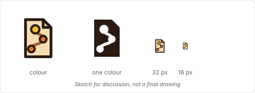

= Name and Brand
:toc: left
:toclevels: 3
:toc-title: Table of Contents
:sectnums:
:source-highlighter: highlight.js

xref:../README.adoc[CISOs-Friend documentation] » Concepts

Status: *the name is decided: Trailhand* (owner's decision of 2026-11-20); the mark and the mascot are proposals. This
page records what was checked, why the working title *CISOs-Friend* was dropped, and what the rename changed
(<<_the_rename>>). The trademark search of <<_open_decisions>> is still to be done.

== Why the Working Title Needs a Decision

* *Close to an established product.* https://github.com/intuitem/ciso-assistant-community[CISO Assistant] is an
  open-source governance, risk and compliance platform by intuitem, with a hosted offering; a 2026 article describes it
  as open-source cybersecurity management and GRC
  (https://www.helpnetsecurity.com/2026/01/14/ciso-assistant-open-source-cybersecurity-management-grc/[Help Net
  Security, 14 January 2026]). "CISOs-Friend" and "CISO Assistant" would be confused in a search and in a
  conversation, in the same field.
* *Narrower than the audience.* The application serves development teams that fill in assessments, incident responders
  and AI agents as well as CISOs (xref:trailhand-overview.adoc#_audience[Overview, Audience]). A name built on one
  of the roles describes the buyer, not the work.
* *Hard to say and to type.* The possessive and the hyphen give an identifier no one can predict (`cisos-friend`,
  `CISOs-Friend`, `CISO's Friend`).

The strength of the working title is that it says in three words what the application is for. The recommendation keeps
that as the descriptor under a shorter name.

== The Brand Family

The libraries and tools of the author share one brand language: a cartoon character in an outfit that says the role of
the project. The family images are in
https://github.com/cuioss/cuioss-parent-pom/tree/main/doc/images[`cuioss-parent-pom/doc/images`] (a sheriff, a
detective, a quality controller with a tape measure, a craftsman, among others); their licence file
(https://github.com/cuioss/cuioss-parent-pom/blob/main/doc/images/image-license.adoc[`image-license.adoc`]) states that
they were generated with ChatGPT (DALL·E) for the project and are released under Apache License 2.0. The plan-marshall
web app turned that language into a small design system
(https://github.com/plan-marshall/pm-mcp-clients/blob/main/doc/design/web-app/brand-mark.adoc[`brand-mark.adoc` of
`pm-mcp-clients`]). Its rules are taken over here, because the web app of this application follows `pm-web-app`
(xref:web-app.adoc[Web App]):

[cols="1,3"]
|===
|Rule |Taken over as

|One character, one outfit per project
|The outfit tells the role. The sheriff badge is already the sign of Token Sheriff and of plan-marshall; this product
gets no star.

|A hand-drawn vector mark derived from the outfit
|Never an auto-traced copy of the raster image. A `24 × 24` grid, a solid colour rendering and a one-colour
rendering that follows `currentColor`.

|A five-token warm palette
|`--color-mascot-fur` `#E17512`, `--color-mascot-gold` `#F2B630`, `--color-mascot-hat` `#A0602E`,
`--color-mascot-cream` `#F6DDB0`, `--color-mascot-outline` `#2A1A10`, the same in both themes. The violet
`--color-brand` of the interface stays the accent of the interface and does not colour the mark.

|The raster mascot only on calm surfaces
|Login, empty states, a finished release. Never on the editing view of an incident report or in a deadline warning.

|The mark never changes with state
|State is said by words, colours and icons of its own.

|The visible name stays beside the mark
|The mark stands alone only where an accessible name carries the word (a collapsed rail, a browser tab).

|Provenance is recorded
|Who or which tool made each drawing, and the owner's acceptance, before it ships.
|===

== Name Candidates

Criteria: it says something true about the product; it is short and can be a package, a command and a domain; it fits
the family without borrowing the sheriff badge; it does not collide with a product in security, compliance or
developer tooling. Checked on 2026-11-20 by web search, by repository search on GitHub and by DNS lookup. *This is not a
trademark search.*

[cols="1,2,3,1"]
|===
|Name |Idea |Findings |Verdict

|*Trailhand*
|The _trail_ is the audit trail: every change is a signed commit whose trailers carry the person's pseudonym
(xref:authentication-and-identity.adoc#_the_claims_and_what_becomes_of_them[Authentication and Identity]). The _hand_
is the ranch hand, the reliable helper who does the legwork: the friend of the CISO, and the agent that works for a
user.
|No product of this name found by web search. GitHub: one repository, `krumIO/trailhand-ui`, no stars, no description.
`trailhand.com`, `trailhand.io` and `trailhand.dev` resolve in DNS, so they are registered by someone (content not
checked).
|Chosen

|*Tinstar*
|The tin star is the sheriff's badge: the family sign.
|GitHub: `except-pass/tinstar`, "An Infinite Canvas IDE built for human/AI collaboration" (one star). `tinstar.io`
resolves; `tinstar.dev` does not. Close to an AI developer tool, and it borrows the badge that two other projects
already wear.
|Runner-up

|*CISOs-Friend*
|The working title.
|See <<_why_the_working_title_needs_a_decision>>. `cisos-friend.com` has no address in DNS (`.com` only).
|Keep as descriptor

|*Docket*
|The court's list of cases.
|Taken in the same field: Docket (`docket.io`, `docketai.com`) is an AI platform whose
https://www.docket.io/platform/security-and-trust[security page] describes a trust portal for security posture, audit
reports, policies and controls.
|Rejected

|*Deputy*
|The sheriff's assistant.
|Taken: https://www.deputy.com/enterprise[Deputy] is established workforce-management software. In the MCP field the
word also names the _confused deputy_ problem, which makes it a poor name for anything that holds a user's authority
(see xref:local-mcp-gateway.adoc[Local MCP Gateway]).
|Rejected

|*Dossier*
|A file on a case.
|Generic; several GitHub repositories carry the name (the largest a self-hosted job-search app with over 5,000 stars).
|Rejected
|===

=== Decision

*Trailhand, with the descriptor "the CISO's friend"*: the application is *Trailhand*, and the sentence under the logo
is "Security documents on the Git server you already run -- the CISO's friend". The working title lives on as the
tagline, so nothing of the first idea is lost, and a reader who searches for the role finds it.

The name carries the two promises the design makes: _the trail_ (every change is attributable and verifiable,
xref:../specification/authentication.adoc[Authentication]) and _the hand_ (it does the legwork for the person, in the
web app or through an agent, and never decides alone: a release stays with a human,
xref:mcp-server.adoc[MCP Server]).

[#_the_rename]
=== The Rename

Done in one sweep with the decision, because scopes and file names are public interfaces once the first release is out:

[cols="2,2"]
|===
|Was |Is

|`CISOs-Friend` (name, titles)
|`Trailhand`

|Requirement prefix `CIFR-<GROUP>-<n>`
|`TRH-<GROUP>-<n>` (numbers and groups unchanged)

|`cisos-friend.yaml`, `cisos-friend.schema.json`, `cisos-friend.config.dir`
|`trailhand.yaml`, `trailhand.schema.json`, `trailhand.config.dir`

|Scopes `cisos-friend:read`, `:write`, `:request-release`
|`trailhand:read`, `:write`, `:request-release`

|Image `ghcr.io/cuioss/cisos-friend`, Maven `de.cuioss:cisos-friend-parent`, package `de.cuioss.cisosfriend`
|`ghcr.io/cuioss/trailhand`, `de.cuioss:trailhand-parent`, `de.cuioss.trailhand`

|Cookies `+__Host-cisos-friend-*+`, environment `CISOS_FRIEND_*`, example host `cisos-friend.example.org`
|`+__Host-trailhand-*+`, `TRAILHAND_*`, `trailhand.example.org`

|`concepts/cisos-friend-overview.adoc`, `resources/diagrams/cisos-friend-system-context.svg`
|`concepts/trailhand-overview.adoc`, `resources/diagrams/trailhand-system-context.svg`
|===

Nothing outside `doc/app/` named the application except the index `doc/README.adoc` and `AGENTS.md`, both updated. The
orchestrator ledger under `.plan/` is history and is left as it was. The libraries keep their own prefix `GDR`.

== The Mark

*Idea:* a document page with a trail of three nodes over it, the commits of its history; the newest node is gold. It
says "versioned document" without a star, a shield or a padlock, the three symbols every security product carries.

* *Drawing rules* are those of the family (<<_the_brand_family>>): `24 × 24` grid, hand-drawn, solid fills with the dark
  outline, a one-colour rendering with the trail cut out, no text in the drawing.
* *The sketch is for discussion.* At `16` px the colour version is too fine; the final drawing needs a favicon variant
  with two nodes and a heavier trail. The drawing in `resources/brand/mark-sketch.svg` is a throw-away sketch, not an
  asset to ship.
* *Distance from the sheriff badge:* the mark has no star and no ball tips, so it is not mistaken for the sign of
  plan-marshall or Token Sheriff beside which it will sit in a user's tool list.

== The Mascot

The character is the family's bear. A *ranch hand*: a worn, wide-brimmed hat, a neckerchief, a tally book under one
arm and a pencil behind the ear; the book's cover carries the mark. It is friendly where the sheriff is stern, and it is
unarmed: the product stands for care, not enforcement. The family has a stern sheriff and a smiling detective; the ranch
hand stands next to them as the one who keeps the books.

A small closed set of poses, in the manner of the plan-marshall web app: *welcome* (login, first run), *at work* (the
tally book open, empty states), *done* (the book closed with a tick, after a release). No pose shows a person's data or
a score. The raster images follow the asset rules of the family: only derived, size-reduced files are shipped, never
the source image.

*Provenance:* the family's images were made with an AI image tool. For each pose, record the tool, the prompt and the
owner's acceptance in a table like the one in `brand-mark-mascot.adoc` of `pm-mcp-clients`, before the pose ships. The
Apache-2.0 release of the existing family images does not cover new poses automatically; the owner states the licence
of each new one.

== Voice

Plain, calm and accountable. The people who read the application's pages are preparing an audit or answering an
incident; the tone is that of a colleague who keeps good notes. No jokes in error messages, deadline warnings or
anywhere in the incident-report category; the ranch-hand character appears only where nothing is at stake.

== Usage Rules

* Use the delivered drawings; do not redraw, recolour, rotate or add a shadow.
* The colour mark does not stand on a plate; the one-colour mark takes the surface's text colour.
* The visible name stays beside the mark except where an accessible name carries it.
* The mark and the character never change with state, and never appear in a generated document that leaves the
  application (an exported report carries the organisation's identity, not the product's).

[#_open_decisions]
== Open Decisions

. *Clearance of the name.* Decided, but not yet cleared: a trademark search at the DPMA register and in
  https://www.tmdn.org/tmview/[TMview] (EUIPO) in the relevant classes, and a check of the domains and of the GitHub
  organisation names. If the search finds a conflict, the rename is repeated with the same mapping.
. *Whether the character is a ranch hand,* or another outfit of the family.
. *Who draws the final mark and who makes the poses,* and under which licence.
. *The name of the local gateway* (xref:local-mcp-gateway.adoc[Local MCP Gateway]), which is a base project of its own
  and may carry a name in the Sheriff family: it builds on Token Sheriff.

== Related

* xref:trailhand-overview.adoc[Overview]
* xref:web-app.adoc[Web App] -- takes its visual language from `pm-web-app`
* xref:local-mcp-gateway.adoc[Local MCP Gateway]
