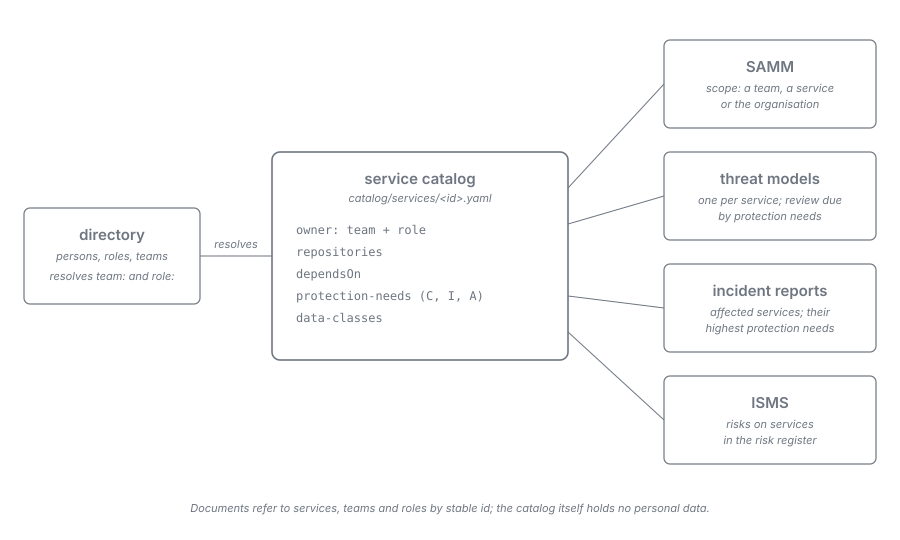

= CISOs-Friend: Overview
:toc: left
:toclevels: 3
:toc-title: Table of Contents
:sectnums:
:source-highlighter: highlight.js

link:../README.adoc[CISOs-Friend documentation] » Concepts

Security documentation in a development organisation tends to live in four places at once: a spreadsheet for the
OWASP SAMM assessment, a wiki page per threat model, a Confluence space for incident reports, and an ISMS tool that
the developers never open. Each place has its own history, its own rights and its own backup, and none of them knows
the others. *CISOs-Friend* is the application that puts these documents into one shape, on one persistence the
organisation already runs: its Git server.

This page is the entry point of the application concepts. It names the four categories, the audience, the two user
interfaces, the parts the application builds on, and the place it takes beside established ISMS products.

== The Question Behind the Application

The application is always server-based. One server manages the Git repositories; no client holds a clone. Git is the
persistence only, not a tool the users touch. The organisations that use it are development organisations that
already operate a maintained Git server (GitHub, GitLab, Gitea) with backups. Every additional database
brings operating effort; reusing the existing Git server avoids it.

Whether Git carries this load is answered by the libraries of `git-document-repository`; the reasoning is in
link:../../concepts/git-as-document-persistence.adoc[Git as the Persistence of Versioned Documents]. CISOs-Friend is
the first application on them. It adds the categories, the user interfaces, the authentication and the operation.

== Four Categories

[cols="1,3,1"]
|===
|Category |What it is |Concept

|*OWASP SAMM assessments*
|Maintained per scope and date, versioned, released and compared over time. The core of the application.
|link:category-samm.adoc[SAMM]

|*Threat models*
|Filled in and maintained per service, guided by recipes for threat modelling; reviews due by protection need.
|link:category-threat-models.adoc[Threat Models]

|*Incident response reports*
|Written in Confluence today; here a form that produces AsciiDoc and takes care of review, approval and deadlines.
|link:category-incident-reports.adoc[Incident Reports]

|*ISMS*
|An information security management system on the same foundation. An extension, not the starting point.
|link:category-isms.adoc[ISMS]
|===

All four share one shape: a schema per category, YAML data with AsciiDoc free text, generated AsciiDoc output, review
and approval, deadlines and typed links. The shape is the library's
link:../../concepts/schema-driven-documents.adoc[schema-driven documents]; a category is configuration of it (schema,
template, workflow, repository), not code. Further categories become cheap: exception approvals, supplier
assessments, access reviews.

The categories hang together through master data: the persons, roles and teams of the library's
link:../../concepts/directory-and-catalogs.adoc[directory and catalogs], and above all the application's
link:service-catalog.adoc[service catalog].

== Audience

* *Security officers and CISOs* who need released, comparable, auditable states: the SAMM trend, the risk register as
  of the audit date, the incident reports of a year.
* *Development teams* who fill in assessments in workshops and maintain the threat models of their services.
* *Incident responders* who write the report after the live phase and must meet notification deadlines.
* *AI agents* acting for a user: filling in a threat model from a recipe, drafting an incident report from notes the
  user hands over, answering "which services lack a current threat model".

Users of the ISMS and of incident reports often have no account on the Git server. The application therefore never
requires one; the identity of a change comes from the login and is signed into the commit (see
link:authentication-and-identity.adoc[Authentication and Identity]).

== Two User Interfaces

[cols="1,3"]
|===
|Interface |Purpose

|*Web app*
|A Svelte single-page application for people: forms generated from the category schemas, dashboards from the
in-memory index, review and approval with step-up. Visuals and UI structure follow `pm-web-app`. See
link:web-app.adoc[Web App].

|*MCP server*
|A Model Context Protocol server for AI agents. The same operations as the web app, as tools, under OAuth 2.1 with
audience-bound tokens that the server validates and never passes on. See link:mcp-server.adoc[MCP Server].
|===

Both interfaces call the same application services. Neither carries a rule of its own: what a user may do, whether
a release needs step-up and which deadline is due is decided once, in the server.

== What the Application Builds On

[cols="1,3"]
|===
|Part |Role

|`git-document-repository`
|The libraries: storage engine with drafts and saving, schema-driven documents, commit signature, anchoring,
directory with persons under pseudonyms. Concepts in link:../../concepts/module-structure.adoc[Module Structure].

|Token Sheriff
|Authentication and the OAuth flows: the confidential client for the web login (`token-sheriff-client-quarkus`) and the
validation of bearer tokens for the MCP server (`token-sheriff-validation-quarkus`). A system of its own in a parallel
repository; this application takes it as given.

|Quarkus, native
|The runtime: Java 25, a native image in a distroless container, aligned with API Sheriff. See
link:application-architecture.adoc[Application Architecture] and link:deployment.adoc[Deployment].

|The organisation's systems
|Git server (truth and backup), identity provider, KMS or Vault, SIEM. The application adds no store of its own and
calls no other system.
|===

== Positioning

CISOs-Friend does not compete with an established ISMS product such as verinice as a complete ISMS; it complements it.
A complete ISMS on Git would take years to reach the catalogues and methodology such a product ships, and the texts of
ISO 27001 may not be shipped.

. *Core*: SAMM on Git. No tool known to this concept keeps SAMM assessments as versioned documents in Git.
. *Extension*: a lean "ISMS as code" for development organisations: policies and the risk register, with risks from
  SAMM gaps, threat models and incident reports.
. *No bridge*: where an organisation runs an ISMS product, the product refers to a released SAMM assessment by its
  release tag; CISOs-Friend delivers nothing into it.

The comparison with verinice is in link:category-isms.adoc#_comparison_with_verinice[ISMS, Comparison with verinice].

[CAUTION]
====
Git replaces no document management system an auditor knows as such. The process description of the control of
documented information has to be written once per organisation, and the time to a complete ISMS at verinice level is
counted in years, not weeks. SAMM alone takes weeks to months.
====

== Open Questions

. Clarify with Token Sheriff which claims (`sub`, `acr`, `amr`, `auth_time`) and groups reach the application,
  and how step-up for a release is triggered
  (tracked in link:authentication-and-identity.adoc#_open_questions[Authentication and Identity]).

== Related

* link:../README.adoc[CISOs-Friend documentation index] and reading order
* link:../../concepts/git-as-document-persistence.adoc[Git as the Persistence of Versioned Documents] (library)
* link:service-catalog.adoc[Service Catalog]
