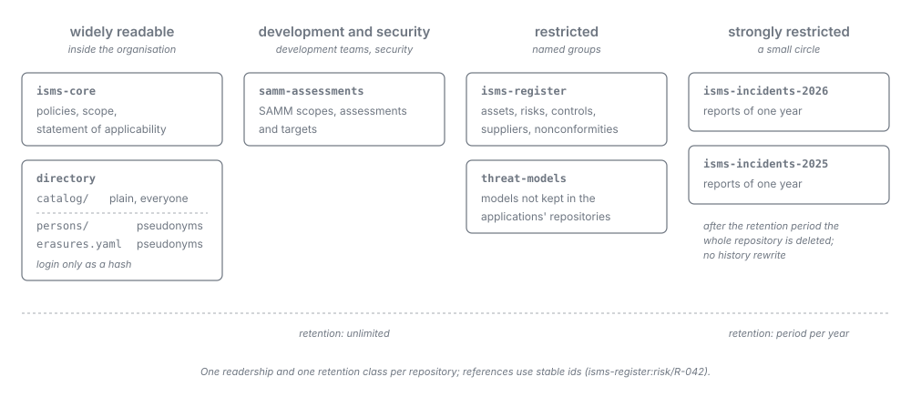

= Data Protection and Repository Layout
:toc: left
:toclevels: 3
:toc-title: Table of Contents
:sectnums:
:source-highlighter: highlight.js

link:../README.adoc[CISOs-Friend documentation] » Concepts

Git grants rights per repository and forgets nothing. An application that puts a CISO's risk register and a
developer's SAMM answers into one repository has made both properties into problems: everyone who may read one may
read the other, and the incident report that must be deleted after its retention period takes the risk register's
history with it. CISOs-Friend turns both properties into advantages by cutting its data into repositories by
confidentiality and by retention period.

The mechanisms underneath (pseudonymous commits, the person directory outside Git with erasure by deletion, the
registry of repositories with stable aliases, references across repositories) belong to the library and are described
in link:../../concepts/data-protection.adoc[Data Protection]. This page states what the
application configures on top of them and what it has to agree with the organisation.

This is a technical design, not legal advice.

== The Repository Cut

[cols="2,3,2"]
|===
|Repository |Content |Readers

|`isms-core`
|Policies, scope, statement of applicability
|Widely readable

|`isms-register`
|Assets, risks, controls, suppliers, nonconformities
|Restricted

|`isms-incidents-<year>`
|Incident response reports of one year
|Strongly restricted; retention period

|`samm-assessments`
|SAMM scopes, assessments and targets
|Development and security

|`threat-models`
|Threat model reports, where not in the application's repository
|Restricted

|`directory`
|Catalogs of roles, teams, systems, services and external parties, and the record of erasures; no persons
|Everyone
|===

Threat models that live in the applications' own repositories (variant A of
link:category-threat-models.adoc[Threat Models]) inherit the rights of those repositories.

Drafts of every repository, confidential ones included, are never pushed: they stay in the application's local
repositories on the persistent volume, which the operator backs up
(link:../../concepts/storage-engine.adoc#_two_levels_of_saving[Storage Engine, Two Levels of Saving];
link:deployment.adoc#_operating_duties[Deployment, Operating Duties]).

The cut is configuration: an organisation may merge `isms-core` and `isms-register` or split the register further.
Two rules hold for every configuration:

* *One retention class per repository.* Data with different retention periods never share a repository, because a
  repository is deleted as a whole when its period ends; no history is rewritten.
* *One confidentiality class per repository.* Git grants rights per repository only; with pushes in the user's name
  the Git server enforces them itself.

References across repositories have the form `<alias>:<kind>/<id>`, where the alias is the repository's stable alias
from the registry (`isms-register:risk/R-042`, `samm-assessments:assessment/<id>`); entries of the directory's catalogs
are referenced as `<catalog>:<id>` (`service:payment-api`, `role:ciso`). The application checks on save that the target
exists, and a CI pipeline on the pull request validates schemas and references with the existing infrastructure. The
decision is recorded in link:../adr/0007-Repositories_are_cut_by_confidentiality_and_retention_class.adoc[ADR-0007].

== Personal Data in the Categories

[cols="1,3"]
|===
|Category |Personal data and its handling

|SAMM
|Assessors only, as pseudonyms; resolved through the directory.

|Threat models
|Hardly any, apart from owners; roles instead of names.

|Incident reports
|Participants as pseudonyms. Affected or involved persons appear only as categories and approximate numbers, which is
what the notification to the supervisory authority asks for (GDPR Art. 33(3)(a),
link:https://eur-lex.europa.eu/eli/reg/2016/679/oj[Regulation (EU) 2016/679]); their details stay in the ticket
system, referenced by ticket id. The yearly repository is deleted after the retention period.

|ISMS
|Owners by role (`owner: role:it-security-lead`), not by person.

|Directory
|No person in Git. Names and memberships lie in the person directory outside Git (see below and
link:../../concepts/directory-and-catalogs.adoc[Directory and Catalogs]).
|===

The UI supports data minimisation where the library cannot: free-text fields carry a hint that personal details and
interview notes do not belong there but in the ticket system, and a field that names a person offers only a pick from
the person directory, which stores a pseudonym.

== The Person Directory

CISOs-Friend uses the library's person directory
(link:../../concepts/data-protection.adoc#_the_person_directory[Data Protection, The Person Directory]) and chooses
the provider by configuration:

* *`local`, the default.* Each person enters name, team and role at the first login
  (link:authentication-and-identity.adoc[Authentication and Identity]); the entry lies as a plain file on the
  application's persistent volume, outside every repository. Nothing else is needed.
* *The organisation's own source.* Where persons and groups are maintained centrally (the identity provider's user
  directory, SCIM, LDAP), a provider reads them from there; there is no entry form, and the organisation keeps and
  erases the personal data in that source. Which such provider ships first is an open question of the library.

== The Erasure Concept

With the `local` directory an erasure deletes the person's entry at once; the application turns this into an
operational concept:

* *On request or on leaving*: a user with `administer-catalogs` erases a pseudonym in the *Due* lens; the deletion is
  effective at once. Documents keep the pseudonym and show "former member"; because responsibilities run through
  roles, they stay understandable.
* *Restriction instead of erasure*: during a statutory retention period (GDPR Art. 17(3)(b) for the retention
  obligation; § 35(3) BDSG) that covers the attribution of a person's commits, for example the approvals of incident
  reports, the erasure sets a restriction date: the entry is hidden from every view and deleted on that date. At the
  end of the period the repository of that retention class is deleted as well.
* *Evidence of erasure*: the directory's repository records the erased pseudonym and the date, never the person; the
  next checkpoint anchors that record.
* *Copies*: the backups of the volume and logs that pair a pseudonym with a login expire within the period the
  organisation publishes in its erasure concept. The GDPR asks for an answer without undue delay and within one month
  at the latest (Art. 12(3)).
* *With the organisation's own source* the application erases nothing itself; it shows the pseudonym as "former
  member" once the source no longer knows the person.

== What Is Agreed with the Data Protection Officer

The application cannot settle these; they are agreed per organisation before go-live:

. Pseudonymisation as the protection of commit authors.
. Erasure by deleting the person directory's entry: the pseudonym stays in the history and is personal data while
  anything can still link it to the person (the entry, its backups, logs). The expiry of those copies, and whether the
  pseudonym then counts as anonymous, are agreed here.
. The retention classes and their periods (incident reports, ISMS registers, audit reports).
. The legal basis and the information text of the directory (legitimate interest or employee data protection). The
  general clause of the German rule, § 26(1) sentence 1 BDSG, is disputed since the CJEU held on 30 March 2023
  (C-34/21) that national employment rules which do not meet Art. 88(2) GDPR must be disregarded unless they form a
  legal basis under another article of the GDPR
  (link:https://curia.europa.eu/site/upload/docs/application/pdf/2023-03/cp230054en.pdf[CJEU press release
  No 54/23]); the ruling concerned a Hessian rule whose wording largely matches it
  (link:https://www.gleisslutz.com/de/know-how/unanwendbarkeit-nationaler-generalklauseln-des-beschaeftigtendatenschutzes[Gleiss
  Lutz, 26 April 2023]).
. Where the read-access log lives: who read a confidential risk is logged to the organisation's existing logging or
  SIEM (ISO 27001 A.8.15), not stored in Git.

== Open Questions

. Agree the points above with the data protection officer of the first adopting organisation.
. Whether the first adopting organisation uses the `local` directory or its own source.

== Related

* link:../../concepts/data-protection.adoc[Data Protection] — the library mechanisms
* link:../../concepts/evidence-and-companion-stores.adoc[Evidence and Companion Stores] — timestamps, SIEM, drafts
* link:authentication-and-identity.adoc[Authentication and Identity] — first login and information duty
