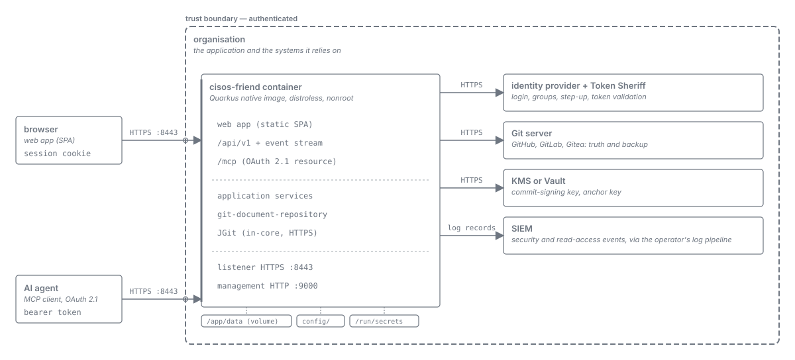

= Deployment
:toc: left
:toclevels: 3
:toc-title: Table of Contents
:sectnums:
:source-highlighter: highlight.js

link:../README.adoc[CISOs-Friend documentation] » Concepts

The promise of CISOs-Friend to an operator is short: no new database. The honest version of the promise is longer:
no new database, one container, one persistent volume, one secret, and a handful of systems the organisation already
runs. This page names all of them, and how the container is built and shipped. The structure follows API Sheriff.

== What Runs Where

[cols="1,3"]
|===
|Component |Role

|*CISOs-Friend container*
|The native binary: web app, REST API, MCP endpoint, services. Listens on HTTPS; management (health, metrics) on a
separate port.

|*Persistent volume*
|The local repositories: in remote mode a disposable cache plus the drafts, in local mode the source of truth. Without
it a restart loses every unsaved draft.

|*Git server* (GitHub, GitLab, Gitea, Bitbucket)
|Source of truth and backup in remote mode; protected branches and tags; webhooks to the application.

|*Identity provider* with Token Sheriff
|Authentication of people and agents; groups; step-up.

|*KMS or Vault*
|The key-encryption key of the keyring and, preferably, the commit-signing key.

|*Timestamp authority* (optional)
|RFC 3161 timestamps of every new state of `main`.

|*SIEM*
|Read-access and security events of the application.

|*Issue and ticket system*
|Measures and the live handling of incidents; referenced, never written into Git content.
|===

== Modes

* *Remote* (recommended): the Git server is the source of truth; the volume holds a cache that can be deleted and
  re-cloned, and the drafts.
* *Local*: no remote; the bare repositories on the volume are the source of truth and the operator backs up the
  directory. Suitable for evaluation. A remote can be added later with one push.

Both modes run the same code; the configuration of each repository names its remote or `none`.

== The Image

Following API Sheriff:

* *Native binary* built with the Mandrel builder image on the JDK 25 line; no JVM in the runtime image.
* *Base image* `quay.io/quarkus/quarkus-distroless-image`, pinned by digest; the process runs as `nonroot`.
* *Health check* answered by the binary itself (`--health-probe`), because the distroless image has no shell or
  `curl`.
* *Ports*: 8443 (HTTPS), 9000 (management: readiness, liveness, Prometheus metrics). Plain HTTP 8080 only behind a
  terminating proxy.
* *OCI labels* for version, revision, source and licence from build arguments.
* *Multi-architecture*: amd64 and arm64 built natively on separate runners and joined into one image index, published
  as `ghcr.io/cuioss/cisos-friend`.

The release follows the cuioss release process of the application repository; publishing the image is part of it.

== Configuration and Secrets

[cols="1,3"]
|===
|Item |How it reaches the container

|`cisos-friend.yaml` and the category overrides
|Mounted configuration directory, validated at boot and offline (`--validate-config`).

|URLs, client ids
|Environment variables, referenced as placeholders in the YAML.

|Git push credential (technical user)
|Mounted secret file or KMS reference.

|Commit-signing key
|KMS or HSM; the application signs through its interface and never sees the key. A key file is the weakest variant.

|KEK of the keyring
|KMS or Vault transit; a mounted file only for evaluation.

|TLS server certificate and key
|Mounted files.

|OIDC client credential
|Mounted secret file, or `private_key_jwt` key material.
|===

== Compose Sample

The `deployment` module carries a compose sample, like API Sheriff's, that runs the published image and never builds
one:

* `cisos-friend` on `${CISOS_FRIEND_IMAGE}` with a named volume;
* Keycloak as identity provider with a realm for people (web login) and a client registration for an MCP client;
* Gitea as Git server with the repositories of the default cut and a webhook to the application;
* a timestamp-authority stub;
* start and stop scripts and a check script that logs in, saves a draft and releases it.

The integration tests use the same topology with additional variants.

== Operating Duties

. Back up nothing new: in remote mode the Git server's backup is the backup. In local mode back up the volume.
. Keep the KEK versioned in the KMS and let the rotation destroy old versions; never copy the KEK into a backup by
  hand.
. Watch the readiness probe: the application is not ready until every configured repository is fetched, the keyring
  is decrypted and the index is built.
. Register the commit-signing key with the bot account if the Git server shall show commits as "Verified".
. Route the application's security events into the SIEM.

== Open Questions

. Which timestamp authority (qualified under eIDAS or internal) the sample and the first organisation use.
. Whether a Helm chart is shipped beside the compose sample.
. Sizing of the volume and memory for the expected number of repositories and documents (to be measured in the
  prototype).

== Related

* link:application-architecture.adoc[Application Architecture]
* link:data-protection-and-repository-layout.adoc[Data Protection and Repository Layout] — the repository cut and the
  KEK source
* link:../../concepts/evidence-and-companion-stores.adoc[Evidence and Companion Stores] — timestamps and mirror
