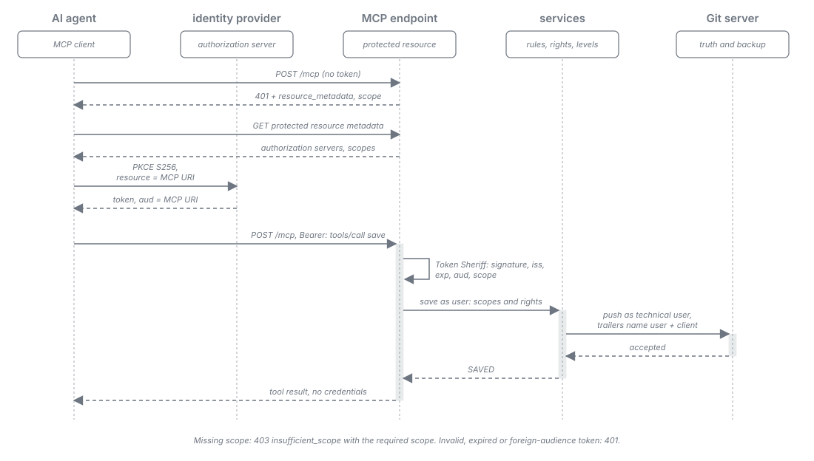

= MCP Server
:toc: left
:toclevels: 3
:toc-title: Table of Contents
:sectnums:
:source-highlighter: highlight.js

xref:../README.adoc[CISOs-Friend documentation] » Concepts

An AI agent that fills in a threat model from a recipe or drafts an incident report from the responders' notes is useful
exactly as long as it can be held to the same rules as the person it works for. An integration that hands the agent a
long-lived API key with the rights of a service account leaves an audit trail that names only the service account.
CISOs-Friend's MCP server works the other way round: every call carries an audience-bound token of a
named user and acts with no more than that user's rights, and the steps that need a human stay with the human.

== The Server as a Protected Resource

The MCP authorization specification makes authorization optional and says that HTTP transports which use it should
conform to it. CISOs-Friend uses authorization and follows the MCP authorization specification for HTTP transports:
the MCP server is an OAuth 2.1 resource server
(https://www.ietf.org/archive/id/draft-ietf-oauth-v2-1-13.html[draft-ietf-oauth-v2-1-13], an Internet-Draft). The
normative revision is 2026-07-28 (its published pages
`basic/authorization`, `basic/transports` and `basic/transports/streamable-http`, linked under <<_related>>).

* *Discovery*: the server publishes Protected Resource Metadata (RFC 9728) naming the organisation's authorization
  server and the scopes, and answers a request without a valid token with `401` pointing to that metadata.
* *Validation*: section 5.2 of draft-ietf-oauth-v2-1-13 requires a resource server to check that a token has not
  expired, is authorized for the requested resource and carries the appropriate scope. The server validates every
  token through `token-sheriff-validation-quarkus`, above all its *audience*: the token's `aud` must contain the
  server's canonical URI, the value MCP clients send as `resource` parameter (RFC 8707), so a token issued for any
  other resource is rejected however valid it is otherwise.
* *Insufficient scope* yields `403` naming the scopes needed, so the client can obtain a new token with exactly those
  scopes. This is not the step-up of a release, which is a renewed MFA login of the user.
* *No token passthrough*: the server never forwards the token it received to another service. Upstream calls use
  their own credentials (see <<_git_credentials_never_reach_the_agent>>).

The client side of the flow (discovery, PKCE `S256`, `resource` parameter, Client ID Metadata Documents or dynamic
registration) is the agent's and the authorization server's duty; the server's side is specified in
xref:../specification/mcp-server.adoc#CIFR-MCP-2[MCP Server, CIFR-MCP-2] and
xref:../specification/mcp-server.adoc#CIFR-MCP-3[CIFR-MCP-3].

== Transport

The server speaks Streamable HTTP at `/mcp`, in the shape of revision 2026-07-28: no protocol-level sessions, so every
request carries and is checked against its own token, and nothing an agent did earlier widens what it may do now.
`GET` and `DELETE` on `/mcp` are answered with `405`, because the server opens no stream outside a request and keeps
no session to delete. The
server validates the `Origin` header of every request and answers an invalid origin with `403`. A STDIO transport is not
offered: the specification does not apply its authorization to STDIO, and a local process could not prove a user.

== Scopes and Rights

A scope says what kind of operation an agent may attempt; the user's rights say on which repositories. The effective
permission of a call is the intersection: the agent never exceeds the user it acts for.

[cols="1,3"]
|===
|Scope |Operations

|`cisos-friend:read`
|List, read and search documents, catalogs and the index; diffs; due items.

|`cisos-friend:write`
|Write the user's drafts and save them to the working branch, signed by the application like every commit.

|`cisos-friend:request-release`
|Open a release request that a human completes.
|===

The user's rights come from the identity-provider groups, mapped per repository, exactly as for the web app
(xref:authentication-and-identity.adoc#_rights[Authentication and Identity, Rights]). There is no agent-specific
service account.

== What an Agent Can and Cannot Do

[cols="1,1"]
|===
|Can |Cannot

|Read what the user may read
|Read what the user may not read

|Fill in drafts from recipes and the user's notes
|Release

|Save, attributed to the user in the signed trailers
|Change catalogs, rights or configuration

|Request a release; the human approves in the web app
|Perform step-up MFA

|Receive validation errors per field and conflicts per file
|Obtain Git or KMS credentials
|===

A release is bound to a human act: the step-up authentication of the user. The MCP server therefore stops at the
request; the request appears in the user's *Due* lens of the web app.

[#_git_credentials_never_reach_the_agent]
== Git Credentials Never Reach the Agent

The application pushes only with the technical user
(xref:authentication-and-identity.adoc#_the_git_credential[The Git Credential]). That credential is never part of a tool
result, an error message or a log line, and the agent's access token is never used against the Git server. A
compromised agent therefore holds at most an audience-bound token for this one server, valid for the lifetime its
authorization server sets.

[#_attribution_of_agent_actions]
== Attribution of Agent Actions

Every commit an agent causes carries the identity of the user, exactly as a commit from the web app does (pseudonym,
issuer, authentication time and context; the trailer schema is the library's, see
xref:../../concepts/identity-and-signing.adoc[Identity and Signing]). The agent client, the `client_id` (or `azp`) of
the token, is recorded in the audit log only (see <<_open_questions>>).

== Limits and Audit

* *Size limits* on tool inputs, derived from the category schemas. Rate limits are left to the ingress in front of the
  application.
* *Audit*: every tool call is logged with a `LogRecord`: pseudonym, client id, tool, repository, outcome. Token
  material, session ids and document content are never logged. The records reach the SIEM.
* *Content is data*: document text returned to an agent may contain instructions written by anyone with write access.
  The server treats every write the agent sends as untrusted input: schema validation and rights check, exactly as
  for a human.

[CAUTION]
====
The design binds an agent to its user's rights; it does not make the agent's judgement better. An agent with
`cisos-friend:write` can still save a wrong answer. That is why nothing an agent saves is released without a
human.
====

[#_open_questions]
== Open Questions

. Which protocol revisions the server supports besides 2026-07-28 (in revision 2025-11-25 protocol sessions are
  optional).
. Whether the organisation's authorization server supports Client ID Metadata Documents, or agents are pre-registered.
. The exact tool list per category, and whether recipes are offered as MCP prompts.
. How a release request is stored in Git: as a field of the document on its working branch or as a document of a kind
  of its own, and in which repository
  (xref:../specification/architecture-and-modules.adoc#CIFR-GEN-3[CIFR-GEN-3]).
. Deferred: the trailer `Actor-Client`. Until it comes, the history does not show whether a commit came from the user
  in the web app or from an agent acting for the user; only the audit log records the client.
. Deferred: sender-constrained tokens (DPoP, RFC 9449).

[#_related]
== Related

* xref:authentication-and-identity.adoc[Authentication and Identity]
* xref:web-app.adoc[Web App] — where humans complete what agents request
* Sources: https://modelcontextprotocol.io/specification/2026-07-28/basic/authorization[MCP Authorization 2026-07-28],
  https://modelcontextprotocol.io/specification/2026-07-28/basic/transports[MCP Transports 2026-07-28],
  https://modelcontextprotocol.io/specification/2026-07-28/basic/transports/streamable-http[Streamable HTTP 2026-07-28],
  https://www.rfc-editor.org/rfc/rfc9728[RFC 9728], https://www.rfc-editor.org/rfc/rfc8707[RFC 8707],
  https://www.rfc-editor.org/rfc/rfc6750#section-3.1[RFC 6750 §3.1],
  https://www.rfc-editor.org/rfc/rfc9449[RFC 9449],
  https://www.ietf.org/archive/id/draft-ietf-oauth-v2-1-13.html[The OAuth 2.1 Authorization Framework,
  draft-ietf-oauth-v2-1-13] (Internet-Draft, 28 May 2025; the version the MCP authorization specification is based on);
  Token Sheriff `doc/validation` and `doc/client`
  (CLIENT-12)
