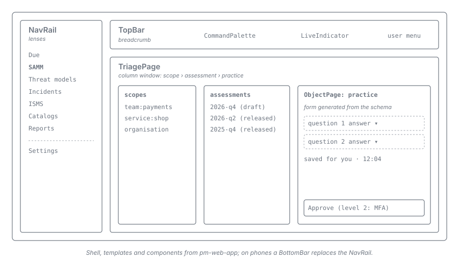

= Web App
:toc: left
:toclevels: 3
:toc-title: Table of Contents
:sectnums:
:source-highlighter: highlight.js

link:../README.adoc[CISOs-Friend documentation] » Concepts

The web app is where a security officer releases an assessment and where a team spends a two-hour SAMM workshop. The
first wants to see exactly what is being approved; the second wants the form out of the way. Neither wants to learn a
new interface vocabulary, and the cuioss project already has one that works: the `pm-web-app` of `pm-mcp-clients`.
CISOs-Friend takes its visuals and its technical UI structure from there and changes only what the domain and the
authentication demand.

== What Is Taken Over

[cols="1,3"]
|===
|Part |From `pm-web-app`

|*Stack*
|Svelte 5 with runes, SvelteKit with `adapter-static` as a pure single-page app (`ssr = false`, `prerender = false`,
a `fallback` page that the Quarkus application serves for every route of the app), Vite, TypeScript in strict mode
checked with `svelte-check`, ESLint and Prettier, stylelint for the token rules.

|*Design tokens*
|`src/styles/tokens.css`: type scale, 4 px spacing scale, radius, control sizes, z-index layers, motion and
breakpoints (phone < 768, tablet 768–1279, desktop ≥ 1280); a light and a dark palette switched by `data-theme` and
`prefers-color-scheme`; the token contract and WCAG 2.1 AA contrast checks of its theme-readability design. No raw
colour literal in a view or a component.

|*Typeface and icons*
|Inter, self-hosted; an own icon set; no font service and no open icon library in the build.

|*Shell*
|`lib/shell`: `AppShell` with `NavRail` (collapsible), `TopBar`, `BottomBar` on the phone, `CommandPalette`, live
indicator.

|*Page templates*
|`lib/templates`: `DashboardPage`, `ObjectPage`, `TriagePage` (the column engine), `WizardPage`. A view sets no page
width of its own; the template's split is the only layout.

|*Components*
|The closed vocabulary of basic components (button, data table, field, toggle, tabs, confirm dialog, toast, status
label, …); a view is built from them, not from ad-hoc markup.

|*Address model*
|One address model (`routes.ts`, `parseAddress` / `formatAddress`); route files are thin stubs that hand over to one
router view; every object kind has exactly one canonical route.

|*API client*
|One `ApiClient` against same-origin `/api/v1` with timeouts and typed errors, and one shared Server-Sent Events stream
with reconnect for live state.

|*Texts*
|No user-facing text in the code; the en/de message catalogue comes from the server and is cached per version.

|*Tests*
|Vitest with jsdom and Testing Library beside the code; Playwright and axe-core in a separate end-to-end module.

|*Packaging*
|`frontend-maven-plugin` builds the app into a resource JAR under `META-INF/resources`; the Quarkus application serves
it same-origin.
|===

The design documents of `pm-web-app` (`pm-mcp-clients/doc/design/web-app/`: navigation, components, view density and
filtering, theme readability, interaction affordances) are the reference for the visual and interaction rules; this
page records only the deviations. The decision is in
link:../adr/0002-The_web_UI_is_a_Svelte_static_single-page_application_served_same-origin.adoc[ADR-0002].

== Structure of the App

The rail carries the *lenses* of CISOs-Friend:

[cols="1,2,2"]
|===
|Lens |Chain of levels (columns) |Template

|*Due* (start page)
|launcher: deadlines, reviews, approvals waiting for the user
|`DashboardPage`

|*SAMM*
|scope › assessment › practice
|`TriagePage`, the practice as `ObjectPage`

|*Threat models*
|service › threat model
|`TriagePage`

|*Incidents*
|year › incident
|`TriagePage`

|*ISMS*
|register › entry; documents
|`TriagePage`

|*Catalogs*
|catalog › entry (roles, teams, services)
|`TriagePage`

|*Reports*
|trends, heat maps, comparisons, reporting dates
|`DashboardPage`

|*Settings*
|own directory entry
|`WizardPage`
|===

The first login and the release of a document run as `WizardPage` flows.

== What Differs

=== Authentication

`pm-web-app` pairs a device and sends a device secret as bearer token. CISOs-Friend does not: the browser never holds a
token. The server is the confidential client of the identity provider (Token Sheriff) and keeps a server-side session.
During the login the browser holds a short-lived `HttpOnly`, `Secure`, `SameSite=Lax` login-transaction cookie that
binds `state` and `nonce` across the identity provider's callback; afterwards it holds only the `HttpOnly`, `Secure`,
`SameSite=Strict` session cookie. State-changing requests carry an
anti-CSRF header the `ApiClient` adds. A `401` sends the user through the login and back to the same address; a
step-up demand opens the identity provider's MFA prompt and returns to the approval
(link:authentication-and-identity.adoc[Authentication and Identity]).

=== Forms from Schemas

Every document is edited in a form generated from the category's JSON Schema: field types map to the field components,
`required` marks mandatory fields, enumerations become pickers, references to catalogs (`service:`, `team:`, `role:`)
become pickers over the catalog, and AsciiDoc fragments get a text area with preview. The same schema validates in the
browser and in the server; the server's verdict wins. No category has a hand-written view.

=== Drafts, Saving and Conflicts

The form saves intermediate states automatically as drafts and shows "saved for you" versus "saved for everyone". The
`ApiClient` sends the blob id it loaded with every save; a concurrent change of the same file returns a conflict for
that file, and the draft is kept. The form shows the fields that differ, with both values; the field-level comparison
comes from `git-forms`. Changes by others arrive over the event stream; a
practice another assessor saved refreshes in place.

=== Review and Approval

Release shows the diff against the last released state, generated from the YAML, not from the AsciiDoc output. The
approve button says when it needs step-up and then triggers the renewed MFA login before the approval is written.

=== Brand

CISOs-Friend has its own brand mark; it keeps the token contract and the palette roles of `pm-web-app`, not its mascot.

== Security of the Page

* A strict Content Security Policy without `unsafe-inline` for scripts; the SvelteKit bootstrap script is allowed by
  hash. With `kit.csp.mode` `'hash'` (or `'auto'`, which uses hashes for prerendered pages) SvelteKit adds the
  SHA-256 hash of every inline script it generates
  (link:https://svelte.dev/docs/kit/configuration#csp[SvelteKit configuration, `csp`]). The `adapter-static`
  fallback page is rendered as a prerendered page, so the policy is written into it as a
  `<meta http-equiv="content-security-policy">` tag
  (link:https://github.com/sveltejs/kit/blob/%40sveltejs/kit%403.2.0/packages/kit/src/core/postbuild/fallback.js[`fallback.js`],
  link:https://github.com/sveltejs/kit/blob/%40sveltejs/kit%403.2.0/packages/kit/src/runtime/server/page/render.js[`render.js`],
  `@sveltejs/kit` 3.2.0). A `<meta>` policy ignores `frame-ancestors`, `report-uri` and `sandbox`; the Quarkus
  application sends these as a response header.
* No third-party origin: fonts, icons and scripts come from the application.
* AsciiDoc previews and generated reports are rendered by the server and sanitised; the browser never renders raw
  user HTML.
* Every text shown comes from the catalogue or from validated document data.

== Open Questions

. Whether the AsciiDoc preview runs server-side only or with a sanitising client renderer.
. Which `pm-web-app` components move into a shared component package instead of being copied.

== Related

* link:authentication-and-identity.adoc[Authentication and Identity]
* link:application-architecture.adoc[Application Architecture]
* link:../../concepts/schema-driven-documents.adoc[Schema-Driven Documents] — schemas and generated output
* `pm-mcp-clients/pm-web-app` and `pm-mcp-clients/doc/design/web-app/` (reference implementation and design)
