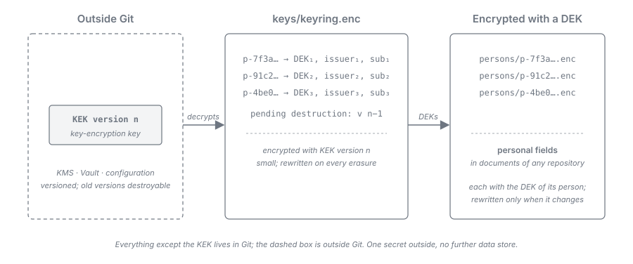
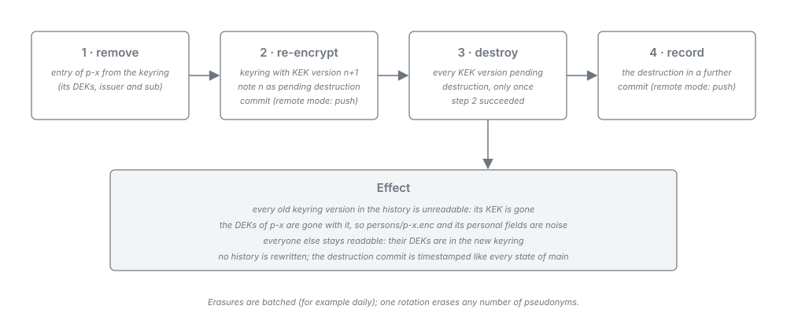

= Data Protection: Pseudonymisation, Erasure and Repository Cut
:toc: left
:toclevels: 3
:toc-title: Table of Contents
:sectnums:
:source-highlighter: highlight.js

Git is built to forget nothing; the GDPR insists on the right to be forgotten. Declaring the persistence "not
deletable" does not exempt it. This concept describes how the libraries keep personal data out of the history, how a
pseudonym mapping can lie in Git and still be erased, and how cutting data into repositories turns Git's coarse rights
into an advantage.

This is a technical assessment, not legal advice.

== The Problem

As soon as personal data lie in a repository, the right to erasure (GDPR Art. 17) applies, and Art. 25 (data
protection by design and by default) demands a system that can serve the data subjects' rights. Exceptions exist
(Art. 17(3)), above all statutory retention duties (Art. 17(3)(b)), but only for the data they cover and only for their
period; afterwards storage limitation (Art. 5(1)(e)) requires deletion. Under German law, where a retention period
stands against erasure, restriction of processing replaces erasure for that period (§ 35(3) BDSG).

Commits themselves are personal data when the author is a named person. Rewriting history to remove one person breaks
every clone, every signature and every timestamp. The design therefore keeps personal data out of the history instead
of removing them later.

== Keeping Personal Data out of the History

* *Pseudonymous commits.* The author is an opaque pseudonym; the mapping of pseudonym to person lies encrypted in Git
  and is erased by key rotation (next section).
* *Roles instead of persons* in documents (`owner: role:it-security-lead`); the directory resolves the role
  (see xref:directory-and-catalogs.adoc[Directory and Catalogs]).
* *Crypto-shredding* for personal fields that must be in a document: they are encrypted with a data encryption key
  (DEK) of the data subject (the same keyring as the pseudonym mapping); destroying the key erases the data in effect.
  A data subject has one DEK per retention class, so data under a retention duty and erasable data never share a key
  and each can be erased on its own (see <<_erasing_a_person>>).
* *Repositories per retention period* (last section): after the period the whole repository is deleted; no history
  is rewritten.

== An Encrypted Keyring in Git

Pseudonymisation needs a mapping of pseudonym to person, and that mapping must be deletable. A store of its own for
it would bring back the operating effort Git was meant to avoid. The mapping can instead lie in Git, encrypted with a
key supplied from outside.

*One fixed key is not enough.* The mapping changes: erasing a person writes a new encrypted version without the
entry. The old versions stay in the Git history, encrypted with the same key; whoever holds the key decrypts
yesterday's version and has the person back. For the controller, who holds the key, the entry is not erased.

*Rotating the key on erasure works.* When the key is changed on erasure and the old one destroyed, all old versions in
the history become unreadable at once. *Envelope encryption* keeps this cheap:

* `persons/<pseudonym>.enc` -- the entry of a person, encrypted with the person's own DEK for the retention class of
  the directory's repository; rewritten only when the person changes it.
* `keys/keyring.enc` -- per pseudonym the issuer and `sub` of the identity provider (a `sub` is unique only within its
  issuer) and one DEK per retention class (the retention class of a repository, see
  <<_repositories_per_confidentiality_and_retention_class>>), encrypted with the *key-encryption key* (KEK, version
  n); small, rewritten on every erasure. A data subject without an account at the
  identity provider, such as an external person named in a document, has no issuer and `sub`; how such an entry is
  keyed is an open question.
* Outside Git: only the KEK, supplied from outside and versioned.

The keyring and the entries of persons live in the repository of the directory (see
xref:directory-and-catalogs.adoc[Directory and Catalogs]); personal fields in documents of other repositories use the
same keyring.

=== Erasing a Person

. Remove from the person's entry the DEKs of the retention classes whose data must be erased. A class whose data are
  under a statutory retention duty keeps its DEK until that retention ends: for that period restriction of processing
  replaces erasure (§ 35(3) BDSG). When no DEK is left, remove the whole entry (issuer and `sub`).
. Encrypt the keyring with a new KEK (version n+1), note version n as pending destruction, and commit it; in remote
  mode push it.
. Only when the new keyring is published, destroy KEK version n, and record the destruction in a further commit.

The order matters. Destroying version n before the new keyring reaches the remote would leave the remote with a
keyring nobody can decrypt, and every mapping in it would be lost, not only the erased ones. A failed commit or push
therefore destroys nothing; a version still pending destruction is destroyed by the next run.

All old versions of the keyring in the history are unreadable, because their KEK is gone. With them the removed DEKs
are gone, and the data encrypted with them, such as the `persons/*.enc` of erased persons, are noise, although they
stay in Git. The data of everyone else, and the retained classes of a person under restriction, remain readable,
because their DEKs are in the new keyring; only the small keyring is encrypted anew. The same
mechanism serves personal fields in documents encrypted with the DEK of the data subject: pseudonymisation and
crypto-shredding run on one technique.

=== What Has to Be Done Right

* *Really destroy the KEK.* This is the most demanding step. The KEK needs backups, or its loss loses all mappings;
  at the same time the old version has to vanish everywhere, backups included. A KMS or Vault (transit) that manages
  key versions and destroys old versions selectively covers both. A key as a plain configuration value works too,
  but then every rotation is a manual operating step.
* *Batch erasures.* Rotate daily, for example, not per erasure. The GDPR asks for an answer without undue delay and
  within one month at the latest (Art. 12(3)); the maximal delay belongs in the operator's erasure concept.
* *Evidence of erasure.* A commit "KEK v7 destroyed on …, concerns pseudonyms X, Y" (without the key), anchored with
  an RFC 3161 timestamp like every new state of `main` (see xref:evidence-and-companion-stores.adoc[Evidence and
  Companion Stores]).
* *No home-made cryptography.* AES-256-GCM as authenticated encryption, with the path and the key version as associated
  data so that no blob can be swapped; random nonces, never reused. Google Tink (Java,
  link:https://github.com/tink-crypto/tink-java/releases/tag/v1.24.0[release 1.24.0] of 16 October 2026) provides
  envelope encryption in
  link:https://github.com/tink-crypto/tink-java/blob/main/src/main/java/com/google/crypto/tink/aead/KmsEnvelopeAead.java[`KmsEnvelopeAead`]
  and, for Java, KMS integrations for AWS KMS and Google Cloud KMS; its HashiCorp Vault integration exists only for Go
  (link:https://developers.google.com/tink/key-management-overview[Tink: Key management overview]). It would be a
  deliberate dependency decision.
* *Longevity.* The ciphertext stays in Git for good, in every clone and every backup of the Git server. Hence AES-256,
  not AES-128, as a reserve against future attacks, quantum computers included. After the erasure the protection rests
  entirely on the destruction of the KEK.
* *At run time* the application needs the current KEK at start, decrypts the keyring and holds the mapping in memory,
  like the index. Every instance reloads the keyring when a fetch brings a new version and forgets the DEKs that are
  gone; with several instances an erasure takes effect in each at its next fetch, so the erasure delay includes the
  fetch interval. The keyring is a single file and thereby a hot spot for compare-and-swap; with few new persons per
  day this is uncritical, otherwise it is split.

Legally, encrypted data stay personal data for the controller as long as the key exists: encryption is a protective
measure, not an erasure. Whether the remaining ciphertext counts as anonymous after the destruction of the KEK is
not settled. The EDPB states that after deletion of the key encrypted data are unintelligible "at least until the
algorithm is broken", that encrypted personal data are still personal data, and that even state-of-the-art
encryption is "overtaken by time" when the ciphertext is kept indefinitely
(link:https://www.edpb.europa.eu/system/files/2026-07/edpb_guidelines_202502_blockchain_v2_en.pdf[EDPB Guidelines
02/2025 on blockchain technologies, version 2.0 of 7 July 2026], para. 51). Its draft guidelines on anonymisation
call encryption "by its very nature, intended to be reversible" and require assessing whether anyone with access
could still decrypt "with means reasonably likely to be used", for example by cryptanalysis
(link:https://www.edpb.europa.eu/system/files/2026-07/edpb_guidelines_202602_anonymisation_v1_en_0.pdf[EDPB
Guidelines 02/2026 on Anonymisation, version 1.0 for public consultation], para. 91). Neither declares the
destruction of a key to be an erasure; every operator agrees it with their data protection officer.

The result: no further store. Everything lies in Git; outside it lies one secret, the KEK, not a data store. Operators
manage secrets anyway.

== Repositories per Confidentiality and Retention Class

GitHub, GitLab and Forgejo grant read rights per repository: roles are assigned per repository or project
(link:https://docs.github.com/en/organizations/managing-user-access-to-your-organizations-repositories/managing-repository-roles/repository-roles-for-an-organization[GitHub],
link:https://docs.gitlab.com/user/permissions/[GitLab],
link:https://forgejo.org/docs/latest/user/repo-permissions/[Forgejo]). The protected branches of GitHub and GitLab
restrict pushing, merging, force pushing and deletion, not reading
(link:https://docs.github.com/en/repositories/configuring-branches-and-merges-in-your-repository/managing-protected-branches/about-protected-branches[GitHub],
link:https://docs.gitlab.com/user/project/repository/branches/protected/[GitLab]). Gerrit is the exception: its
`Read` permission is granted per reference, so a branch can be hidden
(link:https://gerrit-review.googlesource.com/Documentation/access-control.html[Gerrit access controls]).
None of the four documents a read restriction per path. Cutting the data into repositories *by confidentiality* turns
that into an advantage; cutting them *by retention period* solves deletion. The store therefore manages a *registry of
repositories*, each with a stable alias, a confidentiality class and an optional retention period. A typical cut puts
widely readable policies, restricted registers and strongly restricted records of one year (with a retention period)
into separate repositories; the concrete cut is the decision of the application.

* With pushes in the user's name (see xref:identity-and-signing.adoc[Identity and Signing]) the Git server enforces the
  rights itself; otherwise the application enforces them per repository.
* *References across repositories* use stable ids of the form `<alias>:<kind>/<id>` for documents (for example
  `register:risk/R-042`) and `<catalog>:<id>` for entries of the directory catalogs (for example `role:ciso`). The
  store checks on save that the target exists.
* A CI pipeline on the pull request can validate schemas (JSON Schema) and references with the existing
  infrastructure.
* After its retention period a repository is deleted as a whole.

[CAUTION]
====
Crypto-shredding moves the problem from the history to the key. A KEK that survives in one forgotten backup undoes
every erasure made since. The libraries can rotate and re-encrypt; only the operator can make the old key disappear.
====

== Open Questions

. Choose the key source of the KEK (KMS, Vault, configuration value), and whether Token Sheriff can hold versioned
  secrets and serve as that source.
. Verify Google Tink for envelope encryption; decide the dependency.
. Key the keyring entry of a data subject without an account at the identity provider (no issuer and `sub`).

== Related

* xref:../adr/0008-The_pseudonym_mapping_lies_in_an_encrypted_keyring_in_Git_and_erasure_rotates_the_key-encryption_key.adoc[ADR-0008]
  -- the keyring decision.
* xref:../Requirements.adoc#requirements-git-crypto[`git-crypto` requirements] and
  xref:../specification/git-crypto.adoc[`git-crypto` specification].

== Sources

* BDSG: https://www.gesetze-im-internet.de/bdsg_2018/__35.html[§ 35 BDSG, Right to erasure]
