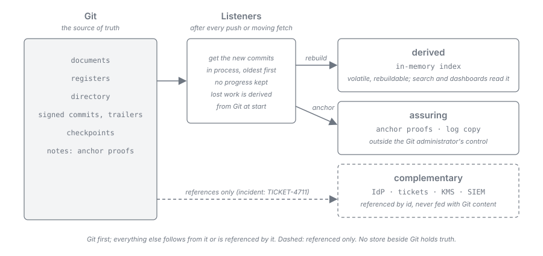

= Evidence and Companion Stores
:toc: left
:toclevels: 3
:toc-title: Table of Contents
:sectnums:
:source-highlighter: highlight.js

A store that promises "no further database" has to answer where the search index, the access log and the proof
against a rewritten history live. This concept names the gaps that remain beside Git, the systems that close them
without a database of their own, how the history is anchored, and how Git and the other systems stay consistent.

== The Problem

Git names every object by the hash of its content, and every commit names its parents
(link:https://git-scm.com/docs/gitglossary[gitglossary(7)], _object_, _object name_, _parent_), so a commit fixes its
whole history. That protects the history only as long as nobody with administrative rights moves the references: a
force push by an administrator replaces the history silently. Search and evaluations need structures Git does not
keep. Personal data must be deletable, which Git history is not. Each of these gaps invites a new store; most of them
do not need one.

== Three Classes of Stores

Every store beside Git falls into one of three classes:

. *Derived*: rebuildable from Git at any time (index, search, dashboards). Local, volatile, no backup.
. *Complementary*: data that must not be in Git because it is mutable, deletable or personal. It belongs in a system
  the organisation already operates, not in a new store.
. *Assuring*: an independent proof about Git ("these commits existed at this time"). It must lie outside the control
  of the Git administrator.

[cols="2,3,1"]
|===
|Gap |Solution |New infrastructure

|History rewritten (force push by an administrator)
|Anchoring of releases and periodic checkpoints: an own signed timestamp, or an RFC 3161 timestamp authority where an
independent proof is needed
|none for the own timestamp; a timestamp authority for RFC 3161

|Approvals in the Git server's database
|The release commit, merged and signed by the application, names the approver (see
xref:identity-and-signing.adoc[Identity and Signing])
|none

|Personal, deletable data
|Names only in the person directory, where erasure removes the current entry but not its earlier versions (see
xref:data-protection.adoc#_the_person_directory[Data Protection]);
operational details in the ticket system
|none

|Read-access log (who read a confidential document, logins)
|The organisation's existing logging or SIEM (ISO/IEC 27001:2022, A.8.15 Logging)
|none

|Unsaved drafts
|Accepted risk; the library never pushes drafts, so the remote never secures them. They are secured only by a backup
of the clone's storage
|none

|Search, evaluations, reporting-date views
|In-memory index, optionally a disposable cache
|none, disposable
|===

== The Anchor

A copy of all commits in a second store adds nothing: in Git every commit already fixes its history by hash. Value
comes
from a *proof that a state existed at a time*, held where the Git administrator cannot change it unnoticed: the anchor
of the hash chain. Anchoring is optional and pluggable; `git-store` decides what is anchored and stores the proofs,
and one provider obtains and verifies them
(xref:../adr/0007-Releases_and_checkpoints_are_anchored_through_a_pluggable_provider.adoc[ADR-0007]).

=== What Is Anchored

Not every commit, but two kinds of subject:

* *Releases*: the commit of every release tag, right after the tag exists. Releases are the states an auditor asks
  for.
* *Checkpoints*: at most once per interval (default one day) and only when something changed, the store writes a
  checkpoint commit that lists every pushed reference with its object id, chained to the previous checkpoint and tagged
  `refs/tags/checkpoints/<n>`. Because Git is hash-chained, one proof for a checkpoint proves every commit reachable
  from the references it lists, and every earlier checkpoint.

The proofs are `git notes` on the anchored commit under `refs/notes/anchors/<provider>`, so they travel with the
repository and are verifiable without the application. Between two checkpoints a commit that is no release is proven
only at the time of the next checkpoint.

=== Providers

[cols="1,2,2"]
|===
|Provider |What it proves |What it needs

|`signed` (`git-store`), own timestamp
|That the holder of the anchor key signed, at the time its clock showed, that the object existed. Best effort: the
anchor key is separate from the commit-signing key and should lie under another responsibility than the Git
administration; the proofs form a chain (sequence number and hash of the previous proof), and the time never runs
backwards; every proof is also written as a log record, so the operator's log pipeline, often a SIEM under the
security team, keeps a copy outside Git
|A key source (KMS, HSM or key file); no further service

|`rfc3161` (`git-timestamp`)
|That an independent timestamp authority saw the hash at the time it signed. Only a qualified electronic timestamp,
issued by a qualified trust service provider, enjoys the presumption of the accuracy of its date and time and of the
integrity of the data bound to it (eIDAS, Regulation (EU) No 910/2014, Art. 41(2), 42); any other RFC 3161 proof is
an electronic timestamp that may not be denied legal effect solely for not being qualified (Art. 41(1))
|A timestamp authority reachable over HTTPS; one call per release and checkpoint
|===

A deployment activates one of them, or none. The own timestamp is not independent of the operator: whoever holds the
anchor key and controls the clock can sign a back-dated statement. What it gives is narrower and still useful. A Git
administrator without the anchor key cannot forge proofs, a back-dated proof breaks the chain or contradicts the
copies in the log pipeline, and a later compromise of the commit-signing key devalues only the commits not reached by
a proof from before the compromise (see xref:identity-and-signing.adoc#_what_has_to_be_done_right[Identity and
Signing]). It is no qualified electronic timestamp. Where an auditor or a court needs a proof independent of the
organisation's own operation, the deployment uses `rfc3161`. A timestamp authority run inside the organisation is
independent only when it lies under a responsibility other than the Git administration and the application's
operation.

Without a provider the guarantee is what signed commits, the Git server's protected branches and tags, and its backup
give.

=== Detecting a Removed State

Notes and checkpoint tags in the repository have one blind spot. An administrator who rewrites the history can delete
the matching notes and tags in the same push, and a verifier who knows only the rewritten repository sees nothing
missing. Detecting a removed state therefore needs a *copy outside the administrator's control*:

* the log records of the `signed` provider in the operator's log pipeline;
* a mirror on a second Git server under another responsibility, where a force push on the main server shows;
* a copy of each proof in a store of another responsibility (WORM storage, an archive of the security team).

*Public transparency logs* (Sigstore Rekor) are not recommended for internal data: a transparency log makes every
valid entry public so that anybody can validate it, and who does not want an entry in the public Sigstore instances is
pointed to running instances of their own
(link:https://blog.sigstore.dev/privacy-in-sigstore-57cac15af0d0/[Sigstore Blog: Privacy in Sigstore, May 2022]).

== Consistency between Git and the Other Systems

Git comes first; everything else follows and is derived from Git.

* *Post-commit listeners.* After every save or release the store pushed, and after every fetch that moves a branch,
  the store hands the new commits to its listeners in process, for example the index. It keeps no progress: what must
  not be lost is derived from Git at start. The index is rebuilt; the anchoring finds the releases and checkpoints
  without a proof by reading its notes.
* *Complementary data by reference only.* Git holds `incident: TICKET-4711`; the ticket system never holds Git
  content.

The truth then sorts as follows:

* *Git*: documents, registers, the directory with the person entries, signed commits with their trailers,
  checkpoints and anchor proofs as notes.
* *Derived*: index and search, volatile and rebuildable.
* *Complementary*: the identity provider (authentication, groups), an operator's own person directory where one is
  plugged in, the ticket system, the KMS (keys), the SIEM (read-access log).
* *Assuring*: the anchor proofs and their copies outside Git.

[CAUTION]
====
An anchor proves that a state existed; it cannot restore a state that was removed. Restoring after a rewritten
history still needs the Git server's backup or a mirror. Together with a copy outside the Git administrator's
control the anchor turns a silent rewrite into a detectable one, nothing more; notes alone do not.
====

== Open Questions

. Whether the checkpoint interval of one day suits audits, or whether deployments with frequent changes need a
  shorter one.

== Related

* xref:../specification/git-store.adoc#GDR-STORE-15[`git-store`, GDR-STORE-15 – GDR-STORE-18] and
  xref:../specification/git-timestamp.adoc[`git-timestamp`] -- the specifications.

== Sources

* eIDAS: https://eur-lex.europa.eu/eli/reg/2014/910/oj[Regulation (EU) No 910/2014], Art. 41, 42
* ISO/IEC 27001: https://www.iso.org/standard/27001[ISO/IEC 27001:2022], A.8.15 Logging
* Git objects: https://git-scm.com/docs/gitglossary[gitglossary(7)]
* Sigstore: https://blog.sigstore.dev/privacy-in-sigstore-57cac15af0d0/[Privacy in Sigstore]
