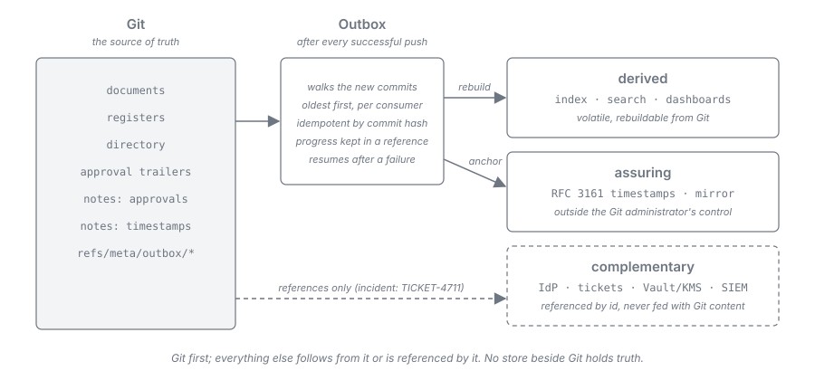

= Evidence and Companion Stores
:toc: left
:toclevels: 3
:toc-title: Table of Contents
:sectnums:
:source-highlighter: highlight.js

A store that promises "no further database" has to answer where the search index, the access log and the proof
against a rewritten history live. This concept names the gaps that remain beside Git, the systems that
close them without a database of their own, how the history is anchored externally, and how Git and the other
systems stay consistent.

== The Problem

Git is an append-only, hash-chained store, but only as long as nobody with administrative rights rewrites it. A
force push by an administrator replaces the history silently. Approvals given in the Git server's review tool live in
the server's database, not in the repository. Search and evaluations need structures Git does not keep. Personal data
must be deletable, which Git history is not. Each of these gaps invites a new store; most of them do not need one.

== Three Classes of Stores

Every store beside Git falls into one of three classes:

. *Derived*: rebuildable from Git at any time (index, search, dashboards). Local, volatile, no backup.
. *Complementary*: data that must not be in Git because it is mutable, deletable or personal. It belongs in a system
  the organisation already operates, not in a new store. The one exception is the default person directory: plain
  files on the application's volume, for organisations whose user directory the application cannot read.
. *Assuring*: an independent append-only proof about Git ("these commits existed at this time"). It must lie
  outside the control of the Git administrator.

[cols="2,3,1"]
|===
|Gap |Solution |New infrastructure

|History rewritten (force push by an administrator)
|Anchoring of releases and periodic checkpoints: an own signed timestamp, or an RFC 3161 timestamp authority where an
independent proof is needed
|none for the own timestamp (it uses the key source of the signing); a timestamp authority for RFC 3161

|Approvals live in the Git server's database
|Commit trailers on merge; passkey approvals as notes (see xref:identity-and-signing.adoc[Identity and Signing])
|none

|Personal, deletable data
|The person directory outside Git: by default plain files on the application's volume, erased by deletion, or the
operator's own user directory (see xref:data-protection.adoc#_the_person_directory[Data Protection]); operational
details in the ticket system
|none; the volume the application has anyway, or the operator's existing directory

|Read-access log (who read a confidential document, logins)
|The organisation's existing logging or SIEM (ISO/IEC 27001:2022, Annex A control 8.15 Logging)
|none

|Unsecured drafts
|Accepted risk by default; the library never pushes drafts. An organisation that wants them secured backs up the
repository directory of the application server
|none

|Search, evaluations, reporting-date views
|In-memory index, optionally a disposable cache (for example embedded SQLite, H2 or Lucene)
|none, disposable
|===

== The Anchor

A copy of all commits in a second store adds nothing: Git already is an append-only, hash-chained store. Value comes
from a *proof that a state existed at a time*, held where the Git administrator cannot change it unnoticed: the anchor
of the hash chain. Anchoring is optional and pluggable; `git-store` decides what is anchored and stores the proofs,
and providers obtain and verify them
(xref:../adr/0009-Releases_and_checkpoints_are_anchored_through_pluggable_providers_and_a_post-commit_outbox_follows_every_save.adoc[ADR-0009]).

=== What Is Anchored

Not every commit, but two kinds of subject:

* *Releases*: the commit of every release tag, right after the tag exists. Releases are the states an auditor asks
  for.
* *Checkpoints*: at most once per interval (default one day) and only when something changed, the store writes a
  checkpoint commit that lists every pushed reference with its object id, chained to the previous checkpoint and tagged
  `refs/tags/checkpoints/<n>`. Because Git is hash-chained, one proof for a checkpoint proves every commit reachable
  from the references it lists, and every earlier checkpoint.

The proofs are `git notes` on the anchored commit under `refs/notes/anchors/<provider>`, so they travel with the
repository and are verifiable without the application. Between two checkpoints a commit that is no release is proven
only at the time of the next checkpoint.

=== Providers

[cols="1,2,2"]
|===
|Provider |What it proves |What it needs

|`signed` (`git-signing`), own timestamp
|That the holder of the anchor key signed, at the time its clock showed, that the object existed. Best effort: the
anchor key is separate from the commit-signing key and should lie under another responsibility than the Git
administration; the proofs form a chain (sequence number and hash of the previous proof), and the time never runs
backwards; every proof is also written as a log record, so the operator's log pipeline, often a SIEM under the
security team, keeps a copy outside Git
|The key source the signing already uses (KMS, HSM or key file); no further service

|`rfc3161` (`git-timestamp`)
|That an independent timestamp authority saw the hash at the time it signed. A qualified electronic timestamp enjoys
the presumption of the accuracy of its date and time and of the integrity of the data bound to it (eIDAS, Regulation
(EU) No 910/2014, Art. 41(2))
|A timestamp authority reachable over HTTPS; one call per release and checkpoint
|===

Both can be active at once. Further providers fit the same interface, for example write-once (WORM) storage where the
organisation has it.

The own timestamp is not independent of the operator: whoever holds the anchor key and controls the clock can sign a
back-dated statement. What it gives is narrower and still useful. A Git administrator without the anchor key cannot
forge proofs, a back-dated proof breaks the chain or contradicts the copies in the log pipeline, and a later
compromise of the commit-signing key devalues only the commits not reached by a proof from before the compromise (see
xref:identity-and-signing.adoc#_what_has_to_be_done_right[Identity and Signing]). It is no qualified electronic
timestamp. Where an auditor or a court needs a proof independent of the organisation's own operation, `rfc3161` is
added. A timestamp authority run inside the organisation is independent only when it lies under a responsibility other
than the Git administration and the application's operation.

Without any provider the guarantee is what signed commits, the Git server's protected branches and tags, and its
backup give.

=== Detecting a Removed State

Notes and checkpoint tags in the repository have one blind spot. An administrator who rewrites the history can delete
the matching notes and tags in the same push, and a verifier who knows only the rewritten repository sees nothing
missing. Detecting a removed state therefore needs a *copy outside the administrator's control*:

* the log records of the `signed` provider in the operator's log pipeline;
* a *mirror* to a second Git server under another responsibility, pushed after every save, where a force push on the
  main server shows at once;
* a copy of each proof in a store of another responsibility (WORM storage, an archive of the security team).

*Public transparency logs* (Sigstore Rekor) are not recommended for internal data: every entry of the public log is
readable by anyone.

== Consistency between Git and the Other Systems

Git comes first; everything else follows and is derived from Git.

* *An outbox whose queue is Git.* After every save (and in remote mode every push), and after every fetch that moves
  a branch, for example a merge the Git server performed, the store walks the new commits and feeds its consumers from
  them: mirror and index. The anchoring runs on the same triggers.
* *Idempotent by commit hash.* After a failure the store resumes from the last processed hash. The progress is
  remembered per consumer and branch in a reference `refs/meta/outbox/<consumer>/<branch>`, again in Git, so it needs
  no store of its own. The branch name is escaped, first every `%` as `%25`, then every `/` as `%2F`, so the progress
  references of `risks` and `risks/<id>` never nest and two branch names never share one reference; they are never
  pushed.
* *Complementary data by reference only.* Git holds `incident: TICKET-4711`; the ticket system never holds Git
  content.

The truth then sorts as follows:

* *Git*: documents, registers, the directory, approval trailers and notes, checkpoints and anchor proofs as notes.
* *Derived*: index and search, volatile and rebuildable.
* *Complementary*: the identity provider (authentication, groups), the person directory (names, memberships), the
  issue and ticket system (operations), Vault or KMS (keys), the SIEM (read-access log).
* *Assuring*: the anchor proofs (own timestamp, RFC 3161 timestamps), optionally a mirror.

[CAUTION]
====
An anchor proves that a state existed; it cannot restore a state that was removed. Restoring after a rewritten
history still needs the Git server's backup or the mirror. Together with a copy outside the Git administrator's
control the anchor turns a silent rewrite into a detectable one, nothing more; notes alone do not.
====

== Open Questions

. Decide whether a mirror is required for every deployment or left to the operator. Interim rule: where the removal
  of a released state must be detectable, the log copy of `signed` or a mirror is mandatory.
. Whether the checkpoint interval of one day suits audits, or whether deployments with frequent changes need a
  shorter one.

== Related

* xref:../adr/0009-Releases_and_checkpoints_are_anchored_through_pluggable_providers_and_a_post-commit_outbox_follows_every_save.adoc[ADR-0009]
  -- anchoring and the outbox.
* xref:../adr/0010-No_database_the_in-memory_index_is_derived_from_Git.adoc[ADR-0010] -- the index as a derived store.
* xref:../specification/git-store.adoc#_anchoring[`git-store`, Anchoring],
  xref:../specification/git-signing.adoc#_own_timestamp[`git-signing`, Own Timestamp] and
  xref:../specification/git-timestamp.adoc[`git-timestamp`] -- the specifications.

== Sources

* eIDAS: https://eur-lex.europa.eu/eli/reg/2014/910/oj[Regulation (EU) No 910/2014], Art. 41(2)
