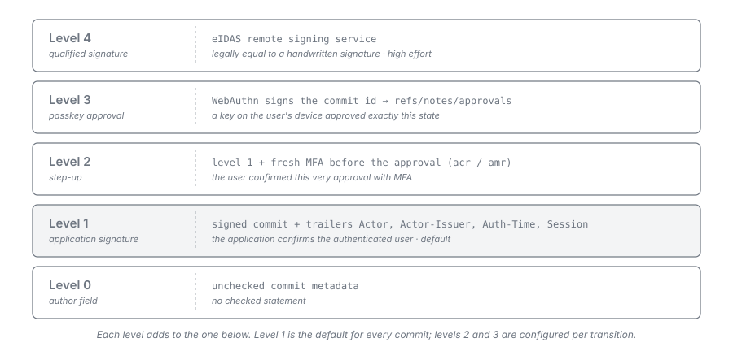

= Identity and Signing
:toc: left
:toclevels: 3
:toc-title: Table of Contents
:sectnums:
:source-highlighter: highlight.js

Who wrote a change, and how strongly can that be shown? The obvious answer -- every user pushes in their own name --
fails on the users themselves: every user needs an account and rights on the Git server, and many users of a
compliance application have none. This concept describes how a signing key of the application, combined with the
claims of the logged-in user, gives graded traceability without that effort.

Statements marked _(unverified)_ come from general knowledge and were not checked against a current source.

== Pushing: Technical User or the Logged-in User

[cols="1,3"]
|===
|Level |Meaning

|a) Technical user pushes, the author is the user
|The commit carries `author = p-7f3a9c`, `committer = docs-bot`. The author is metadata the Git server does not check;
the application checks the rights. The simplest start.

|b) Push with the user's token
|JGit takes the token per push (`UsernamePasswordCredentialsProvider`). The token comes from an OAuth login against
the Git server (GitHub App or OAuth App, GitLab OAuth). Token Sheriff provides these flows, keeps the tokens and
refreshes them (GitHub App user tokens: eight hours plus refresh token _(unverified)_); the library only consumes the
token per push through a credentials strategy. Gain: the Git server enforces the rights and its audit log names the
real pusher. A protected `main` usually rejects a user's direct push; the user then pushes the working branch and the
release runs as a pull or merge request.

|c) Commits signed by the user's own Git key
|Not feasible server-side through a JGit push, because it would need the user's signing key. Commits created through
the Git server's API can be signed by the server itself, depending on the vendor _(unverified)_, at the price of
binding to one vendor. The graded signature below replaces this level.
|===

*One push per save* keeps every push to the commits of exactly one user; the only exception are commits saved locally
while the remote could not be reached, which the next successful push carries along. Who may read and write a
repository is decided by the application from the identity provider; in the first iteration no right is derived from
the roles of the directory (see xref:directory-and-catalogs.adoc[Directory and Catalogs]).

== What a Signature of the Application Shows

When the application signs a commit with its own key, the signature covers the whole commit object: the tree (and
with it all content), the parents, author, committer and the commit message with its trailers. When the application
writes the identity of the logged-in user as *trailers* into the message, that statement is signed with it:

----
Update data/section-a.yaml

Actor: p-7f3a9c                       ← pseudonym from the keyring
Actor-Issuer: https://idp.example     ← who authenticated the user
Auth-Time: 2026-11-12T14:03:11Z
Auth-Context: mfa                     ← acr / amr of the token
Session: hmac:3b1e…                   ← HMAC of the session id, not the session id itself
Actor-Client: agent-client-42         ← only when a delegated client (an AI agent) acted for the user
----

A release commit additionally carries the approvals, so the evidence survives a change of Git server:
`Approved-by: p-91c2d0 (role:ciso)` and `Review: <url of the pull request>`. The role in parentheses only records in
which role the user approved; in the first iteration it grants and checks nothing (see
<<_the_level_is_configuration>>). Approvals given in a pull request live in the Git server's database; on merge the
application writes them as trailers. When protected `main` makes the Git server create the merge, that commit is the
server's and the application cannot sign it; the application then appends the approvals as an entry of kind `merge`
to the note of the merge commit under `refs/notes/approvals`, in a notes commit it signs, as soon as a fetch shows the
new tip. These *portable approvals* make the repository itself the evidence.

What the signature shows:

* *Integrity and origin.* The commit came through the application and has not been changed since. Whoever has Git
  access only (an administrator, a direct push) cannot forge such a commit; a commit without a valid signature shows
  at once in a check.
* *Binding to an authenticated identity.* The author field can be set freely; the signed trailer says "the
  application confirms: this change came from a user whom identity provider X authenticated at T with MFA".
* *Correlation with logs.* The HMAC of the session id links the commit to the login logs of the identity provider or
  Token Sheriff without disclosing the session id.

What it does not show:

* *That the user acted in person*, in the sense of a signature of their own. The application can sign for every user;
  whoever compromises the server can produce commits in the name of any user.
* The trust lies in the application, the protection of its key and the quality of the authentication.

=== Which Identifier Goes into the Trailer

In an OIDC token `sub` is the stable identifier of the user and `sid` the identifier of the session. Both are
pseudonymous, hence personal identifiers, and they would stay in the history for good. Therefore:

* *The own pseudonym from the keyring instead of `sub`.* The mapping pseudonym → `sub` lies in the keyring and is
  erasable through the rotation of the key-encryption key (see xref:data-protection.adoc[Data Protection]).
* *Only an HMAC of `sid`.* That suffices to correlate with logs. The `sid` is no access token, but it is not stored in
  clear text for good either.

== Graded Traceability

[cols="1,3,3,2"]
|===
|Level |How |Statement |Effort for the user

|0
|Author field only
|No checked statement
|none

|1
|The application signs the commit with the trailers (pseudonym, issuer, time of authentication, session HMAC)
|"The application confirms the authenticated user"
|none

|2
|Level 1 and a renewed authentication with MFA before an approval (step-up), with `acr` / `amr` in the trailer
|"… and the user confirmed this very approval with MFA"
|one MFA confirmation per approval

|3
|Level 2 and an approval with a passkey (WebAuthn): the browser signs a single-use challenge bound to the commit id
with the user's passkey; stored as `git notes`
|"A key the server does not hold approved exactly this state"
|fingerprint or Windows Hello per approval

|4
|Qualified electronic signature under eIDAS through a remote signing service
|The equivalent legal effect of a handwritten signature (eIDAS, Art. 25(2))
|high; only where the law demands it
|===

=== Level 3: Approval with a Passkey

Users without a Git account or an OpenPGP key can approve with a *passkey* (Windows Hello, Touch ID, security keys)
where their device supports one. The flow:

. On approval the application issues a fresh, single-use challenge: the hash over the commit id and a random nonce.
. The device signs it after the user confirms (flag _user verification_).
. The application checks the client data (ceremony type `webauthn.get`, origin, challenge), the authenticator data
  (the hash of the relying party id, the _user verified_ flag, and the signature counter where the authenticator keeps
  one), the signature with the registered public key and the nonce's single use. It appends the assertion with the
  nonce as an entry of kind `passkey` to the commit's note under `refs/notes/approvals`.

The challenge covers the commit id, and the commit id covers content and history, so the approval binds to exactly
this state, with a key the server does not hold. The nonce keeps a captured assertion from being replayed; the commit
id alone is predictable and the same for every attempt. The approval cannot sign the commit itself, because the
commit id presupposes the commit; hence a note.

The note of a commit is one YAML document with a list `approvals`; each entry has a `kind` (`merge` or `passkey`) and
its fields. A writer reads the note, appends its entry and writes it back by compare-and-swap of the notes reference,
so a second approval never replaces the first.

Limits: it is no qualified signature; the list of registered public keys has to be kept trustworthy itself, versioned
and signed; with synchronised passkeys (iCloud, Google) the key is bound to the user's account, not to one device.
Whether this kind of transaction signing through the challenge is established practice is _(unverified)_; it has to
be tried first.

=== The Level Is Configuration

The required signature level is part of the workflow of a schema-driven document, per kind of document and per
transition (see
xref:schema-driven-documents.adoc#_workflow[Schema-Driven Documents]). A typical setting: level 1 for intermediate
saves, level 2 for a release, level 3 for the approval of a high-impact document. Which kind of document requires
which level is the decision of the application. In the first iteration an approval needs no particular role of the
directory; who may approve is a matter of access, not of the catalog of roles.

== What Has to Be Done Right

. *Protect the signing key.* Best in a KMS or HSM: the application signs through its interface and never sees the
  key. A key as a file is the weakest variant.
. *Verify independently of the Git server.*
** A file `allowed_signers` in the repository, after the principle of Git's SSH signatures, with validity periods,
   so commits stay verifiable after a change of key.
** A *trust root outside the repository.* An administrator who can rewrite the repository can also put a key of
   their own into `allowed_signers`. The verifier therefore takes the application's keys from its own configuration,
   and accepts a new version of the file only when a key of the previous trusted version signed it.
** The application and a CI job check that every commit on `main` carries a valid signature.
** The Git server can additionally require signed commits. Under which conditions it marks a commit as verified, for
   example a key registered with the account of the technical user, depends on the vendor _(unverified)_.
. *Combine with RFC 3161 timestamps.* The external timestamp proves that a signed commit existed before a point in
  time. If the signing key is compromised or expires later, older commits stay credible; only commits after the time
  of compromise are suspect (see xref:evidence-and-companion-stores.adoc[Evidence and Companion Stores]).
. *Separate responsibilities.* When the Git administration and the operation of the application (or of the KMS) lie
  with different people, a forgery needs both, and auditors can be shown that separation.
. *JGit.* Signing runs through an own implementation of JGit's signer interface `org.eclipse.jgit.lib.Signer`
  (since JGit 7.0), so that the KMS or HSM signs; SSH or OpenPGP format by choice (`signing.format`: `ssh` or
  `openpgp`).

== Relation to Pushing in the User's Name

[cols="1,2,2"]
|===
| |Push with the user's token |Signature of the application with levels

|User needs an account and rights on the Git server
|yes
|no; important for users who have no Git account

|The evidence lies
|in the audit log of the Git server
|in the repository itself, portable, verifiable without the Git server

|Rights enforced by
|the Git server
|the application

|Evidence about the user
|the Git server authenticated them
|levels 1 to 3, up to a key on the user's device
|===

Both complement each other. The libraries take the signature as the basis because it needs no Git account per user:
*level 1 by default for every commit*, level 2 or 3 for approvals, and *pushing in the user's name optional* for
organisations whose users have Git accounts anyway.

[CAUTION]
====
Levels 1 and 2 rest entirely on the application: whoever controls the running application and its signing key can
sign in anyone's name. Level 3 adds a key the server does not hold, but the application still keeps the list of
registered public keys. A timestamp does not expose such a forgery; it only keeps the commits timestamped before a
compromise credible. The levels raise the cost of a forgery; they do not make the application a neutral notary.
====

== Open Questions

. Prototype the graded signature: commit signature through a KMS with JGit's signer interface, the trailer schema,
  `allowed_signers` with validity periods and the configured trust root, and the passkey approval (challenge = hash
  over commit id and nonce) as a note.
. Which claims (`sub`, `sid`, `acr`, `amr`, `auth_time`) and groups the identity provider delivers decides which
  trailers can be filled; the consuming application clarifies this with Token Sheriff.

== Related

* xref:../adr/0006-The_application_signs_every_commit_and_records_the_user_claims_as_signed_trailers.adoc[ADR-0006]
  and xref:../adr/0007-Passkey_approvals_are_stored_as_git_notes_on_the_approved_commit.adoc[ADR-0007].
* xref:../Requirements.adoc#requirements-git-signing[`git-signing` requirements] and
  xref:../specification/git-signing.adoc[`git-signing` specification].

== Sources

* eIDAS: https://eur-lex.europa.eu/eli/reg/2014/910/oj[Regulation (EU) No 910/2014], Art. 25(2)
