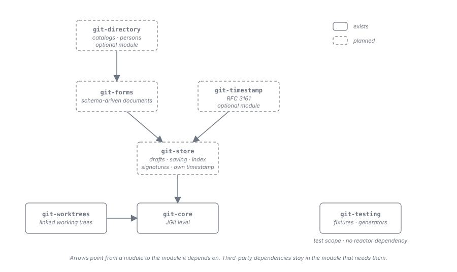

= Module Structure
:toc: left
:toclevels: 3
:toc-title: Table of Contents
:sectnums:
:source-highlighter: highlight.js

A persistence library that starts as one module tends to stay one module until a consumer complains about the
dependencies it drags along. This concept describes how the libraries of this repository are cut into modules
instead, why the cut was made before the first line of store code, and which modules form the generic JGit
foundation.

== The Problem

Three forces would split a single module later, at a higher price:

* *A shared foundation.* Hardened JGit code (remote policy, refusing file system, transport, cache repository) is
  needed by the document store and by other clients of Git repositories. A second copy in the document store would
  need every security fix twice.
* *Optional dependencies.* Encryption, timestamping and form rendering bring third-party libraries. In one module
  they become mandatory for every consumer, including one that only reads a repository.
* *Layering.* "The store must not know the forms" is a convention in one module. Module boundaries make it checkable;
  the build check that enforces it is planned (see xref:../specification/testing.adoc[Testing]).

One module to start would be simpler at first, but it leaves all three forces to a later split, when consumers
already depend on its shape. The cut below removes all three at once.

== The Repository and Its Modules

The repository `git-document-repository` is a multi-module Maven reactor under
the group `de.cuioss` with the parent `cui-java-parent`. Its modules are released together and consumed separately,
so every consumer takes only what it needs. The code is licensed under the Apache License 2.0.

[cols="1,3,1"]
|===
|Module |Content |State

|`git-core`
|Hardened repositories, remote policy, commit and reference identity, results, transport, reading, cache repository,
in-core writing, compare-and-swap, in-core merge, notes
|scaffold

|`git-worktrees`
|Linked working trees, commit from a working tree, working-tree status
|scaffold

|`git-testing`
|Generators and fixtures: local and in-memory repositories, a local remote
|scaffold

|`git-store`
|Drafts, saving, author and committer per save, index, outbox (xref:storage-engine.adoc[Storage Engine])
|planned

|`git-forms`
|Schema-driven documents: schema, template, workflow, deadlines, signature levels
(xref:schema-driven-documents.adoc[Schema-Driven Documents])
|planned

|`git-crypto` (optional)
|Encrypted keyring, erasure by key rotation (xref:data-protection.adoc[Data Protection])
|planned

|`git-signing` (optional)
|Commit signature, user claims, passkey approvals, signature check (xref:identity-and-signing.adoc[Identity and
Signing])
|planned

|`git-timestamp` (optional)
|RFC 3161 anchoring through the outbox (xref:evidence-and-companion-stores.adoc[Evidence and Companion Stores])
|planned

|`git-directory` (optional)
|Directory of persons, catalogs of roles, teams, systems, services and external parties
(xref:directory-and-catalogs.adoc[Directory and Catalogs])
|planned
|===

The first three modules are the extended JGit functionality with its helper classes. The others are the aspects of
the document store. An application with its kinds of documents and its user interface is not part of this
repository; its kinds of documents are configuration of `git-forms`.

=== Dependencies and Third-Party Isolation

`git-worktrees` depends on `git-core` alone. `git-store` builds on `git-core`; `git-forms`, `git-crypto`,
`git-signing` and `git-timestamp` build on `git-store`; `git-directory` builds on `git-forms` and `git-crypto`.
`git-testing` depends on no other module of the reactor; it declares JGit directly (planned), since its fixtures
create JGit repositories.

The optional modules plug into the modules below them through service interfaces that `git-store` defines and
`ServiceLoader` finds (JPMS `uses` and `provides`), so no module calls a module it does not depend on. These
interfaces are planned:

* `SignatureLevelVerifier` (the evidence of a signature level for a transition) and `CommitTrailerContributor` (the
  actor and approval trailers) are provided by `git-signing`. Without a provider only signature level 0 is accepted.
* `FieldEncryptor` (encrypting and decrypting a personal field with the data encryption key of the data subject) is
  provided by `git-crypto`; `git-forms` interprets the schema marker `x-personal` and calls it.
* `PseudonymResolver` (issuer and `sub` to pseudonym) is provided by `git-crypto`. Without `git-crypto` the
  application provides one, so `git-signing` and `git-store` get the pseudonym of the author in either case.
* `git-directory` saves at signature level 1 and therefore needs a `SignatureLevelVerifier` provider, that is
  `git-signing`, at run time. The static dependency graph above stays unchanged.
* `git-core` takes the push refspec and the names of the reserved notes references as configuration from the modules
  above it instead of hard-coding them.

No module knows a term of a domain. The modules above `git-core` carry their own third-party dependencies (a YAML
library, a JSON Schema validator and a template engine in `git-forms`, an envelope-encryption library in `git-crypto`,
a WebAuthn verification library in `git-signing`, a timestamp client in `git-timestamp`), so a consumer of `git-core`
alone pulls none of them. Every one of these dependencies, JGit
included, needs the owner's approval before it is added.

== The Foundation Modules

`git-core`, `git-worktrees` and `git-testing` form the foundation: generic Git functionality on JGit that carries no
term of a domain, so it serves the document store and every other client that works with Git repositories.

* *`git-core`* holds the file system that refuses hooks and process starts (`RefusingFS`), the remote policy
  (`RemotePolicy`: an HTTPS origin or local only, checked before every fetch and push), commit and reference identity
  (`GitIdentity`), the result type and the closed list of outcomes (`GitResult`, `GitOutcome`), and the repository
  operations: open and init, the log, fetch and push (with credentials and lease), and the cache repository (one commit
  fetched into a bare cache under a remote policy, a file read at that commit). For the document store it adds in-core
  writing, compare-and-swap with retry, in-core merge with conflict results per path, and `git notes`. `GitOutcome`
  stays one closed list, the worktree outcomes included: they are terms of Git, not of a domain, and one list keeps
  result handling uniform for every client.
* *`git-worktrees`* holds the linked working trees (administration files in git's own layout, readable by
  `git worktree list` and written natively, because JGit has no command that adds or removes a linked working tree;
  JGit 7.0 added read support only, checked in JGit 7.8.0): adding, listing and removing working trees, the commit
  from a working tree, and a working-tree status as a generic primitive (the path set of changed, untracked and deleted
  files), on which a client builds its own digest. The document store does not need this module; clients that work on
  files on disk do.
* *`git-testing`* holds the generator of transport credentials (`GitCredentialGenerator`, `GitGenerators`) and
  fixtures for local and in-memory repositories and a local remote.

Every module except `git-testing` is to work in a GraalVM native image and to ship the metadata it needs
(xref:../Requirements.adoc#GDR-NFR-4[GDR-NFR-4]), so a client with a native build can use it.

A shared foundation couples life cycles: a contract change wanted by a client is a release of this repository first.
The foundation is therefore released with real versions to Maven Central, stays small and stable, and carries no
domain term of any client.

The code of the foundation is taken over from its first client. The inventory of that code, the split of its tests
and the changes on the client's side are described in xref:../clients/pm-mcp-core.adoc[Client: `pm-mcp-core`].

== Order

. Fill `git-core`, `git-worktrees` and `git-testing` with the foundation code and its tests, with history; build and
  release a first version.
. Switch the first client over to the foundation (see xref:../clients/pm-mcp-core.adoc#_order_of_the_switch_over[Client:
  `pm-mcp-core`, Order of the Switch-Over]).
. Add the aspect modules as the document store needs them: `git-store` first, then `git-signing`, `git-crypto`,
  `git-timestamp`, `git-forms`, `git-directory`. They change nothing for the clients of the foundation.

== Open Questions

The open questions of taking the foundation code over are listed with its client in
xref:../clients/pm-mcp-core.adoc#_open_questions[Client: `pm-mcp-core`, Open Questions].

== Related

* xref:../adr/0004-The_libraries_are_one_reactor_of_separately_consumed_modules_with_optional_aspect_modules.adoc[ADR-0004]
  -- the module cut.
* xref:../adr/0005-The_JGit_foundation_is_a_library_of_its_own_shared_with_its_clients.adoc[ADR-0005] -- the
  shared foundation.
* xref:../clients/pm-mcp-core.adoc[Client: `pm-mcp-core`] -- the first client of the foundation.
* xref:../Requirements.adoc#requirements-general[General requirements] -- layering and dependency isolation as
  requirements.
