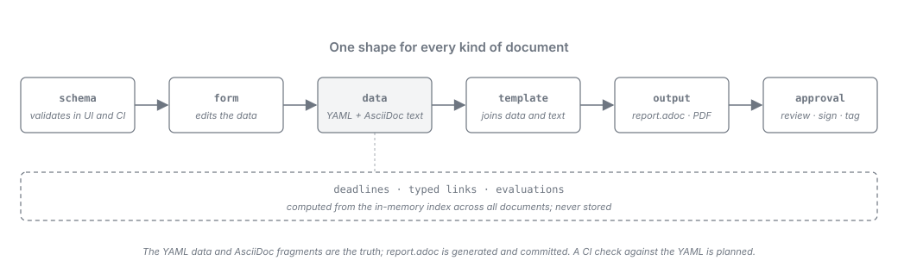
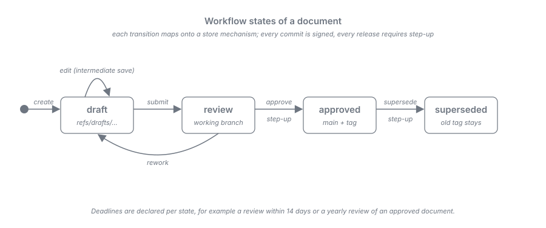

= Schema-Driven Documents
:toc: left
:toclevels: 3
:toc-title: Table of Contents
:sectnums:
:source-highlighter: highlight.js

Assessments, threat models, incident reports, policies, register entries and the entries of a person directory look
like different applications. Laid side by side they turn out to be one: a form, structured data with some free text, a
readable output, a review, an approval, a deadline, a few links. This concept describes the generic layer that
captures that shape, so that a new kind of document is configuration rather than code.

Statements marked _(unverified)_ come from general knowledge and were not checked against a current source.

== The Shape

A schema produces the form. The form produces data in YAML and free text in AsciiDoc. A template joins them into the
output. Review and approval freeze the result in Git. Deadlines, links and evaluations run across all of it.

A *kind of document* is then four pieces of configuration:

* a *schema*,
* a *template*,
* a *workflow*,
* a *repository* (from the registry, see xref:data-protection.adoc#_repositories_per_confidentiality_and_retention_class[Data Protection]).

Further kinds become cheap: exception approvals, supplier assessments and access reviews need no new code.

== Schema

A *JSON Schema* per kind of document produces the form and validates the data, in the user interface and in CI. The
same schema file serves both, so a document edited directly in the repository is held to the same rules as one edited
through the form.

== Data, Free Text and Generated Output

When a form produces AsciiDoc and someone edits that AsciiDoc by hand, the form can no longer load it cleanly. The
layer therefore separates truth from output:

----
<document>/
  document.yaml        ← structured fields (schema)
  narrative/*.adoc     ← free-text sections as AsciiDoc fragments
  report.adoc          ← generated: a template joins the YAML and the fragments
----

* *The structured data stay in YAML.* Free text may be AsciiDoc with tables and images.
* *AsciiDoc is the output, not the truth.* `report.adoc` is generated reproducibly and committed as readable evidence.
  A CI check that makes sure it matches the YAML is planned; no workflow implements it yet. PDF for external readers
  is generated from it as well.
* *Deterministic serialisation.* Fixed key order and stable formatting make diffs show real changes only.
* *One file per independently edited part.* A document that several people edit at once (one file per section,
  practice or entry) keeps concurrent saves free of conflicts (see xref:storage-engine.adoc[Storage Engine]).
* *Evidence as links, not files.* Links to a wiki, a ticket or a pipeline avoid large files and Git LFS.

== Template

A template per kind of document produces the AsciiDoc output. The template engine is not chosen yet.

== Workflow

A workflow names the *states* of a document -- draft, review, approved, superseded -- and maps the transitions onto
the mechanisms of the store:

[cols="1,3"]
|===
|Transition |Mechanism

|edit
|intermediate saves on the user's draft reference

|submit for review
|save onto the working branch; optionally open a pull or merge request

|approve
|merge into `main` and tag; approvals written as signed trailers, a passkey approval as a note

|supersede
|a later approved version of the same document; the old tag stays
|===

Per state the workflow declares:

* *deadlines* -- notification duties and review intervals, computed from the in-memory index;
* *the signature level* -- see xref:identity-and-signing.adoc#_graded_traceability[Identity and Signing].

Deadlines and reminders are computed, never stored: notifications are runtime state of the application, not
persistence.

== Links

Documents refer to each other by *typed references* across kinds and repositories: `service:payment-api`,
`register:risk/R-042`. The store checks on save that the target exists. A retired target stays resolvable, so old
documents keep their meaning.

== Running Numbers and Reporting Dates

* *Running numbers under concurrent creation.* A readable number such as `R-042` cannot be assigned by two creators
  at once. The file name is a ULID; the readable number is assigned on save through a counter file in the same commit,
  and the compare-and-swap makes it unique.
* *Reporting dates.* "The register as of the audit on 1 March" is a tag or the commit of that date; the index is built
  from that snapshot.

[CAUTION]
====
A schema decides what the form can express. A kind of document whose content does not fit structured fields with
free-text fragments -- a diagram editor, a spreadsheet -- gains nothing from this layer and is better linked than
modelled.
====

== Open Questions

. Choose the template engine for the AsciiDoc output.
. Decide the JSON Schema dialect and the form renderer it must support.

== Related

* xref:../adr/0011-Documents_are_schema-driven_YAML_data_with_AsciiDoc_fragments_and_generated_output.adoc[ADR-0011]
  -- the decision for this shape.
* xref:directory-and-catalogs.adoc[Directory and Catalogs] -- the directory is a schema-driven document itself.
* xref:../Requirements.adoc#requirements-git-forms[`git-forms` requirements] and
  xref:../specification/git-forms.adoc[`git-forms` specification].
