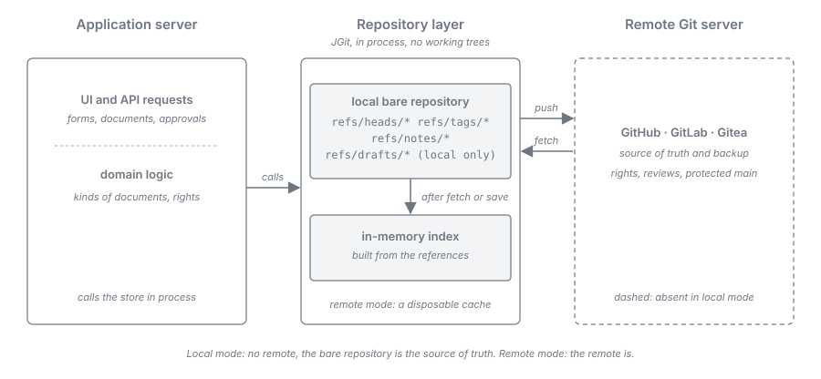

= The Storage Engine on Git
:toc: left
:toclevels: 3
:toc-title: Table of Contents
:sectnums:
:source-highlighter: highlight.js

Git is usually explained through a working tree: check out, edit files, commit. A server that keeps hundreds of
documents for dozens of users cannot afford one checked-out directory per user and document. This concept describes
how the store reads and writes documents in Git without any working tree: one API for local and remote repositories,
drafts and saving, multiple users, and the in-memory index.

Statements marked _(unverified)_ come from general knowledge and were not checked against a current source.

== Overview

The application server calls the repository layer in process. The layer holds a local bare repository and builds an
in-memory index from its references. In remote mode it synchronises with the remote Git server, which is the source
of truth and the backup.

== Two Modes, One API

* *Local*: there is no remote; the bare repository on the server's disk is the source of truth. The operator backs up
  the directory. JGit creates it; no `git` installation is needed.
* *Remote*: the remote repository is the source of truth; the local bare clone is a cache that can be deleted and
  cloned again. Saving adds a fetch and a push.

Both modes run the same code. The configuration says `remote: none` or names the remote. A remote can be added later
with one push of the local repository.

== No Working Trees

A Git branch is no working area; it is a *reference*, a pointer to a commit. Any number of references can exist for
any number of users at the same time. A working tree is a checked-out state on disk, and only one exists per branch.

`pm-provider-git` needs linked working trees because agents and build tools work on files on disk; JGit 7.0 added
read support for linked working trees, and writing them is not supported _(unverified for later versions)_. The
document store holds the content in memory anyway, so it writes blobs, trees and commits directly into the object
database and then moves the reference.

[source,java]
----
// Set data/section-a.yaml on the document branch to `content` (sketch, untested)
Ref ref = repo.exactRef("refs/heads/documents/" + id);
try (ObjectInserter ins = repo.newObjectInserter();
     ObjectReader reader = repo.newObjectReader();
     RevWalk walk = new RevWalk(reader)) {
    RevCommit parent = walk.parseCommit(ref.getObjectId());
    DirCache index = DirCache.read(reader, parent.getTree());     // in-core index, no files
    ObjectId blob = ins.insert(Constants.OBJ_BLOB, content);
    DirCacheEditor editor = index.editor();
    editor.add(new DirCacheEditor.PathEdit(path) {
        @Override public void apply(DirCacheEntry e) {
            e.setFileMode(FileMode.REGULAR_FILE);
            e.setObjectId(blob);
        }
    });
    editor.finish();
    CommitBuilder cb = new CommitBuilder();
    cb.setTreeId(index.writeTree(ins));
    cb.setParentId(parent);
    cb.setAuthor(userIdent);          // the pseudonym of the logged-in user
    cb.setCommitter(serviceIdent);    // the technical user
    cb.setMessage("Update " + path);  // plus the trailers of the user's claims
    ObjectId commit = ins.insert(cb); // signed by the application
    ins.flush();
    RefUpdate ru = repo.updateRef(ref.getName());
    ru.setExpectedOldObjectId(parent);   // compare-and-swap
    ru.setNewObjectId(commit);
    RefUpdate.Result result = ru.update(walk);   // LOCK_FAILURE: someone was faster, retry
}
----

The JGit calls in the sketch are not yet verified against the JGit version in use _(unverified)_. The author,
committer, trailers and signature are described in xref:identity-and-signing.adoc[Identity and Signing].

=== Compare-and-Swap

The last step carries multi-user operation. The reference moves only if it still points to the commit the change was
built on. Of two concurrent writers one wins. The other reloads and applies its *operation* ("set file X to content
Y") again on the new state: a rebase of one operation, without a textual merge.

== Two Levels of Saving

[cols="1,2,1,1"]
|===
|Level |What happens |Where it lives |Secured

|Intermediate save (automatic)
|Commit on `refs/drafts/<user>/<document>`
|The server's repository only
|No

|Save (explicit)
|Merge the draft in core into the document branch (optionally squashed), compare-and-swap; in remote mode fetch,
merge onto the remote state, push, retry on rejection; delete the draft reference
|Locally and remotely
|Yes, in remote mode
|===

image::../resources/diagrams/save-sequence.svg[Sequence of an explicit save: merge in core, compare-and-swap, fetch, push and retry on rejection, align=center]

Draft references are not pushed. The push refspec carries `refs/heads/*`, the tags and `refs/notes/*` (timestamps,
approvals), never `refs/drafts/*`. An organisation that wants drafts secured as well can push them to restricted
references of its own (see xref:evidence-and-companion-stores.adoc[Evidence and Companion Stores]). A user who logs in
again finds the drafts under `refs/drafts/<user>/` and continues.

Conditions:

* *Persistent storage.* The repository directory needs persistent storage, for example a persistent volume in a
  container platform. Without it every restart loses all unsaved drafts, not only a crash.
* *Instances.* With several application instances a draft lives on the instance that wrote it: run one instance, use
  sticky sessions, or share a volume. JGit's lock files keep the compare-and-swap safe on a shared volume.
* *Expiry.* Abandoned drafts expire after a configured period; a garbage collection removes their objects.
* *Real conflicts.* On a real conflict (the same field changed in parallel) nothing is pushed. The conflict is
  reported per path, and the draft is kept.

== When Others See a Change

Every document has one working branch (`refs/heads/<collection>/<id>`), shared by all its editors. The draft reference
of each user lies above it. The pair supports two ways of working:

image::../resources/diagrams/visibility-modes.svg[Two visibility modes: save often onto the shared branch, or keep changes private on the draft until submitted, align=center]

* *A: save often.* Every explicit save lands on the working branch at once, as a small commit with compare-and-swap.
  The draft only holds what is not yet saved. The client remembers the blob id it loaded, like an ETag, to detect a
  concurrent change of the same file. This suits documents filled in jointly, for example in a workshop.
* *B: private until submitted.* The user works on the draft for longer and saves once. Only then do the others see
  the changes, merged in core into the working branch.

*Release* is a merge of the working branch into `main` and a tag `<collection>/<id>`. Protected branches and tags of
the Git server make the release immutable. Optionally the release opens a pull or merge request whose review is the
four-eyes approval.

== Reading and Queries

At start and after every fetch the store reads `main` and the open working branches into an *in-memory index*. Even
hundreds of documents with about ninety fields each are a few megabytes. Dashboards, trends and evaluations are
computed from it. A periodic fetch or a webhook of the Git server refreshes it.

* *Reporting dates.* "The register as of the audit on 1 March" is a tag or the commit of that date; the index is built
  from that snapshot instead of from the tip.
* *Deadlines and reminders* are computed from the index. Notifications are runtime state of the application, not
  persistence.
* *A database is not needed.* If one is ever wanted, it is a disposable cache (embedded SQLite or H2), rebuilt from
  Git (see xref:../adr/0010-No_database_the_in-memory_index_is_derived_from_Git.adoc[ADR-0010]).

[CAUTION]
====
Compare-and-swap makes concurrent writers safe, not fast. Many writers on one branch produce retries, and every
instance's index is only as fresh as its last fetch. The store is built for documents maintained by few people over
days, not for a stream of transactions.
====

== Open Questions

. Prototype concurrent saves against one branch, measuring conflicts and retries.
. Verify the JGit API used in the sketch (`DirCache.read`, `DirCacheEditor`, in-core merge, `RefUpdate` results) and the
  `git notes` support (`NoteMap`) against the JGit version in use.
. Push and fetch with token credentials against GitHub, GitLab and Gitea; token lifetimes and refresh of the hosts
  _(unverified)_.

== Related

* xref:../adr/0001-Documents_are_written_in_core_without_working_trees_and_references_move_by_compare-and-swap.adoc[ADR-0001],
  xref:../adr/0002-Local_and_remote_mode_share_one_API_and_the_local_bare_clone_is_a_disposable_cache.adoc[ADR-0002],
  xref:../adr/0003-Drafts_are_per-user_references_that_are_never_pushed.adoc[ADR-0003] -- the decisions behind this
  concept.
* xref:schema-driven-documents.adoc[Schema-Driven Documents] -- how one file per field group keeps concurrent edits
  free of conflicts.
* xref:../Requirements.adoc#requirements-git-store[`git-store` requirements] and
  xref:../specification/git-store.adoc[`git-store` specification].

== Sources

* JGit: https://projects.eclipse.org/node/30057[JGit 7.0.0 release (read support for worktrees)],
  https://www.eclipse.org/lists/jgit-dev/msg02873.html[jgit-dev: commit without working tree through DirCache and ObjectInserter]
