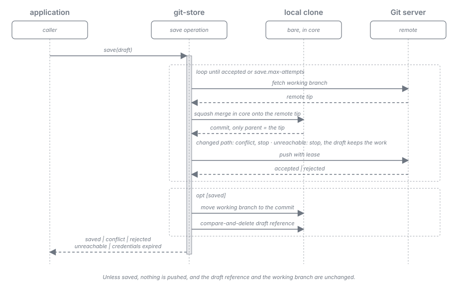
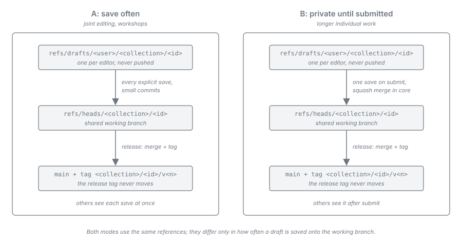

= The Storage Engine on Git
:toc: left
:toclevels: 3
:toc-title: Table of Contents
:sectnums:
:source-highlighter: highlight.js

Git is usually explained through a working tree: check out, edit files, commit. A server that keeps hundreds to a few
thousand documents for dozens of users cannot afford one checked-out directory per user and document. This concept
describes how the store reads and writes documents in Git without any working tree: one API for local and remote
repositories, drafts and saving, multiple users, and the in-memory index.

== Overview

image::../resources/diagrams/storage-engine-overview.svg["The application server writes through the in-process repository layer into a local bare repository that synchronises with the remote Git server",align=center]

The application server calls the repository layer in process. The layer holds a local bare repository and builds an
in-memory index from its references. In remote mode it synchronises with the remote Git server, which is the source
of truth and the backup.

== Two Modes, One API

* *Local*: there is no remote; the bare repository on the server's disk is the source of truth. The operator backs up
  the directory. JGit creates it; no `git` installation is needed.
* *Remote*: the remote repository is the source of truth; the local bare clone is a cache that can be deleted and
  cloned again. Deleting it loses the unsaved drafts, the outbox progress references, and the commits and notes not
  yet pushed (saves reported saved locally, kept pending commits), because none of them is on the remote; after a new
  clone the outbox walks the history again and skips the commits already processed, by commit hash. Saving adds a
  fetch and a push.

Both modes run the same code. The configuration says `remote: none` or names the remote. A remote can be added later
with one push of the local repository.

== No Working Trees

A Git branch is no working area; it is a *reference*, a pointer to a commit. Any number of references can exist for
any number of users at the same time. A working tree is a checked-out state on disk, and only one exists per branch.

Clients whose agents and build tools work on files on disk need linked working trees; JGit 7.0 added
read support for linked working trees; JGit 7.8.0 still has no command that creates one. The
document store holds the content in memory anyway, so it writes blobs, trees and commits directly into the object
database and then moves the reference.

[source,java]
----
// Set data/section-a.yaml on the working branch to `content` (sketch, untested)
Ref ref = repo.exactRef("refs/heads/" + collection + "/" + id);
try (ObjectInserter ins = repo.newObjectInserter();
     ObjectReader reader = repo.newObjectReader();
     RevWalk walk = new RevWalk(reader)) {
    RevCommit parent = walk.parseCommit(ref.getObjectId());
    DirCache index = DirCache.read(reader, parent.getTree());     // in-core index, no files
    ObjectId blob = ins.insert(Constants.OBJ_BLOB, content);
    DirCacheEditor editor = index.editor();
    editor.add(new DirCacheEditor.PathEdit(path) {
        @Override public void apply(DirCacheEntry e) {
            e.setFileMode(FileMode.REGULAR_FILE);
            e.setObjectId(blob);
        }
    });
    editor.finish();
    CommitBuilder cb = new CommitBuilder();
    cb.setTreeId(index.writeTree(ins));
    cb.setParentId(parent);
    cb.setAuthor(userIdent);          // the pseudonym of the logged-in user
    cb.setCommitter(serviceIdent);    // the technical user
    cb.setMessage("Update " + path);  // plus the trailers of the user's claims
    // the application signs the commit here, before the CommitBuilder is inserted
    ObjectId commit = ins.insert(cb);
    ins.flush();
    RefUpdate ru = repo.updateRef(ref.getName());
    ru.setExpectedOldObjectId(parent);   // compare-and-swap
    ru.setNewObjectId(commit);
    RefUpdate.Result result = ru.update(walk);   // LOCK_FAILURE: someone was faster, retry
}
----

Every class, method and constant of the sketch exists with the signature used in JGit 7.8.0, checked against the
jar and the sources of tag
link:https://github.com/eclipse-jgit/jgit/tree/v7.8.0.202609011348-r[`v7.8.0.202609011348-r`];
`content` is a `byte[]` (`ObjectInserter.insert(int, byte[])`). `DirCache.read(ObjectReader, AnyObjectId)` returns
"a new cache which has no backing store file"
(link:https://github.com/eclipse-jgit/jgit/blob/v7.8.0.202609011348-r/org.eclipse.jgit/src/org/eclipse/jgit/dircache/DirCache.java[`DirCache.java`]).
`RefUpdate.update(RevWalk)` takes the lock, reads the reference again and returns `LOCK_FAILURE` when it no longer
equals the expected old id
(link:https://github.com/eclipse-jgit/jgit/blob/v7.8.0.202609011348-r/org.eclipse.jgit/src/org/eclipse/jgit/lib/RefUpdate.java[`RefUpdate.updateImpl`]).
The sketch itself is not compiled or run. The author, committer, trailers and signature are described in
xref:identity-and-signing.adoc[Identity and Signing].

=== Compare-and-Swap

The last step carries multi-user operation. The reference moves only if it still points to the commit the change was
built on. Of two concurrent writers one wins. The other reloads and re-applies its *operation* ("set file X to
content Y") onto the new state, without a textual merge. Without a remembered blob id (`expectedBlobId`, see
<<_when_others_see_a_change>>) the re-applied edit overwrites a concurrent change to the same file; with it, the edit
fails with a conflict for that path.

== Two Levels of Saving

[cols="1,2,1,1"]
|===
|Level |What happens |Where it lives |Secured

|Intermediate save (automatic)
|Commit on `refs/drafts/<user>/<collection>/<id>`, where `<user>` is the pseudonym
|The server's repository only
|No

|Save (explicit)
|Apply the draft's changes onto the working-branch tip as one commit whose only parent is that tip (squash merge in
core), compare-and-swap; in remote mode fetch, replay pending commits onto the remote state, re-apply, push, re-apply
on rejection; if the remote cannot be reached, keep the commit locally as pending; delete the draft reference if no
newer draft commit arrived meanwhile
|The working branch; in remote mode also the remote repository
|Yes, in remote mode
|===

Draft references are not pushed. The push refspec carries `refs/heads/*`, the tags and `refs/notes/*` (anchor proofs,
approvals), never `refs/drafts/*`. The library never pushes drafts; an organisation that wants them secured backs up
the repository directory (see xref:evidence-and-companion-stores.adoc[Evidence and Companion Stores]). A user who logs
in again finds the drafts under `refs/drafts/<user>/` and continues.

Conditions:

* *Persistent storage.* The repository directory needs persistent storage, for example a persistent volume in a
  container platform. Without it every restart, not only a crash, loses all unsaved drafts.
* *Instances.* With several application instances a draft lives on the instance that wrote it: run one instance, use
  sticky sessions, or share a volume. In JGit 7.8.0 every reference update creates the lock file `<ref>.lock` and
  resolves the reference again after taking it; the per-JVM cache is reused only if the file's attributes are
  unchanged
  (link:https://github.com/eclipse-jgit/jgit/blob/v7.8.0.202609011348-r/org.eclipse.jgit/src/org/eclipse/jgit/internal/storage/file/RefDirectoryUpdate.java[`RefDirectoryUpdate.tryLock`]).
  The javadoc names `core.supportsAtomicCreateNewFile = false`, read from the user-level Git configuration, as the
  setting that creates the lock file atomically also on NFS, through a hard-link check; the default `true` calls
  `Files.createFile` only
  (link:https://github.com/eclipse-jgit/jgit/blob/v7.8.0.202609011348-r/org.eclipse.jgit/src/org/eclipse/jgit/util/FS_POSIX.java[`FS_POSIX.createNewFileAtomic`]).
  `core.trustLooseRefStat = AFTER_OPEN` refreshes the cached file attributes of a reference before it is read
  (link:https://github.com/eclipse-jgit/jgit/blob/v7.8.0.202609011348-r/org.eclipse.jgit/src/org/eclipse/jgit/lib/CoreConfig.java[`CoreConfig.TrustStat`]).
  Whether a given network volume honours these guarantees has to be tested before such a deployment (see
  <<_open_questions>>).
* *Expiry.* Abandoned drafts expire after a configured period; a garbage collection removes their objects.
* *Real conflicts.* A conflict is detected per path: the same file changed in parallel. Resolving it per field of
  the YAML structure is the task of `git-forms`. On a conflict nothing is pushed, the draft reference is kept unchanged
  and no commit of the save stays on the local working branch: on a remote conflict the store resets the local branch
  to the fetched remote tip, by a compare-and-swap that may move it backwards (a guarded reset).
* *Pending commits.* When the remote cannot be reached, a save stays on the local working branch as a pending commit
  and reports saved locally; the next successful push carries it. When the remote moved meanwhile, the next save
  replays the pending commits path by path onto the fetched remote tip before its own change. A pending commit that
  now conflicts is never dropped: the store keeps it under a reference that is never pushed and reports it on the
  next load of the document, so its user resolves it.

== When Others See a Change

Every document has one working branch (`refs/heads/<collection>/<id>`), shared by all its editors; the entries of a
numbered collection share one collection branch `refs/heads/<collection>` instead (see
xref:schema-driven-documents.adoc#_running_numbers_and_reporting_dates[Schema-Driven Documents]). The draft reference
of each user lies above it. The pair supports two ways of working:

* *A: save often.* Every explicit save lands on the working branch at once, as a small commit with compare-and-swap.
  The draft only holds what is not yet saved. The client remembers the blob id it loaded, like an ETag, to detect a
  concurrent change of the same file. This suits documents filled in jointly, for example in a workshop.
* *B: private until submitted.* The user works on the draft for longer and saves once. Only then do the others see
  the changes, merged in core into the working branch. Without a remembered blob id such a save overwrites a
  concurrent change of the same file.

*Release* is a merge of the working branch into `main` and a tag `<collection>/<id>/v<n>`, where `n` counts the
releases of the document; a later release of the same document gets the next number, and no release tag ever moves.
The release of an entry of a numbered collection merges that entry's path from the collection branch into `main`
(a path-level merge in core). In remote mode protected branches and tags of the Git server make the release
immutable; in local mode only the store's rule never to move or delete a release tag protects it, together with the
file system rights of the operator.
The store merges every release itself and pushes it as the technical user; `main` is protected so that only the
technical user may push to it. A four-eyes approval is a transition of the document's workflow, approved by a second
user in the application (see xref:schema-driven-documents.adoc[Schema-Driven Documents]).

== Reading and Queries

At start and after every fetch the store reads `main` and the open working branches into an *in-memory index*. Even
hundreds of documents with dozens of fields each are a few megabytes. Dashboards, trends and evaluations are computed
from it. Every save or release of the store updates it at once, in local and in remote mode; a periodic
fetch or a webhook of the Git server brings the changes of other instances and of the Git server itself.

* *Reporting dates.* "The register as of the audit on 1 March" is a tag or the commit of that date; the index is built
  from that snapshot instead of from the tip.
* *Deadlines and reminders* are computed from the index. Notifications are runtime state of the application, not
  persistence.
* *A database is not needed.* If one is ever wanted, it is a disposable cache (for example embedded SQLite, H2 or
  Lucene), rebuilt from Git (see xref:../adr/0010-No_database_the_in-memory_index_is_derived_from_Git.adoc[ADR-0010]).

[CAUTION]
====
Compare-and-swap makes concurrent writers safe, not fast. Many writers on one branch produce retries, and every
instance's index is only as fresh as its last fetch. The store is built for documents maintained by few people over
days, not for a stream of transactions.
====

== Open Questions

. Prototype concurrent saves against one branch, measuring conflicts and retries.
. Test the compare-and-swap of several JVMs on one shared network volume, with
  `core.supportsAtomicCreateNewFile = false` and `core.trustLooseRefStat = AFTER_OPEN`, before such a deployment.
. Push and fetch with token credentials against GitHub, GitLab and Gitea; determine the token lifetimes each host
  grants and how a token is refreshed.

== Related

* xref:../adr/0001-Documents_are_written_in_core_without_working_trees_and_references_move_by_compare-and-swap.adoc[ADR-0001],
  xref:../adr/0002-Local_and_remote_mode_share_one_API_and_the_local_bare_clone_is_a_disposable_cache.adoc[ADR-0002],
  xref:../adr/0003-Drafts_are_per-user_references_that_are_never_pushed.adoc[ADR-0003] -- the decisions behind this
  concept.
* xref:schema-driven-documents.adoc[Schema-Driven Documents] -- how one file per field group keeps concurrent edits
  free of conflicts.
* xref:../Requirements.adoc#requirements-git-store[`git-store` requirements] and
  xref:../specification/git-store.adoc[`git-store` specification].

== Sources

* JGit: https://projects.eclipse.org/node/30057[JGit 7.0.0 release (read support for worktrees)],
  https://www.eclipse.org/lists/jgit-dev/msg02873.html[jgit-dev: commit without working tree through DirCache and ObjectInserter]
