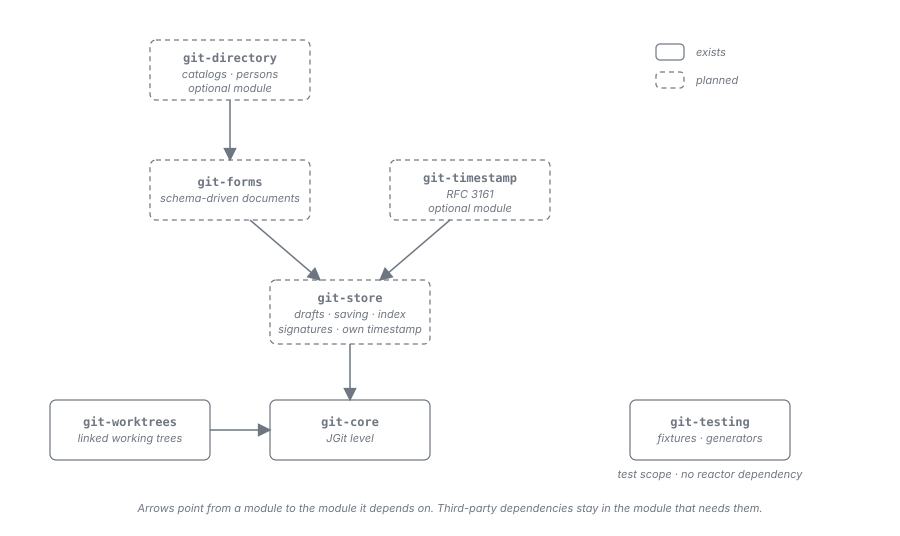

= git-document-repository: General Requirements
:toc: left
:toclevels: 2
:toc-title: Table of Contents
:source-highlighter: highlight.js

The requirements every module meets: layering, platform modules, results, logging, secrets, testing and the
non-functional limits. Rationale: xref:../concepts/module-structure.adoc[Module Structure]. Every requirement of the
libraries is planned: `git-core`, `git-worktrees` and `git-testing` are scaffolds, the other modules are not yet
created.

[#GDR-GEN-1]
== GDR-GEN-1: Module Layering and Dependency Isolation

* Once all planned modules exist, the reactor must consist of the modules `git-core`, `git-worktrees`, `git-testing`,
  `git-store`, `git-forms`, `git-timestamp` and `git-directory`, released together under one version.
* A module must depend only on the modules the dependency graph of the module structure allows; the build must fail
  when a module declares another dependency on a module of the reactor.
* A consumer that depends on `git-core` alone must receive no third-party dependency of the modules above it
  (verifiable with `mvn dependency:tree`).
* No public type of any module may carry a term of a domain (assessment, threat model, incident, risk register).

The reactor dependencies are the edges of the graph. The build rule that enforces them (Maven Enforcer rule or an
architecture test) is open; a test consumer project depending on `git-core` alone asserts that its resolved
dependency set holds no third-party artifact of the upper modules. No third-party dependency is added yet; each one
needs the owner's approval:

[cols="1,3"]
|===
|Module |Third-party dependencies (planned)

|`git-core` |JGit
|`git-worktrees` |none beyond those of `git-core`
|`git-testing` |JGit (declared directly, because `git-testing` depends on no module of the reactor),
`cui-test-generator`, JUnit 5
|`git-store` |possibly JGit's `org.eclipse.jgit.ssh.apache` for the SSH signature format (open)
|`git-forms` |a YAML library, a JSON Schema validator, a template engine (each open)
|`git-timestamp` |an RFC 3161 client library (open)
|`git-directory` |none beyond those of `git-forms`
|===

[#GDR-GEN-2]
== GDR-GEN-2: Java Platform Modules and Null Safety

* Every module must declare a `module-info.java` whose module name is `de.cuioss.git.document.<suffix>`; the
  automatic module name in the POM must repeat that name.
* Every package must be annotated `@NullMarked` (JSpecify); a value that may be absent must be typed `@Nullable`.
* The modules must compile with target Java 21 and their tests must pass on Java 21 and Java 25.

The suffixes are `core`, `worktrees`, `testing`, `store`, `forms`, `timestamp` and `directory`. An `exports`
directive is added together with the first public class of a package. `org.jspecify` is `requires static`.

[#GDR-GEN-3]
== GDR-GEN-3: Results Instead of Exceptions

* Every operation whose expected outcomes include a non-success must return a result carrying one value of a closed
  list of outcomes; an expected non-success must not be signalled by an exception.
* A result must carry a detail text for every non-success outcome; the detail must not contain anything
  <<GDR-NFR-3>> forbids.

`GitResult` carries `outcome` (one value of `GitOutcome`, never null), `value` (`@Nullable`, present only for a
success that yields a value) and `detail` (`@Nullable`, present for every non-success). `GitOutcome` is one closed
list in `git-core` for all modules, the worktree outcomes included:

[cols="1,2"]
|===
|Outcome |Raised by

|success |every operation; reported by the store as saved
|conflict |compare-and-swap after the last attempt, merge, save, concurrent change detection
|rejected |push refused by the remote; reference update refused locally; save after the last attempt
|lease refused |push with lease (`git-core`); the store retries and reports rejected after the last attempt
|unreachable |fetch or push when the remote cannot be reached; the save keeps the draft
|credentials expired or invalid |fetch, push, save
|refused by policy |remote policy, refused capability (hook or process start)
|not found |reading, cache repository, in-core writing on a missing reference, pseudonym lookup
|unserved |cache repository
|ambiguous |identity resolution
|invalid |schema validation, typed links, a person field without a known pseudonym (`git-forms`)
|mismatch |check of the generated output (`git-forms`)
|transition refused, step-up required |workflow (`git-forms`)
|entry required |first login (`git-directory`)
|not supported, managed by source |a person directory whose source the operator maintains: saving an entry, erasing a
pseudonym
|incomplete |release whose tag is still missing after `main` moved (`git-store`)
|unavailable, refused |obtaining an anchor proof: the provider is unreachable, or `signed` refuses because its clock is
behind; the subject stays pending
|no proof, imprint mismatch, signature invalid, chain broken |anchor and signature verification; a valid proof is
success with the time it establishes
|===

Exceptions remain for programming errors (violated preconditions) and unexpected I/O failures; they are never used
for the outcomes above.

[#GDR-GEN-4]
== GDR-GEN-4: Logging

* Every module must log through `CuiLogger` with a `LogRecord` holder per module.
* Every message at level INFO, WARN or ERROR must carry a stable identifier that is documented with the module.
* No log message may contain anything <<GDR-NFR-3>> forbids.

A module prefix makes identifiers unique across the reactor; identifiers follow the CUI `LogRecord` ranges per level,
and each module documents its messages in a log-message catalogue beside its code. Debug and trace messages use
`CuiLogger` directly, without identifiers.

[#GDR-NFR-1]
== GDR-NFR-1: Index Footprint

* The in-memory index of 500 documents with 90 fields each must retain less than 16 MB of heap.

A test generates the documents into an in-memory repository, builds the index and measures the retained size of the
index object graph. The measuring tool is open; a tool that adds a dependency needs the owner's approval.

[#GDR-NFR-2]
== GDR-NFR-2: Concurrent Writers

* With a configured number of attempts of at least ten, ten writers saving different files of one working branch
  concurrently must all succeed, with retries only.
* Two writers saving the same file, each with the blob id it loaded (xref:git-store.adoc#GDR-STORE-5[GDR-STORE-5]),
  must yield exactly one saved result and one conflict result.

The test runs the writers as threads against a local remote of `git-testing`.

[#GDR-NFR-3]
== GDR-NFR-3: Secrets

* No token, password, private or secret key material, session id, `sub`, e-mail address or person name may appear in
  a result detail, an exception message, a log message or the metadata of a commit (author, committer, message,
  trailers); the person entry of the `git` directory is the one file that holds a name.
* Public keys (commit-signing and anchor keys) are no secrets and may be stored.

[cols="1,2"]
|===
|Material |Rule

|access tokens, passwords, the technical user's credential, `timestamp.credentials` |accepted as call parameters or
read from the application's configuration for the call; never stored, logged, committed or put into a detail
|signing and anchor keys |held by the key source or in memory; never written in clear text
|`sub`, e-mail address, person name |`sub` only as the subject hash of the person entry; the name only in the person
entry; never in the metadata of a commit (author, committer, message, trailers), a document or a log
|===

Tests assert the rules with a JUL log capture (`cui-test-juli-logger`) and with checks of result details.

[#GDR-NFR-4]
== GDR-NFR-4: Native Image

* Every module except `git-testing` must work in a GraalVM native image; reflection and resource metadata the module
  needs must ship in `META-INF/native-image`.

The metadata lies under `META-INF/native-image/de.cuioss/<artifactId>/`. The native verification runs in a consuming
application's native build; a native test lane in this repository is open.

[#test-approach]
== Test Approach

* JUnit 5, test data from `cui-test-generator`, test doubles with EasyMock.
* Every module tests against the fixtures of xref:git-testing.adoc[`git-testing`]: in-memory repositories for logic,
  local repositories and a local remote for transport, fetch and push. No test needs network access.
* Build: `./mvnw clean verify`; CI runs on Java 21 and 25.
