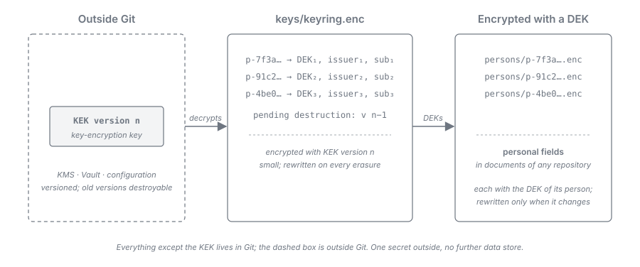
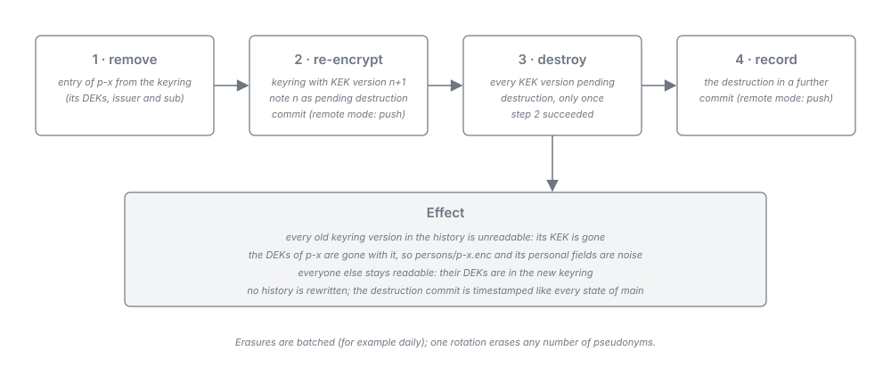

= git-document-repository: `git-crypto`
:toc: left
:toclevels: 3
:toc-title: Table of Contents
:sectnums:
:source-highlighter: highlight.js

xref:../Specification.adoc[Back to Main Specification]

== Overview

_See Requirement link:../Requirements.adoc#GDR-GEN-1[GDR-GEN-1: Module Layering and Dependency Isolation]_

*Status:* PLANNED

`git-crypto` (module `de.cuioss.git.document.crypto`, not yet created, optional) holds the encrypted keyring, the
pseudonyms and the erasure by key rotation. It depends on `git-store`. The envelope-encryption library is open
(candidate: Google Tink _(unverified)_) and needs the owner's approval. Rationale:
xref:../concepts/data-protection.adoc[Data Protection].

== Envelope Encryption

_See Requirement link:../Requirements.adoc#GDR-CRYPTO-1[GDR-CRYPTO-1: Envelope Encryption]_

*Status:* PLANNED

[cols="1,3"]
|===
|File (repository of the directory) |Content

|`keys/keyring.enc` |envelope over the map pseudonym → { DEK, issuer, `sub` } and the list of KEK versions pending
destruction, encrypted with KEK version n
|`persons/<pseudonym>.enc` |envelope over the person entry, encrypted with the person's DEK
|===

Envelope format (all integers big-endian):

[cols="1,1,2"]
|===
|Field |Size |Content

|`format` |1 byte |`1`
|`key-version` |4 bytes |KEK version for the keyring; `0` for DEK-encrypted envelopes
|`nonce` |12 bytes |random per encryption
|`ciphertext` |rest |AES-256-GCM output including the 16-byte tag
|===

Key source interface:

[cols="1,3"]
|===
|Operation |Contract

|`current()` |the current KEK version and its key handle
|`get(version)` |the key handle of a version; absent when destroyed
|`rotate()` |create version n+1 and make it current
|`destroy(version)` |destroy a version irrevocably; returns the outcome of the key source
|===

Implementations: KMS, Vault transit, configuration value (rotation and destruction manual). The KEK never leaves the
key source when the source supports remote encryption; otherwise it lives in memory only.

== Cryptographic Primitives

_See Requirement link:../Requirements.adoc#GDR-CRYPTO-2[GDR-CRYPTO-2: Cryptographic Primitives]_

*Status:* PLANNED

* Cipher: AES-256-GCM, 96-bit random nonce from a `SecureRandom`, 128-bit tag.
* Associated data: UTF-8 of `<repository-path>` + `\n` + `<key-version>`.
* A decryption failure returns the undecryptable outcome; it never returns partial plaintext.

== Pseudonyms

_See Requirement link:../Requirements.adoc#GDR-CRYPTO-3[GDR-CRYPTO-3: Pseudonyms]_

*Status:* PLANNED

* Format: `p-` followed by 12 lowercase hex characters from a `SecureRandom`; collisions are re-drawn.
* The key of a keyring entry is the pair (issuer, `sub`); `sub` values of different issuers never collide.
* `pseudonymFor(issuer, sub)` creates a pseudonym and a DEK when none exists (keyring save by compare-and-swap).
* `subjectOf(pseudonym)` returns (issuer, `sub`); `pseudonymOf(issuer, sub)` reads the in-memory keyring.

== Erasure by Key Rotation

_See Requirement link:../Requirements.adoc#GDR-CRYPTO-4[GDR-CRYPTO-4: Erasure by Key Rotation]_

*Status:* PLANNED

. Collect the pending erasures (batch).
. Remove their entries from the in-memory keyring.
. `rotate()` the key source; encrypt the keyring with version n+1. Its list of versions pending destruction holds every
  version older than n+1 for which `get(v)` still returns a key.
. Commit `keys/keyring.enc` with the rotation message (next section); in remote mode push it.
. Only after step 4 succeeded: `destroy(v)` for every version `v` pending destruction.
. For every destroyed version: remove it from the pending list and commit the keyring with the destruction message
  (next section); in remote mode push it.

Failure handling:

* Step 4 fails: the erasure is incomplete, nothing is destroyed, and the published keyring stays at version n with the
  erased entries. Version n+1 encrypts nothing in Git. The next run repeats the erasure with version n+2; by the rule
  of step 3 its pending list holds n and n+1.
* Step 5 fails: the outcome names the version still to destroy; the erasure counts as incomplete. The pending list in
  the published keyring keeps the version, so the next erasure run or the next start retries the destruction.
* Step 6 fails: the version is destroyed but not yet recorded; the next run finds it absent at the key source
  (`get(v)` empty) and writes the destruction message then.

Other instances: an instance reloads `keys/keyring.enc` whenever a fetch or a reference update changes it, and drops
the DEKs of entries that are gone before it serves the next decryption. In remote mode an erasure therefore takes
effect in every instance at the latest at its next fetch.

== Evidence of Erasure

_See Requirement link:../Requirements.adoc#GDR-CRYPTO-5[GDR-CRYPTO-5: Evidence of Erasure]_

*Status:* PLANNED

Rotation commit (step 4):

----
Rotate keyring to KEK v8

Kek-Pending-Destruction: 7
Erased: p-3f9a0c11b2d4, p-77e01a9c4f20
----

Destruction commit (step 6), written only after `destroy(7)` succeeded:

----
Record destruction of KEK v7

Kek-Destroyed: 7
----

No key material appears in either commit; no commit records a destruction that has not succeeded. The commit is anchored like every state of `main` by `git-timestamp`.

== Personal Fields in Documents

_See Requirement link:../Requirements.adoc#GDR-CRYPTO-6[GDR-CRYPTO-6: Personal Fields in Documents]_

*Status:* PLANNED

A schema field marked `"x-personal": "<pseudonym-field>"` is stored as a base64 envelope encrypted with the DEK of the
pseudonym named by the referenced field. After erasure of that pseudonym the field reads as the undecryptable outcome.

== Keyring at Run Time

_See Requirement link:../Requirements.adoc#GDR-CRYPTO-7[GDR-CRYPTO-7: Keyring at Run Time]_

*Status:* PLANNED

At start the module reads `keys/keyring.enc`, takes `key-version` from the envelope and decrypts with
`get(key-version)`. A missing version or a failed decryption stops the start with an outcome naming the expected
version. The decrypted keyring stays in memory; it is never written in clear text. When the keyring carries versions
pending destruction, the start retries their destruction (Erasure by Key Rotation, step 5). A changed
`keys/keyring.enc` after a fetch or a reference update is reloaded as described there.
