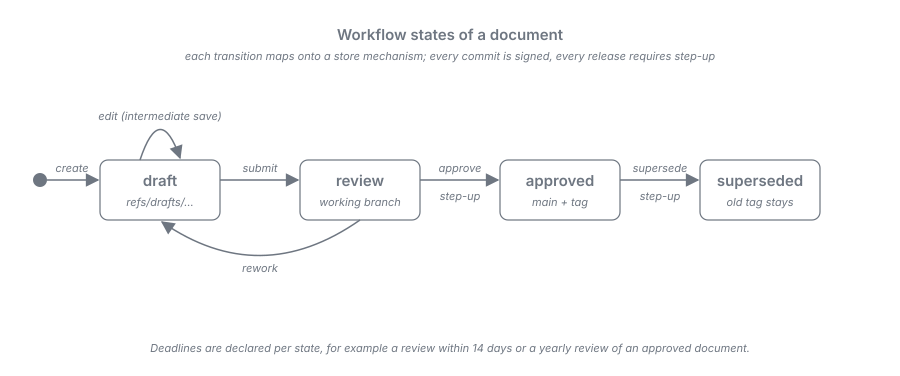

= git-document-repository: `git-forms`
:toc: left
:toclevels: 2
:toc-title: Table of Contents
:source-highlighter: highlight.js

`git-forms` (module `de.cuioss.git.document.forms`, one package of the same name) is the layer of schema-driven
documents on top of `git-store`, on which alone it depends. It holds so far its closed outcome list `FormsOutcome`, its
result `FormsResult` and its log messages (xref:general.adoc#GDR-GEN-3[GDR-GEN-3],
xref:general.adoc#GDR-GEN-4[GDR-GEN-4]); of the requirements below, <<GDR-FORMS-1>>, <<GDR-FORMS-2>> and
<<GDR-FORMS-3>> are implemented and the others are planned. Rationale:
xref:../concepts/schema-driven-documents.adoc[Schema-Driven Documents].

Its two libraries are decided; the owner approved both on 2026-11-21:

* The YAML library is `org.snakeyaml:snakeyaml-engine`, checked at version 3.2. Its POM declares test-scope
  dependencies only, so it adds nothing to the compile or runtime closure
  (link:https://repo1.maven.org/maven2/org/snakeyaml/snakeyaml-engine/3.2/snakeyaml-engine-3.2.pom[snakeyaml-engine 3.2
  POM]). Its jar holds a `module-info.class` of the module `org.snakeyaml.engine`, which requires `java.base` only, and
  no `META-INF/native-image/` entry
  (link:https://repo1.maven.org/maven2/org/snakeyaml/snakeyaml-engine/3.2/snakeyaml-engine-3.2.jar[snakeyaml-engine 3.2
  jar]).
* The JSON Schema validator is `dev.harrel:json-schema`, checked at version 1.9.1. Its POM declares no compile
  dependency. Every runtime dependency it declares (the JSON providers Jackson, Gson, `org.json`, kotlinx
  serialization, Jakarta JSON, Jettison, json-smart and SnakeYAML, and `jmail` for the format `email`) is `optional`,
  and Maven does not pass an optional dependency on to a consumer
  (link:https://repo1.maven.org/maven2/dev/harrel/json-schema/1.9.1/json-schema-1.9.1.pom[json-schema 1.9.1 POM];
  link:https://maven.apache.org/guides/introduction/introduction-to-optional-and-excludes-dependencies.html[Maven,
  Optional Dependencies]). The JSON data reaches the validator through its public interfaces `JsonNodeFactory` and
  `JsonNode`, which a caller can implement over its own data model
  (link:https://github.com/harrel56/json-schema/blob/1.9.1/lib/src/main/java/dev/harrel/jsonschema/JsonNodeFactory.java[json-schema
  1.9.1, `JsonNodeFactory`]), so no further artifact is needed. Its jar has no `module-info.class`; its manifest
  names the automatic module `dev.harrel.jsonschema`
  (link:https://github.com/harrel56/json-schema/blob/1.9.1/lib/build.gradle[json-schema 1.9.1, `lib/build.gradle`]).
  The jar holds no `META-INF/native-image/` entry, but it does hold resources: its message bundle
  `dev/harrel/jsonschema/messages.properties` and its bundled meta-schemas
  (link:https://repo1.maven.org/maven2/dev/harrel/json-schema/1.9.1/json-schema-1.9.1.jar[json-schema 1.9.1 jar]).

The template engine is still open and needs the owner's approval.

[#GDR-FORMS-1]
== GDR-FORMS-1: Kinds of Documents as Configuration

* A kind of document must be defined by configuration only: a JSON Schema, a template (required for a per-document
  kind, optional for a numbered kind), a workflow and a repository alias.
* Adding a kind of document must require no code change in any module.

[source,yaml]
----
kinds:
  - id: assessment                   # kind id, used in links: <alias>:assessment/<id>
    repository: register             # alias from the repository registry
    collection: assessments          # per-document: working branches refs/heads/assessments/<id>
    schema: schemas/assessment.schema.json
    template: templates/assessment.adoc.tpl
    workflow: workflows/approval.yaml
  - id: risk                         # links: register:risk/R-042
    repository: register
    collection: risks                # numbered: one collection branch refs/heads/risks
    schema: schemas/risk.schema.json
    workflow: workflows/approval.yaml
    numbering: { prefix: R-, digits: 3 }   # optional, see GDR-FORMS-9
----

A kind with `numbering` is a numbered collection, a kind without it a per-document collection (see
xref:git-store.adoc#GDR-STORE-2[GDR-STORE-2]). The configuration files live in a configuration repository or directory
chosen by the application.

`KindConfiguration` loads the kinds from the file `kinds.yaml` at the root of a configuration directory
(`fromDirectory`) or of a commit of a configuration repository (`fromRepository`, which resolves the revision with
`RepositoryReader.snapshot` of `git-core` and reads the blob through the repository's JGit `ObjectReader`); both
return a `FormsResult` with the kinds in configuration order and `find(id)`. The file holds the one key `kinds`, a list
of kinds with the keys of the example:

* `id`, `repository`, `collection`, `schema` and `workflow` are required, each a string that is not blank; `id` and
  `collection` must match `[a-z0-9-]+`, `id` must be unique, and `repository` must be an alias of the repository
  registry of `git-store`.
* `template` is required for a per-document kind and optional for a numbered kind.
* `numbering` holds `prefix`, a string that may be empty (numbers without a prefix), and `digits`, an integer of at
  least 1.
* `schema`, `template` and `workflow` are repository-relative references; loading the kinds does not read them.

The file is read as YAML within the JSON data model (ADR-0008) by the package-private `YamlReader`, built on
`org.snakeyaml:snakeyaml-engine` 3.2: plain scalars resolve by the YAML 1.2 core schema, and an anchor, an alias, an
explicit tag, a key that is not a string, a duplicate key, an infinite number or not-a-number and more than one document
are refused. Every refusal is the outcome `MALFORMED` of `git-store`, passed on: a key that is missing or unknown, a
value of the wrong type or form, a duplicate id, an unknown alias, a per-document kind without `template`, or text the
reader refuses. The detail names the file and the key path, positions counted from 0 (`kinds.yaml: kinds[1].template:
missing key, required for a per-document kind`), or the line and column of the text, never a configured value. A
missing file is `MALFORMED` as well; an I/O failure is the passed-on `FAILED` of `git-core`, naming the exception class
only. A successful load is logged as `GIT_FORMS-1` (`git-forms/doc/LogMessages.adoc`).

[#GDR-FORMS-2]
== GDR-FORMS-2: Schema Validation

* Data must be validated against the JSON Schema of its kind before every save, the keyword `required` excepted, so
  that a document with mandatory fields missing can be saved.
* A validation failure must be reported per field path (JSON Pointer,
  link:https://www.rfc-editor.org/rfc/rfc6901[RFC 6901], and message) and must prevent the save.
* A transition that leaves the workflow's first state, and every transition with the mechanism `release`, must also
  check `required` and be refused with the outcome mandatory fields missing, naming the JSON Pointers of the missing
  fields.
* The schema file must be plain JSON Schema, usable unchanged by a validator outside the library that supports its
  dialect; link targets (<<GDR-FORMS-8>>) only the library checks.

The dialect is JSON Schema Draft 2020-12 with the `$schema` URI `https://json-schema.org/draft/2020-12/schema`
(link:https://json-schema.org/draft/2020-12[JSON Schema, Draft 2020-12]). Apart from the person entries of the `git` person directory
(xref:git-directory.adoc#GDR-DIR-2[GDR-DIR-2]), the one kind that holds a name
(xref:general.adoc#GDR-NFR-3[GDR-NFR-3]), documents hold no personal data beyond pseudonyms and have no encrypted
field type: a field that names a person holds a pseudonym (`p-…`), resolved for display through the `PersonDirectory`
of `git-store`.

`FormSchema.parse` reads the schema file of a kind as JSON within the JSON data model of ADR-0008 (through the
`YamlReader` of <<GDR-FORMS-1>>). `$schema` must be absent or the URI of Draft 2020-12; a `$ref` or `$dynamicRef` must
select a schema resource of the same file, otherwise the schema is refused with the reason
`$ref: a reference outside the schema file` (or `$dynamicRef: …`), and its fragment must select an object or boolean
schema within that resource, otherwise the reason is `$ref: a reference that selects no schema of the file` (for
`#/$defs/missing`, a pointer to a string or an anchor no schema declares). An array index in a JSON Pointer selects an
item only in the canonical form of RFC 6901, section 4, `0` or a digit from 1 to 9 followed by digits, because
`dev.harrel:json-schema` 1.9.1 registers every sub-schema under its exact pointer
(link:https://github.com/harrel56/json-schema/blob/1.9.1/lib/src/main/java/dev/harrel/jsonschema/SchemaRegistry.java[json-schema
1.9.1, `SchemaRegistry`]): `#/allOf/0` is accepted, `#/allOf/00` or `#/allOf/-0` selects no schema of the file and is
refused with that reason. A reference must not select an object inside the value of `const`, `enum`, `default` or
`examples` of a schema (`{"$ref": "#/$defs/h/const", "$defs": {"h": {"const": {}}}}`), otherwise the reason is
`$ref: a reference into the value of const, enum, default or examples`: the object would become a schema whose
`required` `validate` removes, so validation would compare the data with a literal other than the one written; values
under these keywords are therefore never rewritten. A fragment must not hold a `+`, otherwise
the reason is `$ref: a fragment with a plus sign, which the validator decodes as a space`: `dev.harrel:json-schema`
1.9.1 decodes a fragment with `java.net.URLDecoder`, which form-decodes `+` to a space, unlike the percent-decoding of
RFC 3986 that RFC 6901 relies on
(link:https://github.com/harrel56/json-schema/blob/1.9.1/lib/src/main/java/dev/harrel/jsonschema/UriUtil.java[json-schema
1.9.1, `UriUtil`]); `git-forms` decodes the same way, so that both follow the same target, and refuses the one case in
which that target differs from the standard one. A `+` encoded as `%2B` is accepted and stays a `+`. These rules, and those on `required` below,
hold for every schema of the file a validator may apply: the root, every sub-schema, and every object a `$ref` or
`$dynamicRef` selects, wherever it sits, also under a keyword the dialect does not define (`{"$ref": "#/x-contact",
"x-contact": {"required": ["name"]}}`). A schema whose references apply a schema to the
same value again without descending into a child value, for example `{"allOf": [{"$ref": "#"}]}`, is refused with the
reason `a reference cycle that returns to the same value without descending into a child value`, because evaluating it
never ends: `dev.harrel:json-schema` 1.9.1 resolves the reference and validates the same value again without a repeat
check
(link:https://github.com/harrel56/json-schema/blob/1.9.1/lib/src/main/java/dev/harrel/jsonschema/Applicators.java[json-schema
1.9.1, `RefEvaluator` and `DynamicRefEvaluator` in `Applicators`]). The edges of such a cycle lead from a schema to the schemas Draft
2020-12 applies to the same value: the members of `allOf`, `anyOf` and `oneOf`, the sub-schemas of `not`, `if`, `then`
and `else`, the schemas of `dependentSchemas`, and the targets of `$ref` and `$dynamicRef`. A `$dynamicRef` has further
edges: `dev.harrel:json-schema` 1.9.1 first looks the reference up statically, by a JSON Pointer or an `$anchor` of its
target resource (a `$dynamicAnchor` is registered for the dynamic lookup only), and when that finds nothing takes the
first resource being evaluated, outermost first, that declares a `$dynamicAnchor` of the name in the fragment,
whatever resource the reference names
(link:https://github.com/harrel56/json-schema/blob/1.9.1/lib/src/main/java/dev/harrel/jsonschema/EvaluationContext.java[json-schema
1.9.1, `EvaluationContext.resolveDynamicSchema`] and
link:https://github.com/harrel56/json-schema/blob/1.9.1/lib/src/main/java/dev/harrel/jsonschema/SchemaRegistry.java[`SchemaRegistry`]).
It can therefore return to an outer schema that its static target does not show: in
`{"$id": "https://example.invalid/a", "$dynamicAnchor": "node", "$ref": "b", "$defs": {"b": {"$id": "b",
"$dynamicRef": "c#node"}, "c": {"$id": "c", "$dynamicAnchor": "node"}}}` the static targets lead from `a` to `b` to
`c`, but the validator binds the `$dynamicRef` to `a`. As the scope depends on the data, a `$dynamicRef` whose fragment
is a name has an edge to every schema object of the file that declares a `$dynamicAnchor` of that name, an
over-approximation that finds every cycle some scope could produce, so that schema is refused. A keyword that descends
into a child value (`properties`, `items`, `unevaluatedProperties` and the others) is no edge, so a recursive schema such
as a tree of items that reference `#`, or whose items bind a `$dynamicRef` to the root by its `$dynamicAnchor`, stays
valid. The check starts from every schema of the file, those under `$defs`
included, so a cycle that is declared but never referenced is refused as well, and it runs before the other checks of
the sub-schemas and before the validator sees the schema. `required` must be an array of unique strings, in the schema and every sub-schema,
because the validator evaluates the schema without it and so never checks its form. `required` must not occur in a
sub-schema of `oneOf`, `anyOf`, `not`, `if`, `then`, `else` or `contains`, nor in a schema such a sub-schema references
within the file: these keywords decide between alternatives or conditions, and removing `required` for `validate` would
change which alternative or condition holds, so a schema that puts it there is refused with the reason
`required: not allowed under <keyword>, where it cannot be deferred`. A definition under `$defs` counts only where it is
referenced. The schema is checked by `dev.harrel:json-schema` 1.9.1 against the meta-schema of the
dialect, which the jar holds as the resource `draft2020-12.json`
(link:https://github.com/harrel56/json-schema/blob/1.9.1/lib/src/main/java/dev/harrel/jsonschema/SpecificationVersion.java[json-schema
1.9.1, `SpecificationVersion`]). A schema the library does not accept is the outcome `MALFORMED` of `git-store`, passed
on, its detail naming the schema file and the problem, never content of the schema.

The data reaches the validator through the library's public interfaces `JsonNodeFactory` and `JsonNode`, implemented by
the package-private `DataNode` over the JSON data model, so none of the optional JSON providers of the library is used.
`DataNode` checks the whole data against the data model before validation, every nested value included, and refuses a
value outside it (a `Double`, for example) with an `IllegalArgumentException` that names the class, never the value. A
number without fraction (`1.00`, or a `BigDecimal` with a negative scale) is an integer if it has at most 1,000 digits;
a longer one, a `BigInteger` included, is of the type `number`, so the keyword `"type": "integer"` refuses it. The limit
exists because the validator compares two integers by their full expansion (`JsonNode.asInteger`): `1e2147483647`,
which `YamlReader` accepts, would otherwise be expanded to more than two thousand million digits. `DataNode` holds every
number in a canonical form, the unscaled value stripped of its trailing zeros as far as the scale stays within the range
of `int`, and compares numbers by that form, so equal values are equal whatever their notation (`10`, `1e1` and `10.0`;
`100e2147483647` and `10e2147483648`) and no number is expanded by its exponent. The validator compares the values of
`const`, `enum` and `uniqueItems` through `asInteger` and `asNumber` of the node, because `DataNode` is not one of its
own node types, and `minimum`, `maximum` and their exclusive forms by `BigDecimal.compareTo`
(link:https://github.com/harrel56/json-schema/blob/1.9.1/lib/src/main/java/dev/harrel/jsonschema/JsonNodeUtil.java[json-schema
1.9.1, `JsonNodeUtil`];
link:https://github.com/harrel56/json-schema/blob/1.9.1/lib/src/main/java/dev/harrel/jsonschema/Evaluators.java[json-schema
1.9.1, `Evaluators`]). Only `multipleOf` is left to the library: it computes `BigDecimal.remainder`, whose working
precision grows with the difference of the exponents, so data with a large exponent under `multipleOf` can stall the
validation, and no node can prevent that. The library then compares the remainder, converted to `double`, with zero
(`remainder(factor).doubleValue() == 0` in `MultipleOfEvaluator`,
link:https://github.com/harrel56/json-schema/blob/1.9.1/lib/src/main/java/dev/harrel/jsonschema/Evaluators.java[json-schema
1.9.1, `Evaluators`]); a remainder of a magnitude below the smallest positive `double` (about `4.9e-324`; below about `1e-308` it already
loses precision) underflows to zero, so `multipleOf` accepts such
a number, `1e-400` under `"multipleOf": 1` for example. `git-forms` accepts this gap of the library and adds no check of
its own.
`SchemaValidator.validate` evaluates the schema with every keyword `required` removed, in the schema, every
sub-schema (`contentSchema` included) and every schema a reference selects, also under an unknown keyword, so that the
example `x-contact` above validates `{}` as `Valid` while `required` reports `/name`; a key named `required` in any other
object, the value of `const` for example, is data and stays. It returns a `ValidationResult`: `Valid`, or `Invalid` with every `Violation` (JSON Pointer and message).
`SchemaValidator.required` checks `required` alone and applies the sub-schemas as Draft 2020-12 applies them
(link:https://json-schema.org/draft/2020-12[JSON Schema, Draft 2020-12], Core, section 10, "A Vocabulary for Applying
Subschemas"): in the schema itself; for every property the data holds, in the sub-schema of `properties` that names it, in
that of every pattern of `patternProperties` that matches its name, and in `additionalProperties` when neither
`properties` nor a pattern of the same schema selects it; for every item of an array, in the entry of `prefixItems` at
its position and in `items` only for the items after those of `prefixItems`, so an item the array does not hold is
never required; in every sub-schema of `allOf`; in the schema of every entry of `dependentSchemas` whose property the
data holds, applied to the same object; in every schema a `$ref` or `$dynamicRef` references within the file (see the
resolution below; a `$dynamicRef` is resolved like a `$ref`, its dynamic scope not considered); and in the sub-schema of `unevaluatedProperties` and of `unevaluatedItems` for exactly the
properties and items that Draft 2020-12 treats as unevaluated at its location (Core, section 11, "A Vocabulary for
Unevaluated Locations"). A property is evaluated there by `properties`, `patternProperties` and `additionalProperties`
of the same schema, and by these keywords and `unevaluatedProperties` of every schema applied in place to the same
value that the value satisfies: a sub-schema of `allOf`, `anyOf` and `oneOf`, `if` and the branch `then` or `else` it
selects, the schema of an entry of `dependentSchemas` whose property the object holds, and the target of a `$ref` or
`$dynamicRef`; an item likewise by `prefixItems` (the leading items), `items` (every item), `contains` (each item it
matches) and `unevaluatedItems` of an applied schema; the annotations of `not` are never collected. Whether a value
satisfies an applied schema is decided by the validator with the schema without `required`, as `validate` evaluates it,
so `{"unevaluatedProperties": {"required": ["name"]}}` with the data `{"entry": {}}` reports `/entry/name`, while the
data `{}` is complete. The evaluation is computed only for an `unevaluatedProperties` or `unevaluatedItems` whose
sub-schema holds `required`. A pattern is a Java regular expression found anywhere in the name, not anchored, as
`dev.harrel:json-schema` 1.9.1 matches it (`Pattern.compile` and `Matcher.find`,
link:https://github.com/harrel56/json-schema/blob/1.9.1/lib/src/main/java/dev/harrel/jsonschema/Applicators.java[json-schema
1.9.1, `Applicators`]). A reference is resolved per schema resource, as Draft 2020-12 resolves it (Core, section 8.2,
"Base URI, Anchors, and Dereferencing") and as `dev.harrel:json-schema` 1.9.1 does
(link:https://github.com/harrel56/json-schema/blob/1.9.1/lib/src/main/java/dev/harrel/jsonschema/JsonParser.java[json-schema
1.9.1, `JsonParser`];
link:https://github.com/harrel56/json-schema/blob/1.9.1/lib/src/main/java/dev/harrel/jsonschema/SchemaRegistry.java[json-schema
1.9.1, `SchemaRegistry`]), so that `validate` and `required` follow the same target: the root is a resource under the
base URI `https://gdr.invalid/schema`, under which `git-forms` also registers the schema with the validator, and under
its `$id` resolved against that base; every object of the file that declares an `$id` is an embedded resource, its URI
the `$id` resolved against the URI of the resource that contains it. A reference is resolved against the URI of the
resource that contains the schema holding it (its own, when that schema declares the `$id`): the part before `#`
selects a resource of the file, and the fragment, URL-decoded, is empty for the resource itself, a JSON Pointer from the
root of that resource, or the name of an `$anchor` or `$dynamicAnchor` declared within it. So `#/$defs/contact` inside an
embedded resource names the definition of that resource, not one of the root, and a reference back to the root or to
another embedded resource by its `$id` is followed, as long as it stays within the file. `required` under `oneOf`, `anyOf`, `not`, `if`, `then`, `else` and `contains` stays refused
by `FormSchema.parse`. The result is `Valid` or `MandatoryFieldsMissing` with the JSON Pointers of the missing fields,
those of a referenced definition exactly as those of an inline schema. A schema applied a second time to the same value is not walked
again, so each missing field is named once; a recursive schema is checked as deep as the data goes. The outcome of `Invalid` is `INVALID`, that of `MandatoryFieldsMissing` is
`MANDATORY_FIELDS_MISSING`; the detail names the number of findings only, the findings are data of the result. A message
is composed by `git-forms` from the failing keyword and the constraint of the schema (a number, a type name or a format
name, for example `must be at most 5`), never from the library's own message, which may quote the value of the
instance (xref:general.adoc#GDR-NFR-3[GDR-NFR-3]); `git-forms` therefore replaces the library's `MessageProvider` by one
that returns the message key.

[#GDR-FORMS-3]
== GDR-FORMS-3: Data Layout and Serialisation

* Structured data must be stored as YAML; free text as AsciiDoc fragments in separate files.
* YAML must be written with the key order of the schema and stable formatting
  (xref:git-store.adoc#GDR-STORE-11[GDR-STORE-11]).

Per-document kind, on the document's working branch:

[source,text]
----
<collection>/<ulid>/
  document.yaml          structured fields, validated by the schema
  narrative/<name>.adoc  free-text fragments, one file per section
  report.adoc            generated output
----

Numbered kind, on the collection branch: one entry file per entry, `<collection>/<number>.yaml` (for example
`risks/R-042.yaml`), the counter file `<collection>/.counter`, and with a template the output
`<collection>/<number>.adoc`. A kind may split `document.yaml` into one file per independently edited part when its
schema declares the split.

The schema declares the split with the annotation keyword `gdr-split`: `"gdr-split": true` on a top-level property of
`"type": "object"` stores that property as the part `<collection>/<ulid>/<property>.yaml`. A validator outside the
library ignores the unknown keyword, so the schema stays plain JSON Schema; `gdr-split` anywhere else, or with a value
that is not a boolean, makes the schema `MALFORMED`, also in a schema that only a reference selects
(`{"$ref": "#/x", "x": {"gdr-split": "yes"}}` is refused with `gdr-split: not a boolean`). `DocumentLayout` gives the paths of a kind (`document`,
`narrative`, `part`, `entry`, `counter`) and splits the data of a document into `document.yaml` and its parts and joins
them back; a ULID, a fragment name or a running number that is empty, holds a `/` or starts with `.` is refused as
`INVALID`, naming the argument, never its value. Creating a layout refuses, with an `IllegalArgumentException` that
names no value, a split property that is no such name segment (`details/summary`) or whose part would be stored as
`document.yaml` (a split property `document`). Generated output and the allocation of running numbers are not part of
the layout yet.

`YamlDocumentCodec` is the `Codec` of `git-store` (xref:git-store.adoc#GDR-STORE-11[GDR-STORE-11]) for
`document.yaml`, an entry file and, through `part(property)`, a split part. It writes the keys of every object in the
declaration order of the `properties` of its schema, nested objects and array items by their sub-schema (the leading
items by `prefixItems`, position by position, the others by `items`), and the keys the schema does not declare after
them in lexicographic order. The formatting is fixed by the package-private `YamlWriter`: block style, an indentation
of two spaces, `{}` and `[]` for an empty mapping and sequence, line feed line ends and one trailing line feed; a string
is plain only when it is made of letters, digits and a few punctuation marks and reads back as a string under the YAML
1.2 core schema, otherwise it is double-quoted with escapes; a key whose written form is longer than 1024 code points,
which a reader does not take as an implicit key, is written explicitly (`? <key>`, then `: <value>`). Equal data
therefore yields byte-identical content. `encode` refuses with an `IllegalArgumentException` a value whose YAML would
be longer than the 3,145,728 code points (3 Mi) that `YamlReader` sets as the code point limit of snakeyaml-engine
and decoding therefore reads, so for every value `encode` accepts, `decode(encode(v))` succeeds and `encode(decode(encode(v)))` equals
`encode(v)` byte for byte. Decoding reads through `YamlReader`, so content outside the JSON data model of ADR-0008 (an
anchor, an alias, an explicit tag, a key that is not a string, a duplicate key, an infinite number, a number whose
exponent leaves the range of `int`, a double-quoted string whose escape yields a lone surrogate) is `MALFORMED` with
its line and column, never the content.

The counter file `<collection>/.counter` holds the last running number given, as one decimal integer without sign and
without leading zero followed by one line feed (`42\n`; `0\n` before the first number). `CounterCodec` writes and reads
exactly that form; any other content, a number beyond the range of `long` included, is `MALFORMED`. The codec defines the
format; advancing the counter belongs to <<GDR-FORMS-9>>.

[#GDR-FORMS-4]
== GDR-FORMS-4: Generated Output

* The template must join data and fragments into one AsciiDoc output file; equal input must produce byte-identical
  output.
* The output must be committed in the same commit as the data it was generated from. A save must regenerate the
  output from the data of the commit it creates (after re-applying the draft onto the remote tip,
  xref:git-store.adoc#GDR-STORE-3[GDR-STORE-3]); the output file itself is never merged.
* A check operation must report whether a committed output matches its data, and must run from CI without the
  application.
* A kind without a template must generate no output; generation and its check must be skipped.

[#GDR-FORMS-5]
== GDR-FORMS-5: Workflow

* A workflow must declare its states and the allowed transitions; the names of the states are the workflow's own.
* Every transition must map onto a mechanism of the store: `intermediate-save`
  (xref:git-store.adoc#GDR-STORE-2[GDR-STORE-2]), `save` (xref:git-store.adoc#GDR-STORE-3[GDR-STORE-3]) or `release`
  (xref:git-store.adoc#GDR-STORE-6[GDR-STORE-6]).
* A transition the workflow does not allow must be refused with the outcome transition refused.

[source,yaml]
----
states: [draft, review, approved, superseded]
transitions:
  - { name: edit,      from: draft,    to: draft,      mechanism: intermediate-save }
  - { name: submit,    from: draft,    to: review,     mechanism: save }
  - { name: approve,   from: review,   to: approved,   mechanism: release }
  - { name: rework,    from: review,   to: draft,      mechanism: save }
  - { name: revise,    from: approved, to: draft,      mechanism: save }
  - { name: supersede, from: approved, to: superseded, mechanism: release }
deadlines:
  - { state: review,   within: P14D }
  - { state: approved, review-interval: P1Y }
----

The example is the default workflow. `revise` starts the next version on the working branch while `main` keeps the
last release until the next `approve`; `supersede` withdraws an approved document, for example when another document
replaces it, by a last release that records the state; the earlier tags stay. The current state is the field
`state`, written by the transition into `document.yaml` or the entry file. The workflow state `draft` is unrelated to
the draft references of `git-store`, which hold intermediate saves in any state.

[#GDR-FORMS-6]
== GDR-FORMS-6: Deadlines

* A workflow must declare deadlines per state: `within` (due after entering the state), `review-interval` (due
  periodically while in the state) or `field` (due at the date of a data field).
* The library must list the documents whose deadline is due at or before a given instant, computed from the index.
* Deadlines must not be stored as separate data.

Further forms of a deadline rule are an open question of
xref:../concepts/schema-driven-documents.adoc#_open_questions[Schema-Driven Documents].

[#GDR-FORMS-7]
== GDR-FORMS-7: Step-Up per Transition

* A transition may declare whether it requires step-up with the boolean `step-up`. Without the declaration a
  transition with the mechanism `release` (every approval is one) must require step-up and every other transition must
  not.
* A transition with the mechanism `intermediate-save` must not require step-up; a workflow that declares it for one
  must be refused when the workflow is loaded.
* A transition that requires step-up must be refused with the outcome step-up required unless the caller's
  `Auth-Context` holds a value of `step-up.amr` or `step-up.acr` and its `Auth-Time` is not older than
  `step-up.max-age`.

[source,yaml]
----
transitions:
  - { name: submit,  from: draft,  to: review,   mechanism: save,    step-up: true }
  - { name: approve, from: review, to: approved, mechanism: release, step-up: false }
----

The example deviates from the default in both directions: the submission into review requires step-up, the approval
does not. The keys below are one setting for every transition that requires step-up; the workflow only decides where
it applies.

[cols="1,2"]
|===
|Key |Semantics

|`step-up.amr` |`amr` values that denote multi-factor authentication, default `mfa`; a single method such as `otp`
or `hwk` is no multi-factor authentication (https://www.rfc-editor.org/rfc/rfc8176.html[RFC 8176])
|`step-up.acr` |`acr` values that denote multi-factor authentication
|`step-up.max-age` |required; ISO 8601 duration, for example `PT5M`
|===

Every commit is signed the same way; step-up changes only the authentication the trailers record.

[#GDR-FORMS-8]
== GDR-FORMS-8: Typed Links

* A link must have the form `<alias>:<kind>/<id>` (for example `register:risk/R-042`) or `<catalog>:<id>` (for
  example `team:payments`). A document link may end in `#<fragment>`, naming a part of the target document; the
  library does not interpret the fragment.
* On save the library must check that every link target exists, for a link with a fragment the document without
  the fragment; a missing target must prevent the save with the outcome invalid.
* A retired target (a catalog entry with `retired: true`) must still resolve.

The schema marks link fields with `"format": "gdr-link"`; targets are resolved through the index or the directory.

[#GDR-FORMS-9]
== GDR-FORMS-9: Running Numbers

* A new document of a per-document kind must be stored under a ULID, which names its working branch, its tags and its
  data directory.
* An entry of a numbered kind must receive a readable running number (prefix and zero-padded counter) on its first
  save, from the counter file of the collection branch changed in the same commit; the number names the entry file,
  the tags and the link target.
* Two documents created concurrently must never receive the same running number.

Until its first save a numbered entry is identified by a ULID (draft reference
`refs/drafts/<pseudonym>/<collection>/<ulid>`). Two concurrent creations race on the collection branch; the loser's
push is refused, and it re-reads the counter and takes the next number.
