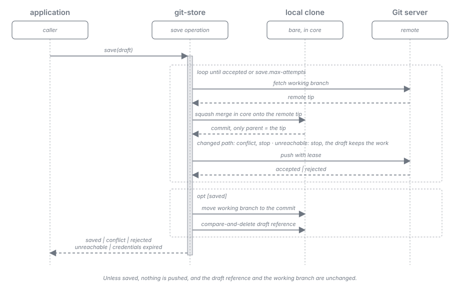
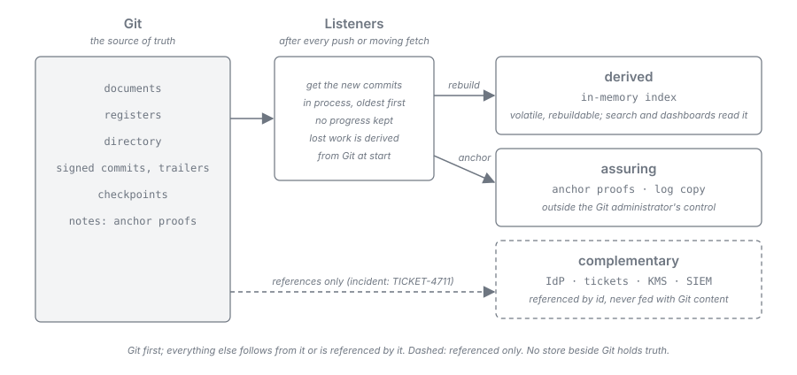

= git-document-repository: `git-store`
:toc: left
:toclevels: 2
:toc-title: Table of Contents
:source-highlighter: highlight.js

`git-store` (module `de.cuioss.git.document.store`) turns `git-core` into a document store: drafts, saving, release,
the signature and the identity trailers of every commit, the in-memory index, post-commit listeners, the anchoring
with the own timestamp `signed`, and the person directory interface. It depends on `git-core` only.
Rationale: xref:../concepts/storage-engine.adoc[Storage Engine], xref:../concepts/identity-and-signing.adoc[Identity
and Signing] and xref:../concepts/evidence-and-companion-stores.adoc[Evidence and Companion Stores].

Implemented are the repository registry (<<GDR-STORE-1>>), the codec interface (<<GDR-STORE-11>>), the typed
configuration (<<store-configuration>>), the outcome list with its result, and the three service interfaces below with
the selection of their providers; the providers themselves (`file`, `signed`) and every other requirement are planned.
Its third-party dependencies are `cui-java-tools` for `CuiLogger`, required transitively because the public holder
`GitStoreLogMessages` exposes its `LogRecord`, Lombok (scope `provided`) and
`org.jspecify:jspecify`, see xref:general.adoc#GDR-GEN-1[GDR-GEN-1]; JGit comes through `git-core`, which the module
requires transitively because its public API exposes `GitOutcome`, `GitResult`, `RemotePolicy` and JGit's `ObjectId`.

Every operation of `git-store` returns a `StoreResult` (outcome, value, detail; xref:general.adoc#GDR-GEN-3[GDR-GEN-3]),
never an exception for an expected outcome. Its outcome is a constant of the closed list `StoreOutcome`, or a
non-success Git outcome the operation passes on as `StoreResult.PassedOn`; only `StoreOutcome.OK` is a success. A
success carries no detail; a non-success carries a detail that is not blank and no value. `StoreResult.passOn` keeps
the outcome and the detail of the `GitResult` it passes on and refuses a success.

It defines three service interfaces, found through `ServiceLoader` (`uses` and `provides` in `module-info.java`), each
provider named by configuration. For `SigningKeySource` and `PersonDirectory` exactly one provider is active; for
`AnchorProvider` at most one, and without one the store anchors nothing (<<GDR-STORE-15>>). A configured id that no
provider carries, or that two providers carry, stops the start of the store.

[cols="1,2,2"]
|===
|Interface |Contract |Providers

|`SigningKeySource` |Signs bytes with a private key the source holds (<<GDR-STORE-12>>) |`file` in `git-store`;
KMS or HSM sources supplied by the application
|`AnchorProvider` |Obtains and verifies a proof that an object existed at a time (<<GDR-STORE-15>>) |`signed` in
`git-store`, `rfc3161` in xref:git-timestamp.adoc[`git-timestamp`]
|`PersonDirectory` |Pseudonyms, person entries, holders of a role, erasure (<<GDR-STORE-19>>) |`git` in
xref:git-directory.adoc[`git-directory`], or a provider for the operator's own source
|===

Each interface has `String id()`, the value the configuration names the provider by. The operations, each returning a
`StoreResult`:

* `SigningKeySource`: `sign(keyReference, data)`, the raw signature; `publicKey(keyReference)`, the public key as an
  OpenSSH public key line, needed because the SSH signature format embeds the signer's public key in every signature
  (the field `publickey` of the signature blob,
  link:https://github.com/openssh/openssh-portable/blob/master/PROTOCOL.sshsig[PROTOCOL.sshsig]). Non-success:
  `UNAVAILABLE` or `REFUSED`; the private key never leaves the source.
* `AnchorProvider`: `obtain(repository, subject, previous)`, the proof for the object id `subject` of the repository
  with that alias (`UNAVAILABLE`, `REFUSED`); `verify(subject, proof, previous)`, the time the proof establishes
  (`IMPRINT_MISMATCH`, `SIGNATURE_INVALID`, `CHAIN_BROKEN`). `previous` is the provider's previous proof as bytes,
  empty for the first. The id names the notes reference `refs/notes/anchors/<id>`.
* `PersonDirectory`: `pseudonym(issuer, subject)`; `entry(pseudonym)`, a `PersonEntry` that is either a `Member`
  (pseudonym, name, memberships) or a `FormerMember` (pseudonym, the memberships still known, possibly none);
  `holders(team, role)`; `save(member)`; `saveUnbound(name, memberships)`, the pseudonym of the new entry;
  `unbound(memberships)`; `bind(pseudonym, issuer, subject)`; `erase(pseudonym)`. A `Membership` is a pair of team and
  role, neither blank; the memberships of an entry are copied immutably, and `Member.toString()` renders no name
  (xref:general.adoc#GDR-NFR-3[GDR-NFR-3]).

`StoreProviders.load(configuration)` finds the candidates with `ServiceLoader.load` for each interface (through the
`uses` directives of the module, or `META-INF/services` on the class path) and hands them to
`StoreProviders.select(configuration, signing, anchors, persons)`, which picks the provider whose id is
`signing.key-source`, the one whose id is `directory.persons.provider`, and, when `anchor.provider` is present, the one
with that id; without `anchor.provider` no anchor provider is selected. A configured id that no candidate carries, or
that two candidates carry, is `MALFORMED` with the detail `<interface>: no provider with the id of <key>` or
`<interface>: more than one provider with the id of <key>`, where `<key>` is the configuration key the id is read from;
the detail never carries the configured id, a configured value (xref:general.adoc#GDR-NFR-3[GDR-NFR-3]). Two candidates
with an id nobody configured do not stop the start. A `ServiceConfigurationError` while loading is `MALFORMED` naming
the interface; only the interface and the class name of the error are logged (DEBUG), never the message of the error
or of its cause, which a failing provider may fill with a credential. A selection is logged as
`GIT_STORE-1` with the three ids, a refusal as `GIT_STORE-100` with its detail; both are catalogued in
`git-store/doc/LogMessages.adoc` (xref:general.adoc#GDR-GEN-4[GDR-GEN-4]).

[#GDR-STORE-1]
== GDR-STORE-1: Repository Registry

* The store must manage several repositories, each with a stable alias, a remote, a confidentiality class and an
  optional retention period.
* Every operation of the store must address a repository by its alias.

[source,yaml]
----
repositories:
  - alias: register              # stable id, [a-z0-9-]+, used in links (register:risk/R-042)
    remote: https://git.example/sec/register.git   # or the path of a local bare repository
    confidentiality: restricted  # application-defined class name, mapped to access rules by the application
    retention: P10Y              # optional; after it the operator deletes the repository; the store only reports it
----

A repository is the record `StoreRepository` (alias, remote, confidentiality, optional retention as a
`java.time.Period`); its `toString()` renders the remote without user information. `RepositoryRegistry.of(repositories,
policy)` builds the immutable registry, in registration order, and checks every repository in turn against one
`RemotePolicy` of `git-core`: one remote policy per registry, because every repository has a remote on the one Git
server, or on a single server local bare repositories
(xref:../adr/0002-Every_repository_has_a_remote_and_the_local_bare_clone_is_a_disposable_cache.adoc[ADR-0002]). The
first refusal is returned:

[cols="2,1,2"]
|===
|Check |Outcome |Detail

|alias outside `[a-z0-9-]+` |`MALFORMED` |`repositories[<n>]: invalid alias`, by zero-based position, since the alias
itself is invalid
|alias registered twice |`MALFORMED` |`repository <alias>: duplicate alias`
|blank confidentiality class |`MALFORMED` |`repository <alias>: blank confidentiality`
|remote that JGit's `URIish` cannot parse, including a port beyond the range of `int`, for which JGit 7.8.0 throws
`NumberFormatException` instead of `URISyntaxException` (observed by `RepositoryRegistryTest`) |`MALFORMED` |`repository <alias>: malformed remote`
|remote with a user or a password |`MALFORMED` |`repository <alias>: remote carries user information`
|remote the policy does not permit (`RemotePolicy.permits`) |`PassedOn(REFUSED_BY_POLICY)` |`repository <alias>: remote
not permitted by the remote policy`
|===

No detail carries the remote. `repositories()` returns the repositories in registration order, `find(alias)` an
`Optional` of the repository. The retention period is only reported through the record; the store never acts on it.

[#GDR-STORE-2]
== GDR-STORE-2: Drafts per User and Document

* An intermediate save must be a commit on `refs/drafts/<pseudonym>/<collection>/<id>`, where `<pseudonym>` is the
  user's pseudonym and `<collection>/<id>` names the document.
* The push refspec must carry `refs/heads/*`, the tags and `refs/notes/*`, and must never carry `refs/drafts/*`.
* The store must list the drafts of a user.

[cols="2,3,1"]
|===
|Reference |Content |Pushed

|`refs/heads/main` |released state |yes
|`refs/heads/<collection>/<id>` |working branch of one document of a per-document collection |yes
|`refs/heads/<collection>` |collection branch of a numbered collection: every entry and the counter file |yes
|`refs/tags/<collection>/<id>/v<n>` |release `n` of one document or numbered entry, never moved |yes
|`refs/tags/checkpoints/<n>` |checkpoint `n` (<<GDR-STORE-16>>), never moved |yes
|`refs/notes/anchors/<provider>` |anchor proofs (<<GDR-STORE-17>>) |yes
|`refs/drafts/<pseudonym>/<collection>/<id>` |intermediate saves of one user for one document or entry |*never*
|===

* A collection is either per-document or numbered, never both: JGit refuses a reference nested below an existing one
  and a reference that would contain an existing one (`RefDatabase.isNameConflicting`, checked by
  `RefUpdate.updateImpl`; link:https://github.com/eclipse-jgit/jgit/blob/v7.8.0.202609011348-r/org.eclipse.jgit/src/org/eclipse/jgit/lib/RefDatabase.java[JGit 7.8.0 `RefDatabase`]), so
  `refs/heads/risks` and `refs/heads/risks/<id>` cannot exist side by side. A collection is never named `main`
  or `checkpoints`.
* `<id>` of a per-document collection is the document's ULID (26 characters of Crockford base32 over a 48-bit
  timestamp and 80 random bits, sortable by creation time; link:https://github.com/ulid/spec[ULID specification]);
  `<id>` of a numbered collection is the readable number
  (for example `R-042`). A new numbered entry uses a ULID for its draft reference until its first save
  (xref:git-forms.adoc#GDR-FORMS-9[GDR-FORMS-9]).
* The drafts live only in the store's bare clone; the remote never secures them, and they are lost with the clone
  unless the operator backs up its storage.

[#GDR-STORE-3]
== GDR-STORE-3: Explicit Save

* An explicit save must apply the draft's changes onto the remote tip of the working branch as one commit whose only
  parent is that tip (a squash merge in core, path-level as in xref:git-core.adoc#GDR-CORE-6[GDR-CORE-6]); no draft
  commit may become reachable from a pushed reference.
* The save must push with lease; when the lease is refused or the push rejected, it must fetch and re-apply its
  operation onto the new tip, up to `save.max-attempts`.
* When the remote cannot be reached, the save must report unreachable and change nothing; the draft keeps the work.
* After a successful save the draft reference must be deleted only if it still points to the draft commit that was
  applied; a newer draft commit must be kept for the next save.
* The result must report one of: saved, conflict, rejected, unreachable, credentials expired or invalid.

. Fetch the working branch; its tip is the base.
. Apply the draft's changes onto the base as one commit (path-level; no textual three-way merge of file content).
  Check every edit that carries an `expectedBlobId` (<<GDR-STORE-5>>).
. Push with lease, the expected remote id being the base. On a lease refusal or a rejection, repeat from step 1.
. After the accepted push, move the local working branch to the new commit and delete the draft reference by
  compare-and-delete (xref:git-core.adoc#GDR-CORE-5[GDR-CORE-5]); a draft reference that moved meanwhile is kept.

The local working branch moves only after the remote accepted the commit, so the clone never holds a saved commit the
remote lacks.

The target of a save is the working branch of the document or the collection branch of its numbered collection. A
target branch that does not exist yet starts at the tip of `main`, which gives the release its merge base; the push
then expects the branch to be absent on the remote. Content that has no release is saved with the same steps onto
`main` itself: the person entries and the erasure record of `git-directory`
(xref:git-directory.adoc#GDR-DIR-3[GDR-DIR-3], xref:git-directory.adoc#GDR-DIR-6[GDR-DIR-6],
xref:git-directory.adoc#GDR-DIR-7[GDR-DIR-7]).

[#GDR-STORE-4]
== GDR-STORE-4: Conflict Handling

* On a conflict nothing must be pushed, and the draft reference and the working branch must be unchanged.
* The conflict result must name every conflicting path; conflicts are detected per path (blob), never per field.

The user resolves a conflict in the draft and saves again.

[#GDR-STORE-5]
== GDR-STORE-5: Concurrent Change Detection

* A save of a file must accept the blob id the caller loaded as `expectedBlobId`.
* When the file's blob id on the fetched tip differs, the save of that file must report a conflict instead of
  overwriting it.
* A save of a file without an expected blob id must overwrite a concurrent change to that file.

[#GDR-STORE-6]
== GDR-STORE-6: Release

* A release must merge the document's working branch into `main` and create the tag
  `refs/tags/<collection>/<id>/v<n>` on that merge commit; `n` counts the releases of that document from 1. For a
  numbered collection the release must merge only the entry's path from the collection branch (path-level merge in
  core).
* `main` and the tag must be pushed together, `main` with lease.
* When `main` moved but the tag is missing, the release must report incomplete, and a repeated release of the same
  document must create the missing tag on the merged commit instead of merging again.
* An existing release tag must never be moved or deleted.

The store merges every release itself. `main` is protected on the Git server so that only the technical user may
push to it and nobody may force-push; a refused push of `main` returns rejected. The release commit carries the
identity trailers of the user who releases (<<GDR-STORE-13>>), so it names the approver.

[#GDR-STORE-7]
== GDR-STORE-7: Draft Expiry

* Drafts not changed for `drafts.expiry` must be deleted by compare-and-delete
  (xref:git-core.adoc#GDR-CORE-5[GDR-CORE-5]), so that a draft changed meanwhile is kept.
* A garbage collection must remove objects reachable only from deleted drafts.

[#GDR-STORE-8]
== GDR-STORE-8: Author, Committer and Credentials

* Every commit of a save must carry the caller's pseudonym as author (e-mail field empty) and the technical user as
  committer.
* Every fetch and push must use the credential of the technical user configured for the repository; the store must
  offer no other credentials.
* Commits the store writes without a user's save (checkpoints, notes) must not be combined with the commits of a save.

[#GDR-STORE-9]
== GDR-STORE-9: In-Memory Index

* The store must build an index from `main` and every working branch and collection branch of the repository
  (<<GDR-STORE-2>>) at start, after every fetch, and after every save or release.
* The content of the index must be supplied by the consumer through an index interface.
* The store must fetch periodically (`fetch.interval`), so that changes made outside the store reach the index.
* The store must build an index from a tag or a commit for a reporting date, without changing the current index.

The consumer registers an index contributor per collection; the store calls it with the snapshot of `main` and of
every working branch and collection branch. After a save only the changed documents are re-read.
`snapshotIndex(tag | commit)` builds
the index of a reporting date.

[#GDR-STORE-10]
== GDR-STORE-10: Post-Commit Listeners

* The store must call every registered listener in process with each new commit of the branches it subscribes to,
  oldest first: after every save or release the store pushed, and after every fetch that moves a subscribed branch.
* A failing listener must not fail the save, release or fetch that triggered it.
* The store must keep no progress of listeners; work that must not be lost must be derivable from the Git state at
  start, as the anchoring derives its pending subjects from its notes (<<GDR-STORE-17>>).

[#GDR-STORE-11]
== GDR-STORE-11: Deterministic Content through Codecs

* File content must be produced by a codec interface.
* Encoding an unchanged value must produce byte-identical content, so that saving unchanged data creates no change.

Every codec guarantees `encode(decode(encode(v))) == encode(v)` byte for byte. `git-store` carries no YAML library:
`git-forms` supplies the YAML codec.

The interface is `Codec<V>` with `byte[] encode(V value)` and `StoreResult<V> decode(byte[] content)`. Encoding is
canonical: two equal values, and an unchanged value encoded again, yield byte-identical content. A content the codec
cannot read is `MALFORMED`, never an exception, and its detail names what could not be read (a line number or a key)
without repeating the content.

[#GDR-STORE-12]
== GDR-STORE-12: Commit Signature

* Every commit the store writes must be signed by the application in the SSH signature format.
* The private key must be used only through the active `SigningKeySource`; the store must ship the source `file`, and
  an application must be able to supply another (KMS, HSM) without a change of the store.

`git-store` implements JGit's `org.eclipse.jgit.lib.Signer` (since JGit 7.0) and passes it to the in-core writing of
`git-core`; the signer delegates the signing operation to the source. `signing.key-source` names the source (default
`file`), `signing.key` is the key reference passed to it (for `file` the path of an SSH private key). With a KMS or
HSM the application never holds the private key. Whether the store uses JGit's SSH signer of
`org.eclipse.jgit.ssh.apache` for the signature encoding is open and needs the owner's approval.

[#GDR-STORE-13]
== GDR-STORE-13: Identity Trailers

* Every commit of a save or release must carry the trailers below, filled from the user who acted. Commits the store
  writes without a user's action (checkpoints) and notes carry none.

xref:general.adoc#GDR-NFR-3[GDR-NFR-3] keeps the OIDC `sub` and the session id `sid` out of every trailer.

[cols="1,2,2"]
|===
|Trailer |Value |Source

|`Actor` |pseudonym (`p-…`) |the active `PersonDirectory`
|`Actor-Issuer` |issuer URL of the identity provider |token claim `iss`
|`Auth-Time` |ISO 8601 UTC, seconds precision |token claim `auth_time`
|`Auth-Context` |`acr=<acr>; amr=<amr>,<amr>…`; a part is left out when its claim is absent |token claims `acr`, `amr`
|===

The claims `iss`, `auth_time`, `acr` and `amr` are those of the ID Token
(link:https://openid.net/specs/openid-connect-core-1_0.html#IDToken[OpenID Connect Core 1.0, 2 ID Token]); `sid` is
the session id of
link:https://openid.net/specs/openid-connect-backchannel-1_0.html[OpenID Connect Back-Channel Logout 1.0] (2.1). The
caller supplies the claims; the store never receives the access token.

[#GDR-STORE-14]
== GDR-STORE-14: Signature Verification

* The library must verify the signatures of the commits of a reference against `signing.allowed-signers`, a file in
  Git's `allowed_signers` format with a validity period per key, taken from configuration and never from the
  repository.
* The verification must list every commit without a signature valid at its commit time, and must run from CI without
  the application.

The validity period per key is the `valid-after` and `valid-before` options of the `allowed_signers` format
(link:https://man.openbsd.org/ssh-keygen.1#ALLOWED_SIGNERS[ssh-keygen(1), ALLOWED SIGNERS]); Git checks that the
committer timestamp lies within it, with Git 2.35 or later and OpenSSH 8.8 or later (`gpg.ssh.allowedSignersFile` in
link:https://git-scm.com/docs/git-config[git-config(1)]; Git passes the timestamp as `-Overify-time` since 2.35,
link:https://github.com/git/git/blob/v2.35.0/gpg-interface.c[`gpg-interface.c` at v2.35.0]). A Git administrator who rewrites the repository therefore
cannot make a key of their own trusted. A single signature can also be checked with a stock Git installation of version
2.35 or later: `git -c gpg.ssh.allowedSignersFile=<file> verify-commit <id>`
(link:https://git-scm.com/docs/git-verify-commit[git-verify-commit(1)]).

[#GDR-STORE-15]
== GDR-STORE-15: Anchor Provider

* The store must define the service interface `AnchorProvider`: obtain a proof for an object id, given the provider's
  previous proof in the repository, and verify a stored proof, reporting the time it establishes.
* At most one provider must be active, named by `anchor.provider`; without one the store must anchor nothing.
* Which subjects are anchored must be decided by the store (<<GDR-STORE-16>>); a provider must only obtain and verify
  proofs.
* A failing or unreachable provider must not block or fail a save, a release or a fetch.

A proof is bytes the store does not interpret. The outcomes are those of the `git-store` list of
xref:general.adoc#GDR-GEN-3[GDR-GEN-3], used identically by every provider. Obtaining a proof yields the proof,
unavailable (the provider cannot be reached) or refused (the provider refuses or answers with an error). Verifying
yields the time the proof establishes, no proof (a subject without a stored proof), imprint mismatch, signature invalid
(also for a proof that cannot be read) or chain broken. The provider id names its notes reference.

[#GDR-STORE-16]
== GDR-STORE-16: Anchored Subjects and Checkpoints

* With an active provider the store must anchor the commit of every release tag once the tag exists, unless
  `anchor.releases` is `false`.
* With an active provider the store must create a checkpoint when `anchor.checkpoint-interval` has passed since the
  previous checkpoint and a reference the checkpoint lists changed since then, and anchor it; the checkpoint tags
  and the anchor notes, which the anchoring itself moves, must not make a checkpoint due.
* A checkpoint must be tagged `refs/tags/checkpoints/<n>`, `n` counting from 1; an existing checkpoint tag must never
  be moved or deleted.

A checkpoint is a commit:

* tree: one file `refs`, one line `<object id> SP <reference name> LF` per pushed reference, sorted by name in byte
  order; it lists `refs/heads/*`, `refs/tags/*` and `refs/notes/*`, without `refs/tags/checkpoints/*` and
  `refs/notes/anchors/*`;
* parent: the previous checkpoint, none for the first; author and committer: the technical user; message
  `Checkpoint <n>`.

The checkpoint commit is reachable only through its tag; the tag is pushed with the expectation that it does not exist
on the remote, separately from the commits of any save, before the proof is requested. The due check runs after every
push and fetch and every `anchor.retry-interval`.

[#GDR-STORE-17]
== GDR-STORE-17: Anchor Proofs as Notes

* A proof must be stored as a note on the anchored commit under `refs/notes/anchors/<provider>`, base64-encoded.
* The note must be pushed with lease right after it is written, separately from the commits of any save.
* A subject without a pushed proof must stay pending and be retried; a retry must push a stored proof instead of
  requesting a new one.
* A verification must check every stored proof and list every reference a checkpoint lists whose object id is no
  longer reachable from that reference (or, for a tag, no longer its target), and every missing checkpoint number.

The pending subjects are derived from the Git state: the release commits and checkpoints without a note of the provider
in the remote's notes reference as of the last fetch. A subject with a local note that the remote lacks needs only the
push of that note. The store passes the provider its latest proof as `previous`: the note on the newest anchored
checkpoint or release. `verifyAnchors()` walks the checkpoint chain and the release tags and runs from CI without the
application.

[#GDR-STORE-18]
== GDR-STORE-18: Own Timestamp

* The store must provide the anchor provider `signed`: for an object id it must sign a statement of the object id,
  the time, a sequence number and the hash of the previous proof.
* The statement must be signed with an anchor key of its own key source; the start must fail when the anchor key
  equals the commit-signing key.
* The provider must refuse to sign when its clock is behind the time of the previous proof or more than
  `anchor.signed.max-clock-skew` (default `PT5M`) behind the commit time of the subject.
* Every proof must be written as a log record (INFO) with the repository alias, the object id, the time, the
  sequence number and the SHA-256 of the proof.
* The verification must check the signature against `anchor.signed.allowed-signers` and the chain: sequence numbers
  without gaps, every proof referring to its predecessor, times never decreasing.

Statement, UTF-8, each line ended by LF:

[source,text]
----
anchor signed 1
object <object id, lowercase hex>
time <UTC, ISO 8601 with seconds, for example 2026-11-16T09:30:00Z>
sequence <n, 1 for the first proof>
previous <SHA-256 of the previous proof, lowercase hex, or "none" for sequence 1>
----

The proof is the statement followed by an armored SSH signature over it with the namespace `git-document-anchor`
(https://github.com/openssh/openssh-portable/blob/master/PROTOCOL.sshsig[PROTOCOL.sshsig]). The anchor key comes from
`anchor.signed.key-source` and `anchor.signed.key`, like the commit-signing key; it should lie under a responsibility
other than the Git administration, for example the security team's KMS. The log record lets the operator's log
pipeline keep a copy outside Git. A single proof can be checked with a stock OpenSSH installation:
`ssh-keygen -Y verify -f <allowed signers> -I <identity> -n git-document-anchor -s <signature file> < <statement file>`
(https://man.openbsd.org/ssh-keygen.1[ssh-keygen(1)]).

[#GDR-STORE-19]
== GDR-STORE-19: Person Directory Interface

* The store must define the service interface `PersonDirectory`: the pseudonym of an identity-provider issuer and
  `sub`; the entry of a pseudonym (name and memberships, pairs of team and role) or a former-member marker with the
  memberships the provider still knows, possibly none; the pseudonyms holding a role in a team; saving an entry;
  saving an unbound entry, the unbound entries holding one of given memberships, and binding one to an issuer and
  `sub`; and the erasure of a pseudonym.
* Exactly one provider must be active, named by `directory.persons.provider` (default `git`). The author pseudonym of
  every save must come from it.
* A pseudonym must be stable for the same issuer and `sub` as long as its entry exists. After an erasure the provider
  must no longer return the person for that pseudonym and must resolve it as a former member; a later login with the
  same issuer and `sub` is a first login and receives a new pseudonym, which is not linked to the erased one.
* Outside the provider's own entries, the store must write no data it obtains from the provider into a repository
  except pseudonyms.

The issuer and `sub` together are the key, because a `sub` is unique only within its issuer. A provider for the
operator's own source (LDAP, SCIM, the identity provider's user directory) reads names and memberships from that
source and keeps its own mapping to pseudonyms; it returns not supported for saving an entry, an unbound entry or a
binding, and managed by source for
an erasure, because the operator erases there. Rationale:
xref:../concepts/data-protection.adoc#_the_person_directory[Data Protection, The Person Directory].

[#store-configuration]
== Configuration

[cols="1,2"]
|===
|Key |Semantics

|`repositories` |the registry (<<GDR-STORE-1>>)
|`save.max-attempts` |required; attempts of a save or of a push of notes
|`drafts.expiry` |required; ISO 8601 period
|`fetch.interval` |required; ISO 8601 duration of the periodic fetch
|`signing.key-source`, `signing.key` |the commit-signing key; source default `file`
|`signing.allowed-signers` |required for verification; public commit-signing keys with validity periods
|`anchor.provider` |the active anchor provider, `signed` or `rfc3161`; default none, so nothing is anchored
|`anchor.releases` |anchor the commit of every release tag; default `true`
|`anchor.checkpoint-interval` |ISO 8601 duration; default `P1D`
|`anchor.retry-interval` |ISO 8601 duration of the periodic due check and retry; default `PT15M`
|`anchor.signed.key-source`, `anchor.signed.key` |the anchor key of `signed`; never the commit-signing key
|`anchor.signed.allowed-signers` |required for verifying `signed`; public anchor keys with validity periods
|`anchor.signed.max-clock-skew` |ISO 8601 duration; default `PT5M`
|`directory.persons.provider` |the active person directory; default `git`
|===

`StoreConfiguration.from(tree, policy)` reads the configuration at start and returns a `StoreResult` of the typed
record `StoreConfiguration`, whose nested records mirror the sections: `Save`, `Drafts`, `Fetch`, `Signing`, `Anchor`
with `Anchor.Signed`, and `Directory`, plus the `RepositoryRegistry` (<<GDR-STORE-1>>) checked against the one
`RemotePolicy` the caller passes. The input is an already-parsed tree of nested maps as a YAML or JSON parser delivers
it, keys nested by dot segment (`anchor.signed.key` is the key `key` of the map `signed` of the map `anchor`), so
`git-store` needs no parser library:

* Integers are integral `Number` values within the range of `int`, booleans `Boolean`, and other values non-blank
  strings. Durations and periods are ISO 8601 strings parsed with `java.time.Duration` and `java.time.Period`
  (`drafts.expiry` and `retention` are periods); every duration and period must be positive. `save.max-attempts` must
  be at least 1.
* `save.max-attempts`, `drafts.expiry` and `fetch.interval` are required. Every other key may be absent at start and
  then takes the default of the table; a key without a default, such as `signing.key` or the allowed-signers files that
  only a verification needs, stays absent.
* Only an omitted key is absent. A key supplied with a null value, as a leaf (`anchor.releases:` without a value) or as
  a section on the way (`anchor:` without a value), is malformed and named by its dotted key; it never takes the
  default.
* Keys outside the table are ignored, because the tree is shared with the modules above `git-store` (for example
  `timestamp.*` of xref:git-timestamp.adoc[`git-timestamp`]). An absent `repositories` is an empty registry.
* An anchor key equal to the commit-signing key is refused (<<GDR-STORE-18>>): the start compares the effective key
  source (`anchor.signed.key-source`, an absent one taken as the default `file`) with `signing.key-source`, and
  `anchor.signed.key` with `signing.key`, and refuses when both are equal. Comparing the public keys themselves needs
  the key source and is left to the provider `signed`.

The first refusal is returned and logged once as `GIT_STORE-100`. Its outcome is `MALFORMED`, or the passed-on
`REFUSED_BY_POLICY` of the registry; its detail names the dotted key or the alias, never the value:
`<key> is missing`, `<key> is malformed` (a key of a repository as `repositories[<n>].<key>`), or
`anchor.signed.key equals the commit-signing key`. The `toString()` of `Signing` and `Anchor.Signed` states only whether
a key reference is set (xref:general.adoc#GDR-NFR-3[GDR-NFR-3]).
